# Computer Network Module 4

## Table of Contents

- [0. Installing MikroTik-CHR in GNS3](#0-installing-mikrotik-chr-in-gns3)
  - [0.1 Introduction to MikroTik CHR RouterOS](#01-introduction-to-mikrotik-chr-routeros)
    - [0.1.1 RouterOS](#011-routeros)
    - [0.1.2 MikroTik-CHR](#012-mikrotik-chr)
    - [0.1.3 MikroTik Routerboard](#013-mikrotik-routerboard)
  - [0.2 Installation on Windows (GNS3 VM)](#02-installation-on-windows-gns3-vm)
  - [0.3 Installation on MacOS (GNS3 VM + GNS3 Web UI)](#03-installation-on-macos-gns3-vm--gns3-web-ui)
  - [0.4 Creating a Simple Topology](#04-creating-a-simple-topology)
  - [0.5 Saving the Configuration on MikroTik-CHR](#05-saving-the-configuration-on-mikrotik-chr)
    - [0.5.1 Export to a Binary File](#051-export-to-a-binary-file)
    - [0.5.2 Export to a Raw Text or Readable File](#052-export-to-a-raw-text-or-readable-file)
    - [0.5.3 Exporting the Configuration Outside GNS3 Using WinBox](#053-exporting-the-configuration-outside-gns3-using-winbox)
    - [0.5.4 Exporting the Configuration Outside GNS3 Using SFTP](#054-exporting-the-configuration-outside-gns3-using-sftp)
- [1. Subnetting](#1-subnetting)
  - [1.1 Introduction to Subnetting](#11-introduction-to-subnetting)
  - [1.2 Understanding IP Addresses](#12-understanding-ip-addresses)
    - [1.2.1 What Can Be Determined?](#121-what-can-be-determined)
    - [1.2.2 IPv4](#122-ipv4)
    - [1.2.3 Netmask and Prefix](#123-netmask-and-prefix)
    - [1.2.4 Network ID, Broadcast Address, and Available Hosts](#124-network-id-broadcast-address-and-available-hosts)
    - [1.2.5 Public IP and Private IP](#125-public-ip-and-private-ip)
  - [1.3 Subnet Calculation](#13-subnet-calculation)
    - [1.3.1 Classful](#131-classful)
    - [1.3.2 Classless / CIDR](#132-classless--cidr)
    - [1.3.3 Subnet Calculator](#133-subnet-calculator)
  - [1.4 Supernetting](#14-supernetting)
  - [1.5 Implementation](#15-implementation)
- [2. Static Routing (Advanced)](#2-static-routing-advanced)
  - [2.1 Multi-hop Routing](#21-multi-hop-routing)
  - [2.2 Route Summarization and Longest Prefix Match](#22-route-summarization-and-longest-prefix-match)
    - [2.2.1 Route Summarization](#221-route-summarization)
    - [2.2.2 Longest Prefix Match](#222-longest-prefix-match)
  - [2.3 Routing Loop and TTL](#23-routing-loop-and-ttl)
    - [2.3.1 Routing Loop](#231-routing-loop)
    - [2.3.2 TTL and Traceroute](#232-ttl-and-traceroute)
  - [2.4 Implementation](#24-implementation)
- [3. Dynamic Routing](#3-dynamic-routing)
  - [3.1 Introduction to Dynamic Routing](#31-introduction-to-dynamic-routing)
  - [3.2 Types of Routing Protocols](#32-types-of-routing-protocols)
    - [3.2.1 By Algorithm](#321-by-algorithm)
    - [3.2.2 By Scope](#322-by-scope)
  - [3.3 Dynamic Routing Protocols](#33-dynamic-routing-protocols)
    - [3.3.1 RIP](#331-rip)
    - [3.3.2 OSPF](#332-ospf)
  - [3.4 Redundancy and Failover](#34-redundancy-and-failover)
  - [3.5 Routing Convergence](#35-routing-convergence)
  - [3.6 Implementation](#36-implementation)

## 0. Installing MikroTik-CHR in GNS3

### 0.1 Introduction to MikroTik CHR RouterOS

#### 0.1.1 RouterOS

**RouterOS** is a Linux-based operating system developed by **MikroTik**, a Latvian company that works in the field of network devices (networking).
RouterOS is designed specifically to turn a computer or hardware device into a reliable router, switch, firewall, bandwidth manager, or even a wireless access point.
RouterOS provides advanced networking features such as:

- Routing (static, dynamic (OSPF, BGP, RIP))
- Firewall and NAT
- VPN (PPTP, L2TP, SSTP, OpenVPN, WireGuard)
- Bandwidth management (Queue, Simple Queue, Queue Tree)
- Hotspot and User Manager
- Wireless networking
- VLAN and bridging

RouterOS usually runs on physical hardware made by MikroTik called a **RouterBoard**.
However, MikroTik also provides a special version that can run virtually, namely **Cloud Hosted Router (CHR)**.

[MikroTik RouterOS](https://mikrotik.com/software) 

#### 0.1.2 MikroTik-CHR

**MikroTik CHR (Cloud Hosted Router)** is a version of RouterOS made specifically for installation on virtualization or cloud platforms such as:

- VMware
- VirtualBox
- Hyper-V
- KVM/QEMU
- **GNS3** (Graphical Network Simulator-3)
- Proxmox
- Cloud services such as AWS, Google Cloud, Azure, DigitalOcean

CHR comes as a virtual image (`.vmdk`, `.vhdx`, `.ova`, `.img`, `.qcow2` format, and others), so it does not need physical RouterBoard hardware to run
For GNS3, MikroTik-CHR can be installed directly using the `.gns3a` file for GNS3 users on Windows or Linux, while MacOS or `arm`-architecture machines need extra steps to run MikroTik-CHR in the GNS3 VM

[MikroTik CHR](https://mikrotik.com/download/chr)

Here, MikroTik takes over the role of `netics-pc`, which previously ran static routing the conventional way using the built-in `iproute2` package. It will be used in Module 4 and the Final Module (5)

#### 0.1.3 MikroTik Routerboard

<MikroTik routerboard image>

### 0.2 Installation on Windows (GNS3 VM)

[Download the mikrotik .gns3a file](https://drive.google.com/file/d/1kqDN8RMiHSxHr3uo3VvenUwJfmkuQgV-/view?usp=drive_link) 
    <br>
[Download the mikrotik .img file](https://drive.google.com/file/d/1uztXyqvXNClr8QMizV5MJVc8uw3jUax3/view?usp=drive_link)

1. Download both files above and make sure they are in the same directory

2. Select the **File → New Template** menu.

   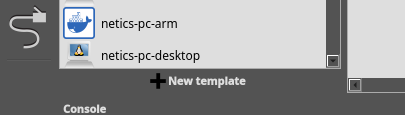

2. Select the **Import an appliance file** option, then select the **mikrotik-chr-7.24.6.gns3a** file you downloaded earlier.

   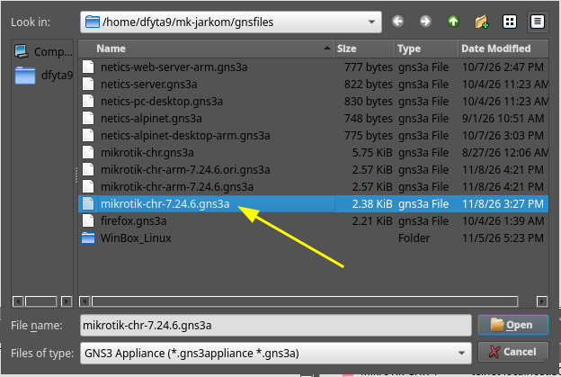

3. Select the **Install appliance on a remote server** option.

    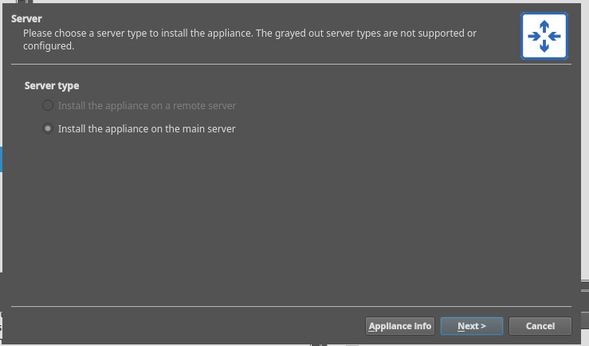

   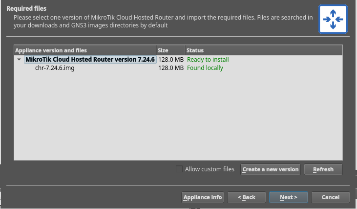
   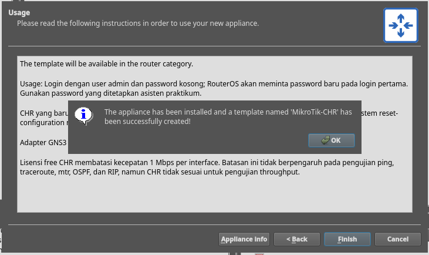

4. Make sure you have opened a new or existing project, then drag and drop the newly installed appliance into GNS
   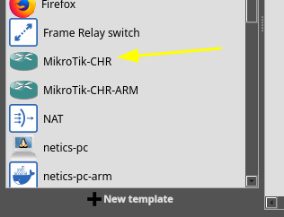
   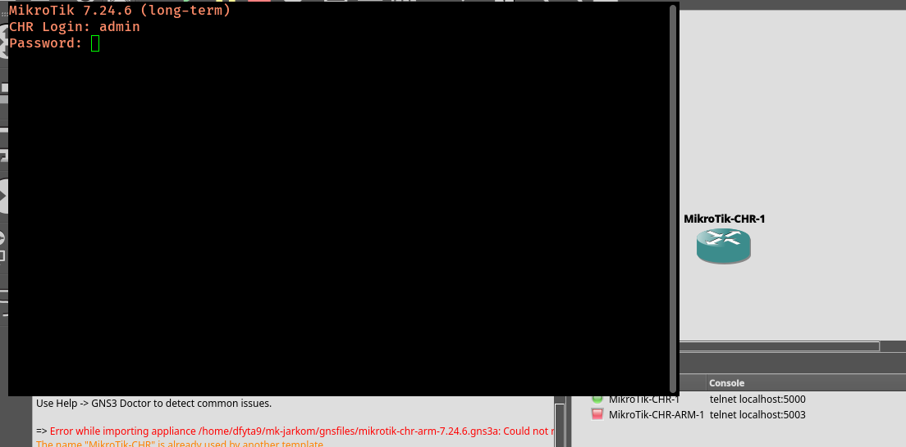

5. To log in to RouterOS on Windows/Linux, the Username is `admin` and the password is left blank (press Enter at the password prompt)
   
   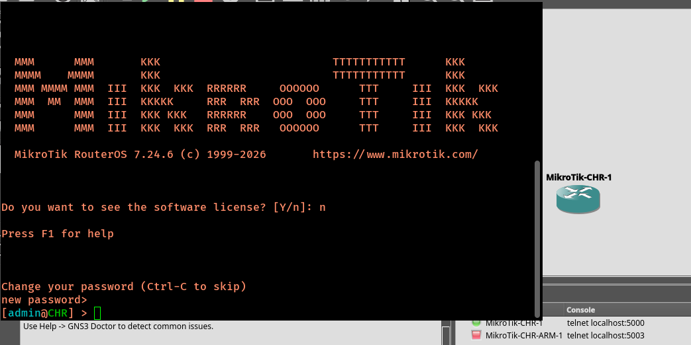

6. To shut down the MikroTik node, the recommended command is to run `/system shutdown` in the RouterOS terminal and press `y`
   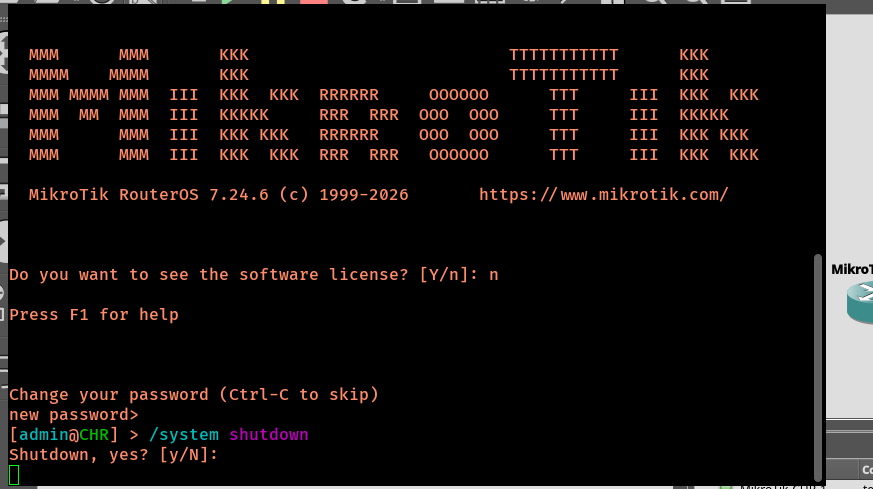

### 0.3 Installation on MacOS (GNS3 VM + GNS3 Web UI)

[Download the mikrotik arm .qcow2 file](https://drive.google.com/file/d/1LWXCE8xQ3Tj17AtX6222ADaNYxU2IJAs/view?usp=sharing)
<br>

1. Download both files above and make sure they are in the same directory

2. Then copy the .qcow2 file into the GNS3 VM using `scp` with the following steps (use the terminal and make sure the VM is running) :

- Open a terminal on your Mac and type the following command, adjusting the path of the qcow2 file you downloaded earlier
```
scp [QCOW2 FILE PATH] gns3@[YOUR GNS3 IP]:/opt/gns3/images/QEMU/
```    

- Then open a shell inside the GNS3 VM and run the command below
```
sudo chown gns3:gns3 /opt/gns3/images/QEMU/chr-7.24.6-arm64-clean.qcow2
```

3. Then you can follow the video tutorial below to set up MikroTik CHR

[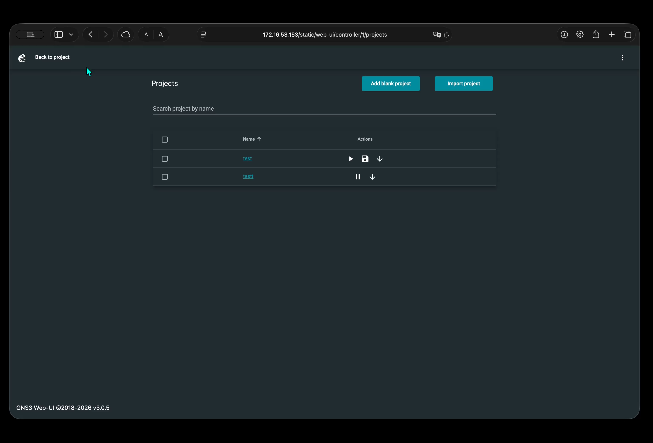](./images/mikrotik-mac-video-1.mp4)

### 0.4 Creating a Simple Topology

1. Create a topology like the one in the image below, where the `Kazdel` node uses the `MikroTik-CHR` you installed earlier, while all nodes other than `Kazdel` still use the `netics-pc` appliance.

   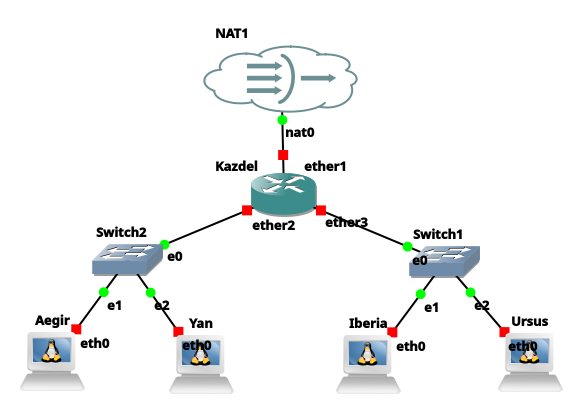   

2. Use the change hostname feature to rename the nodes.

3. Next, set up the network on the client nodes first (Aegir, Yan, Iberia and Ursus). You can use the `edit config` feature by right-clicking the node and replacing its default network configuration

   - Aegir
     ```
        auto eth0
        iface eth0 inet static
            address 10.254.1.2
            netmask 255.255.255.0
            gateway 10.254.1.1
     ```

   - Yan
     ```
        auto eth0
        iface eth0 inet static
            address 10.254.1.3
            netmask 255.255.255.0
            gateway 10.254.1.1
     ```

   - Iberia
     ```
        auto eth0
        iface eth0 inet static
            address 10.254.2.2
            netmask 255.255.255.0
            gateway 10.254.2.1
     ```

   - Ursus
     ```
        auto eth0
        iface eth0 inet static
            address 10.254.2.3
            netmask 255.255.255.0
            gateway 10.254.2.1
     ```

4. Restart or start all nodes, including the Router that has not been configured yet, because the router configuration will be done through MikroTik's RouterOS terminal.

5. On `Kazdel`, open the console and log in with username `admin` and a blank password (press Enter), **Note: if you are using the ARM/MAC image, the password is `admin`**

   If you are asked to change the password, just press Enter or Ctrl+C so the password does not change and stays at its default
   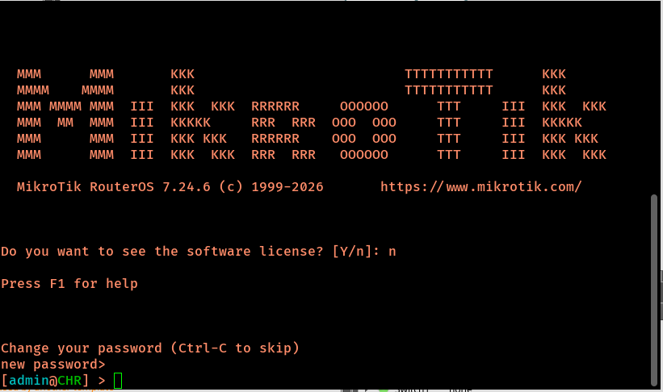  

   Then change the Router's hostname to `Kazdel` so it is not the plain `CHR`, which is the default value and cannot be set automatically from the GNS3 interface, using
   ```
    /system identity set name=Kazdel
   ``` 

   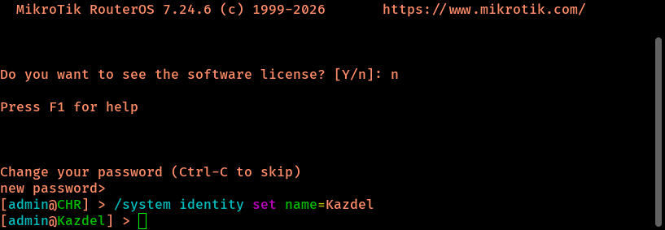 


6. Configure the IP addresses on `Kazdel` and the connection to NAT

   Configure the connection to NAT as follows :
   ```
    # Connect to NAT as the WAN by setting up dhcp-client on ether1
    /ip dhcp-client add interface=ether1 add-default-route=yes use-peer-dns=no disabled=no

    # Equivalent to using iptables -t nat -j MASQUERADE -A POSTROUTING
    /ip firewall nat add chain=srcnat out-interface=ether1 action=masquerade  
   ```

   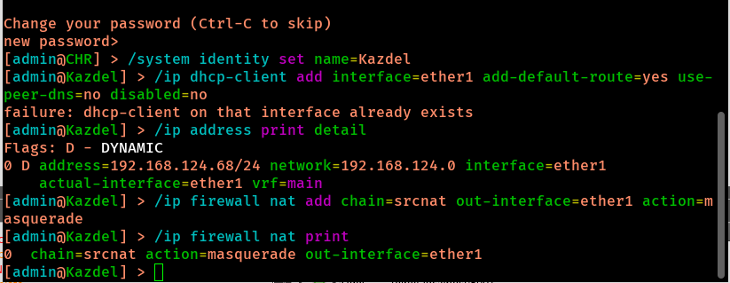 

   Then set the IP addresses for ether2 and ether3 :
   ```
    # Configure ether2 with an IP address in subnet 10.254.1.0/24
    /ip address add address=10.254.1.1/24 interface=ether2

    # Configure ether3 with an IP address in subnet 10.254.2.0/24
    /ip address add address=10.10.2.1/24 interface=ether3

    # Configure the default DNS for the Kazdel node
    /ip dns set servers=1.1.1.1,8.8.8.8 allow-remote-requests=yes
   ``` 

   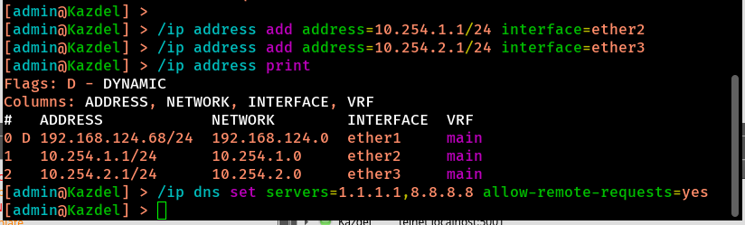 

7. Then try a ping test on `Kazdel` and on a client PC (one of Aegir, Yan, Ursus or Iberia)

   For Kazdel, use `/ping count=N [IP address]`, where N is the number of pings to send and IP address is the IP you want to ping

   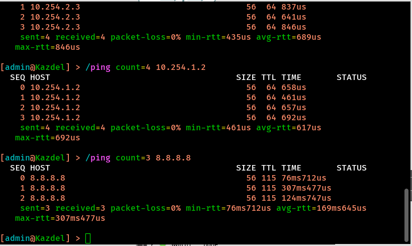 
   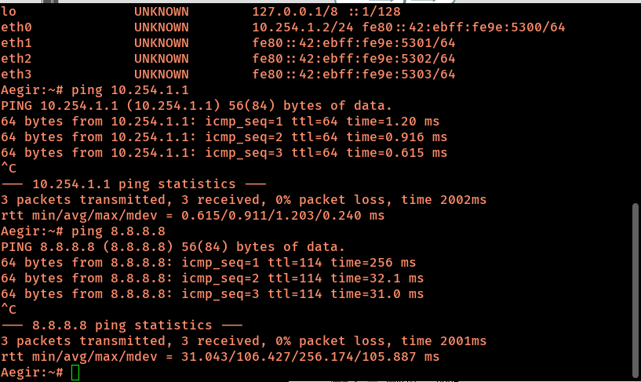
    
8. To ping google.com from a client, add a nameserver to the `/etc/resolv.conf` file as shown below:
   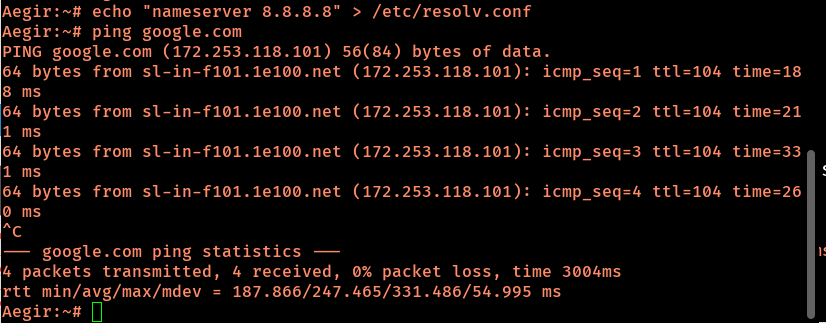 


**Note:** **Note:** The `MikroTik-CHR` node is generally used as a virtual network device for routing, firewall, NAT, and other network services through RouterOS. Meanwhile, for general-purpose networking nodes, you can use the Linux-based `netics-pc` and add packages as needed, such as `frr` for dynamic routing, `kea-dhcp4/udhcpd` for DHCP services, `bind9/dnsmasq` for DNS, and `nftables/iptables` for the firewall.

### 0.5 Saving the Configuration on MikroTik-CHR

> [!TIP]
> *By default, MikroTik-CHR saves the latest configuration automatically, and it persists when the node is started again.*

#### 0.5.1 Export to a Binary File

To preserve the configuration, you can use the following command:
```
/system backup save name=[Backup Name]

# to show the backup files that have been saved
/file print
```

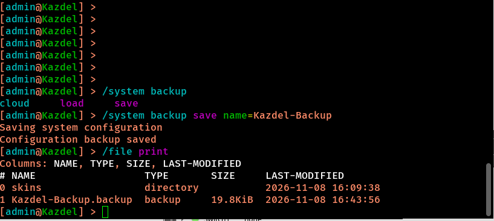 

And to restore it, use
```
/system backup load name=[Backup Name]
```

MikroTik-CHR will prompt you to restart the node. Press `y` on the keyboard, and MikroTik-CHR will restart and load the configuration
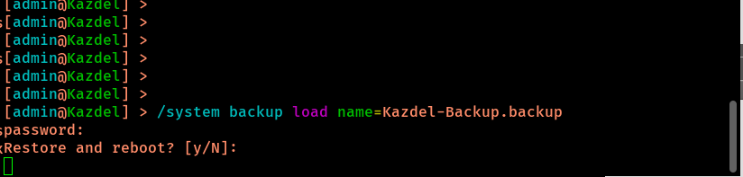 
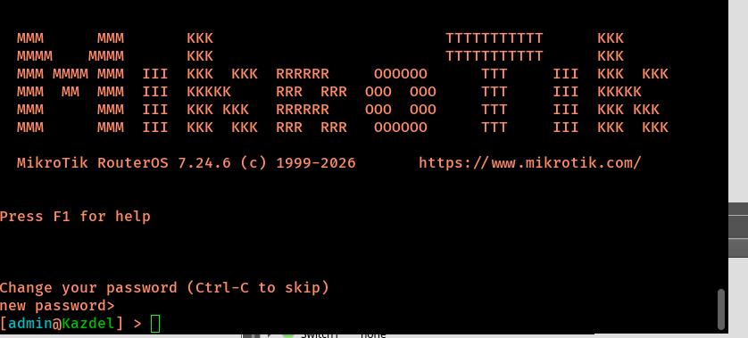

#### 0.5.2 Export to a Raw Text or Readable File

Besides exporting in binary form, you can also export to a file that can be read (readable format) using the command:
```
/export file=[Name File]

# to show the whole configuration directly in the terminal
/export
```

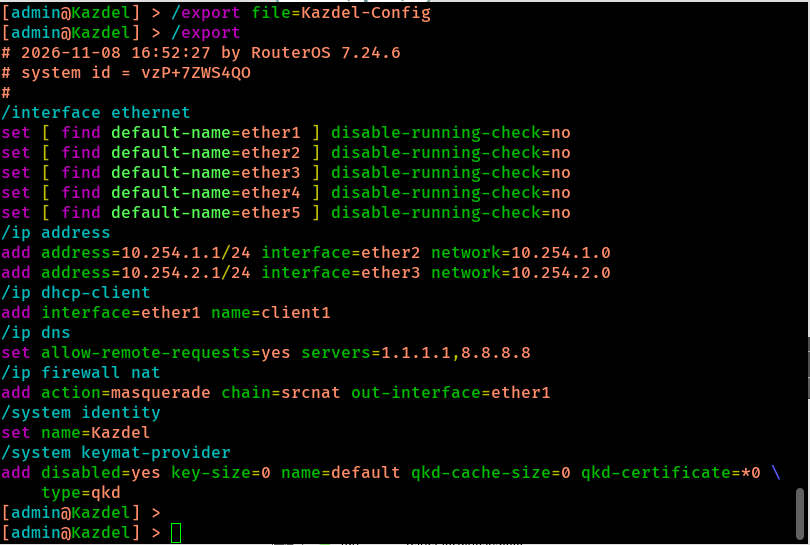 

The `/export file=` command produces a file with the `.rsc` extension
    
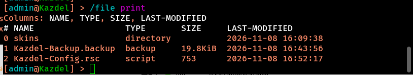 

And to restore a configuration from a `.rsc` file, use the command:
```
/import file-name=[File Name]
```

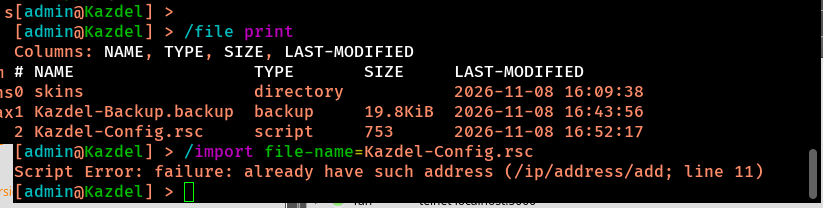 

**Note:** The error above is expected, because the imported configuration is exactly the same as the current configuration, so the configurations stack on top of each other and cause an error (the changes from the import are not applied).

#### 0.5.3 Exporting the Configuration Outside GNS3 Using WinBox

[Download Winbox Official v4.5](https://mikrotik.com/download/winbox) 

Configuration files exported on MikroTik-CHR stay inside the node itself. To export the backup file out of the node or outside GNS3, you need an additional application, namely `WinBox`

- Download WinBox using the link above, then open WinBox while the `MikroTik-CHR` node is still running. The WinBox interface will detect the `Kazdel` node as shown in the image below. Click the Kazdel entry and click the Connect button on the left, or simply double-click the `Kazdel` row

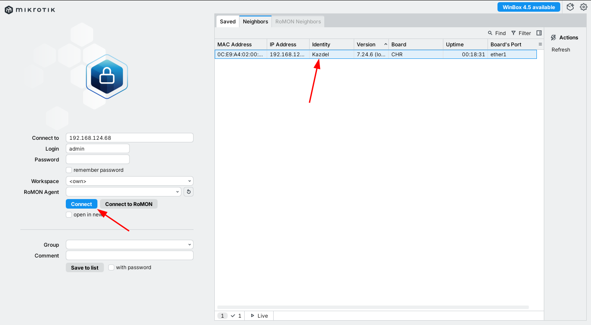 

- If a notice asks you to change the password, just click `Cancel`

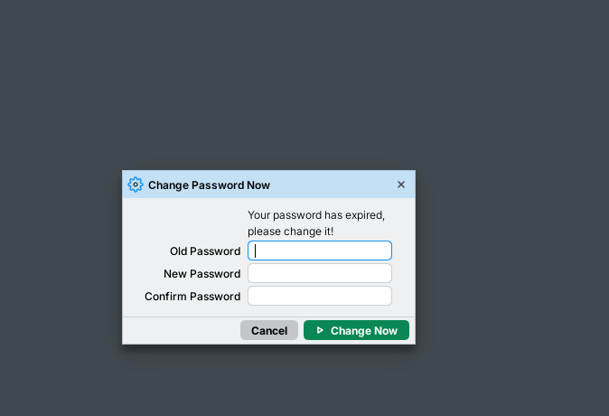

- After entering the Desktop or Web UI version of the MikroTik-CHR interface, click the `Files` menu in the sidebar

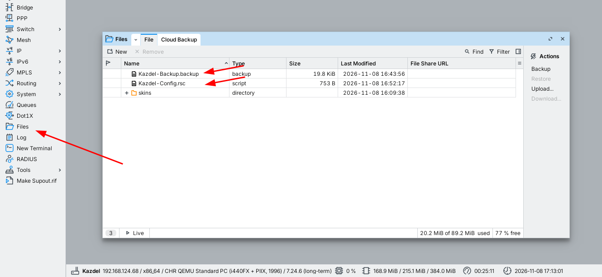

- Then select the file you want to download by clicking it once and click the download button on the right side. A file explorer will open so you can choose where to save the file

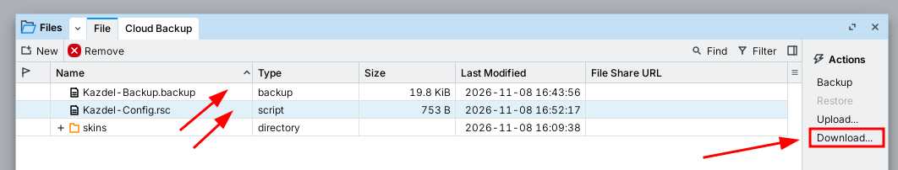
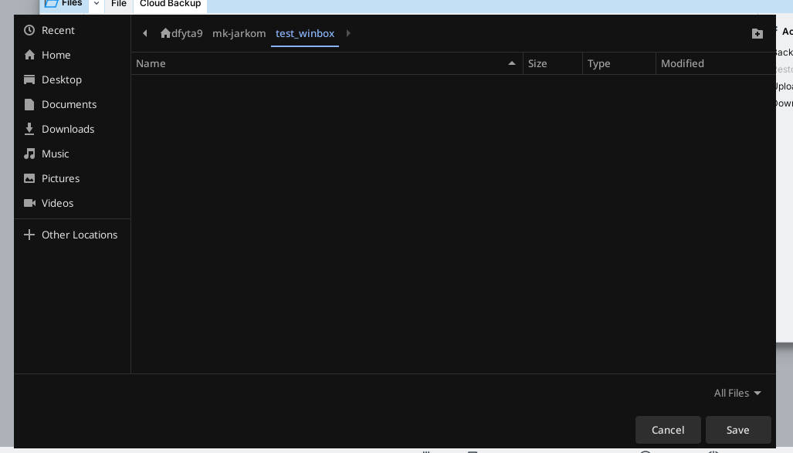

#### 0.5.4 Exporting the Configuration Outside GNS3 Using SFTP

This method does not need WinBox; you only need to verify that the SSH service is running on the `MikroTik` node

```
/ip service print
```

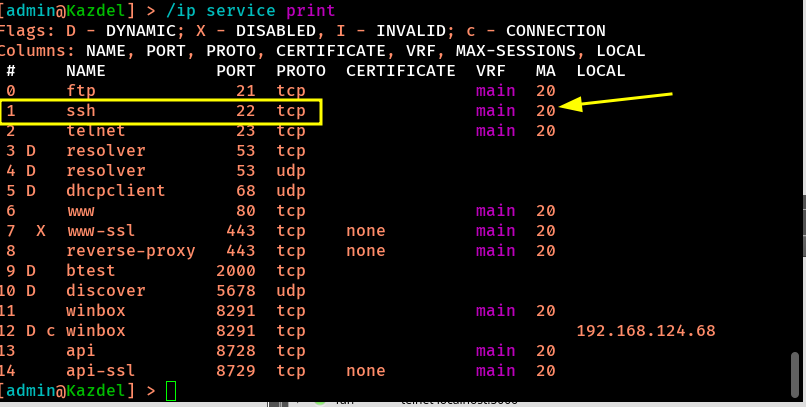 

Then, using any SFTP client, use the `ls` command to list files and `get` to download a file
```
ls
get <file name>
```

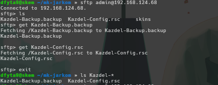 

To find out which IP to use to connect to the MikroTik node, in this case `Kazdel`, use the `/ip address print` command and use the IP assigned to ether1, which is connected directly to NAT

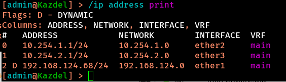

## 1. Subnetting

### 1.1 Introduction to Subnetting

#### 1.1.1 What is Subnetting?

Imagine a large network as a housing neighborhood with many houses in it. To keep it organized, the neighborhood is divided into several smaller blocks.

In computer networks, this kind of division is called subnetting: a way to divide one large IP network into several smaller networks by increasing the prefix length (netmask). For example, the network `192.168.1.0/24` can be divided into four subnets:

1. `192.168.1.0/26`
2. `192.168.1.64/26`
3. `192.168.1.128/26`
4. `192.168.1.192/26`

**Subnet** is a sub-network of a larger network. With subnets, you can manage a network better.

#### 1.1.2 Why is Subnetting Needed?

Suppose all computers in the Department of Informatics building are on the same network. As a result:

- Every broadcast packet (a packet sent to all hosts at once) is received by every computer in the building, even those that have no need for it.
- Access between laboratories is hard to restrict, because all computers are on the same network.

With subnetting, each laboratory gets its own subnet, for example:

1. LP Laboratory: `10.151.34.0/24`
2. AJK Laboratory: `10.151.36.0/24`

Benefits of subnetting:

- Reduces the size of the broadcast domain: a broadcast from Lab LP is only received by computers in Lab LP.
- Allows each subnet to have its own security policy: for example, the router can allow or block access from Lab AJK to Lab LP.
- Improves routing efficiency: the router only needs to know one subnet per laboratory, not the address of every computer.

**Broadcast domain** is the area of a network that a broadcast packet reaches. Broadcast packets are not forwarded by routers, so each subnet has its own broadcast domain.

### 1.2 Understanding IP Addresses

An IP Address is a unique address assigned to identify a host connected to a network.

#### 1.2.1 What Can Be Determined?

From an IP Address written together with its prefix, you can get the following 5 pieces of information:

1. **IP Address**: the address of the host itself.
2. **Netmask**: determines which part of the IP Address indicates the subnet and which part indicates the host.
3. **Network ID (NID)**: the IP Address that identifies a subnet.
4. **Broadcast Address**: the IP Address used to send a broadcast message to all hosts in a subnet.
5. **Available Hosts**: the range of IP Addresses that hosts in a subnet can use.

The first two can be seen directly from how the address is written, while the remaining three need to be calculated. We will go through them one by one.

#### 1.2.2 IPv4

- IPv4 (_Internet Protocol version 4_) is the IP Address version covered in this module.
- An IPv4 Address consists of 32 binary bits, which are converted to decimal numbers when written.
- The 32 bits are divided into 4 octets (each octet contains 8 bits) separated by dots. Example: `10.151.36.5`.

```
decimal :     10    .    151    .     36    .      5
binary  : 0000 1010 . 1001 0111 . 0010 0100 . 0000 0101
          \_______/   \_______/   \_______/   \_______/
           octet 1     octet 2     octet 3     octet 4
```

##### IPv4 Header

Every IPv4 packet sent over a network carries a **header**, the part at the start of the packet that contains the information needed to deliver the packet to its destination. The minimum IPv4 header size is 20 bytes. The structure of the IPv4 header is as follows (each row contains 32 bits):

```
 0       4      8               16    19        24            31
┌───────┬───────┬───────────────┬───────────────────────────────┐
│Version│  IHL  │Type of Service│          Total Length         │
├───────┴───────┴───────────────┼─────┬─────────────────────────┤
│         Identification        │Flags│     Fragment Offset     │
├───────────────┬───────────────┼─────┴─────────────────────────┤
│  Time to Live │    Protocol   │        Header Checksum        │
├───────────────┴───────────────┴───────────────────────────────┤
│                         Source Address                        │
├───────────────────────────────────────────────────────────────┤
│                      Destination Address                      │
├───────────────────────────────────────────────┬───────────────┤
│                    Options                    │    Padding    │
└───────────────────────────────────────────────┴───────────────┘
```

| Field               | Size     | Function                                                                                                                    |
| ------------------- | -------- | --------------------------------------------------------------------------------------------------------------------------- |
| Version             | 4 bits   | The IP version used. For IPv4 the value is `4`                                                                              |
| IHL                 | 4 bits   | _Internet Header Length_, the length of the header in units of 32 bits (4 bytes). The minimum value is `5` (5 × 4 bytes = 20 bytes) |
| Type of Service     | 8 bits   | Marks the packet's priority. It is now split into DSCP (6 bits) for quality of service and ECN (2 bits) for congestion notification |
| Total Length        | 16 bits  | Length of the whole packet (header + data) in bytes, up to 65,535 bytes                                                     |
| Identification      | 16 bits  | Packet identification number, used to reassemble a packet that was split up (fragmentation)                                 |
| Flags               | 3 bits   | Fragmentation settings, namely DF (_Don't Fragment_) and MF (_More Fragments_)                                              |
| Fragment Offset     | 13 bits  | Position of the packet piece (fragment) within the original packet                                                          |
| Time to Live (TTL)  | 8 bits   | Limit on the number of routers the packet may pass through. The value decreases by 1 at each router, and the packet is dropped when it reaches `0` |
| Protocol            | 8 bits   | The protocol carried in the packet, for example `1` for ICMP, `6` for TCP, and `17` for UDP                                 |
| Header Checksum     | 16 bits  | Value used to check whether the header was corrupted during transmission                                                    |
| Source Address      | 32 bits  | IP Address of the packet's sender                                                                                           |
| Destination Address | 32 bits  | IP Address of the packet's destination                                                                                      |
| Options             | variable | Rarely used additional options. If present, Padding is added so the header length stays a multiple of 32 bits              |


#### 1.2.3 Netmask and Prefix

**Subnet mask (netmask)** is a 32-bit combination of numbers that divides an IP into subnets and determines the range of usable IP Addresses in a subnet. The `1` bits in a netmask are always at the front, followed by the `0` bits behind them.

A netmask can also be written in short form as a **prefix**, which is the number of `1` bits in the netmask, written after the IP. For example, `10.151.36.5/24` means IP `10.151.36.5` with netmask `255.255.255.0`, because the first 24 bits of that netmask are `1`.

**Wildcard** is the inverse of the netmask: the `1` bits in the netmask become `0` and the `0` bits become `1`.

The following table lists each prefix with its netmask, wildcard, number of addresses (Addresses), and number of Available Hosts.

| Prefix | Netmask           | Wildcard        | Addresses  | Available Hosts |
| ------ | ----------------- | --------------- | ---------- | --------------- |
| /32    | `255.255.255.255` | `0.0.0.0`       | 1          | NA              |
| /31    | `255.255.255.254` | `0.0.0.1`       | 2          | NA              |
| /30    | `255.255.255.252` | `0.0.0.3`       | 4          | 2               |
| /29    | `255.255.255.248` | `0.0.0.7`       | 8          | 6               |
| /28    | `255.255.255.240` | `0.0.0.15`      | 16         | 14              |
| /27    | `255.255.255.224` | `0.0.0.31`      | 32         | 30              |
| /26    | `255.255.255.192` | `0.0.0.63`      | 64         | 62              |
| /25    | `255.255.255.128` | `0.0.0.127`     | 128        | 126             |
| /24    | `255.255.255.0`   | `0.0.0.255`     | 256        | 254             |
| /23    | `255.255.254.0`   | `0.0.1.255`     | 512        | 510             |
| /22    | `255.255.252.0`   | `0.0.3.255`     | 1,024      | 1,022           |
| /21    | `255.255.248.0`   | `0.0.7.255`     | 2,048      | 2,046           |
| /20    | `255.255.240.0`   | `0.0.15.255`    | 4,096      | 4,094           |
| /19    | `255.255.224.0`   | `0.0.31.255`    | 8,192      | 8,190           |
| /18    | `255.255.192.0`   | `0.0.63.255`    | 16,384     | 16,382          |
| /17    | `255.255.128.0`   | `0.0.127.255`   | 32,768     | 32,766          |
| /16    | `255.255.0.0`     | `0.0.255.255`   | 65,536     | 65,534          |
| /15    | `255.254.0.0`     | `0.1.255.255`   | 131,072    | 131,070         |
| /14    | `255.252.0.0`     | `0.3.255.255`   | 262,144    | 262,142         |
| /13    | `255.248.0.0`     | `0.7.255.255`   | 524,288    | 524,286         |
| /12    | `255.240.0.0`     | `0.15.255.255`  | 1,048,576  | 1,048,574       |
| /11    | `255.224.0.0`     | `0.31.255.255`  | 2,097,152  | 2,097,150       |
| /10    | `255.192.0.0`     | `0.63.255.255`  | 4,194,304  | 4,194,302       |
| /9     | `255.128.0.0`     | `0.127.255.255` | 8,388,608  | 8,388,606       |
| /8     | `255.0.0.0`       | `0.255.255.255` | 16,777,216 | 16,777,214      |

> **Available Hosts = Addresses - 2**, because the first address is used as the Network ID and the last address as the Broadcast Address.


#### 1.2.4 Network ID, Broadcast Address, and Available Hosts

Example scenario: Find the Network ID (NID), Broadcast Address, and IP Address range of the address `10.151.36.5/24`!

Solution: The initial information we get from `10.151.36.5/24` is

```
    1. IP : 10.151.36.5
    2. Netmask : 255.255.255.0 (/24)
    3. Network ID?
    4. Broadcast Address?
    5. Available Hosts?
```

The following explains how to find the NID, Broadcast Address, and Available Hosts:

##### Network ID

The Network ID (NID) is the first address of a subnet. To find it, perform an **AND** operation between the IP and the netmask.

1. Convert the IP to binary (per octet, 8 bits each).

   ```
   IP      :     10    .    151    .     36    .      5
   bit     : 0000 1010 . 1001 0111 . 0010 0100 . 0000 0101
   ```

2. Convert the netmask to binary. Netmask /24 means the first 24 bits are `1` and the rest are `0`.

   ```
   netmask :    255    .    255    .    255    .      0
   bit     : 1111 1111 . 1111 1111 . 1111 1111 . 0000 0000
   ```

3. Perform an AND operation on the IP and the netmask, bit by bit. In an AND operation, the result is `1` only if both bits are `1`.

   ```
   AND table:
   0 AND 0 = 0
   0 AND 1 = 0
   1 AND 0 = 0
   1 AND 1 = 1
   ```

   ```
   IP      : 0000 1010 . 1001 0111 . 0010 0100 . 0000 0101
   netmask : 1111 1111 . 1111 1111 . 1111 1111 . 0000 0000
   ------------------------------------------------------- AND
   NID     : 0000 1010 . 1001 0111 . 0010 0100 . 0000 0000
   NID     :     10    .    151    .     36    .      0
   ```

So, the Network ID of `10.151.36.5/24` is **`10.151.36.0`**.

The parts of the IP that line up with a `1` bit in the netmask (the network part) stay the same, while the parts that line up with a `0` bit (the host part) all become `0`. That is why the NID always has all of its host bits set to `0`.

##### Broadcast Address

The Broadcast Address is the last address of a subnet. To find it, perform an **OR** operation between the IP and the wildcard.

1. Convert the IP to binary.

   ```
   IP      :     10    .    151    .     36    .      5
   bit     : 0000 1010 . 1001 0111 . 0010 0100 . 0000 0101
   ```

2. Convert the netmask to binary, then flip each bit (`1` becomes `0` and `0` becomes `1`). The result is the wildcard. This value is the same as the **Wildcard** column in the table in the [Netmask and Prefix](#123-netmask-and-prefix) section.

   ```
   netmask  :    255    .    255    .    255    .      0
   bit      : 1111 1111 . 1111 1111 . 1111 1111 . 0000 0000
   wildcard : 0000 0000 . 0000 0000 . 0000 0000 . 1111 1111
   wildcard :      0    .      0    .      0    .    255
   ```

3. Perform an OR operation on the IP and the wildcard, bit by bit. In an OR operation, the result is `1` if either or both bits are `1`.

   ```
   OR table:
   0 OR 0 = 0
   0 OR 1 = 1
   1 OR 0 = 1
   1 OR 1 = 1
   ```

   ```
   IP        : 0000 1010 . 1001 0111 . 0010 0100 . 0000 0101
   wildcard  : 0000 0000 . 0000 0000 . 0000 0000 . 1111 1111
   --------------------------------------------------------- OR
   broadcast : 0000 1010 . 1001 0111 . 0010 0100 . 1111 1111
   broadcast :     10    .    151    .     36    .    255
   ```

So, the Broadcast Address of `10.151.36.5/24` is **`10.151.36.255`**.

As the opposite of the NID, the network part stays the same, while the host part all becomes `1`. That is why the Broadcast Address always has all of its host bits set to `1`.

##### Available Hosts

Available Hosts is the range of IP Addresses that can be assigned to hosts (PCs, servers, routers, etc.) in a subnet. To find it, look at which bits in the netmask are `0`.

1. Convert the IP and the netmask to binary.

   ```
   IP      :     10    .    151    .     36    .      5
   bit     : 0000 1010 . 1001 0111 . 0010 0100 . 0000 0101

   netmask :    255    .    255    .    255    .      0
   bit     : 1111 1111 . 1111 1111 . 1111 1111 . 0000 0000
             \_____________________________/   \_______/
                   network part (24 bits)      host part
                                                 (8 bits)
   ```

2. Look at each bit in the netmask:

   - A `1` bit indicates the network part, so the bit in the same position in the IP Address must not change.
   - A `0` bit indicates the host part, so the bit in the same position in the IP Address can be either `0` or `1`.

   Since the last 8 bits of the netmask are `0`, the last 8 bits of the IP Address can change, from `0000 0000` to `1111 1111`. So the IP range in this subnet is:

   ```
   0000 1010 . 1001 0111 . 0010 0100 . 0000 0000   --> 10.151.36.0
                          to
   0000 1010 . 1001 0111 . 0010 0100 . 1111 1111   --> 10.151.36.255
   \_____________________________/   \_______/
             must not change           IP range
   ```

3. From that range, the first IP is already used as the Network ID and the last IP is already used as the Broadcast Address, so neither of them can be assigned to a host.

   ```
   10.151.36.0             --> Network ID (not usable by hosts)
   10.151.36.1   - .254    --> Available Hosts
   10.151.36.255           --> Broadcast Address (not usable by hosts)
   ```

   So, the Available Hosts of `10.151.36.5/24` are **`10.151.36.1` to `10.151.36.254`**.

4. The number of available hosts can be calculated with the following formula, where `n` is the number of host bits (the number of `0` bits in the netmask):

   ```
   Total hosts = 2^n - 2
               = 2^8 - 2
               = 256 - 2
               = 254 hosts
   ```

   The `- 2` in the formula above comes from the Network ID and the Broadcast Address. This result is the same as the **Available Hosts** column in the table in the [Netmask and Prefix](#123-netmask-and-prefix) section for /24.

#### 1.2.5 Public IP and Private IP

IP Addresses are divided into 2 types, namely:

- **Public IP**: an IP Address used on the global internet; its characteristic is that the IP Address can be accessed directly over the internet.
- **Private IP**: an IP Address that is used (recognized) and can only be accessed within a local network.

Private IP ranges:

- `10.0.0.0/8` (`10.0.0.0` - `10.255.255.255`)
- `172.16.0.0/12` (`172.16.0.0` - `172.31.255.255`)
- `192.168.0.0/16` (`192.168.0.0` - `192.168.255.255`)

Most addresses outside the Private IP ranges above are Public IPs, except for some special ranges such as `127.0.0.0/8` (loopback) and `169.254.0.0/16` (link-local).

Private IPs cannot be used directly on the internet. For a host with a Private IP to access the internet, the router needs to translate that Private IP into a Public IP using NAT (_Network Address Translation_).

### 1.3 Subnet Calculation

There are two known methods of dividing/allocating IP addresses in a network: Classful and Classless.

#### 1.3.1 Classful

With this method, IP allocation is based on the Classes of IP Addresses. Each subnet is given a size or netmask that can hold the number of hosts in that subnet. The following table shows the Classes used in the Classful method.

| Class         | IP Address Range                | Netmask               | Number of Blocks | IP Addresses per Block |
| ------------- | ------------------------------- | --------------------- | ---------------- | ---------------------- |
| A             | `0.0.0.0` - `127.255.255.255`   | `255.0.0.0` (/8)      | 128              | 16,777,216             |
| B             | `128.0.0.0` - `191.255.255.255` | `255.255.0.0` (/16)   | 16,384           | 65,536                 |
| C             | `192.0.0.0` - `223.255.255.255` | `255.255.255.0` (/24) | 2,097,152        | 256                    |
| D (Multicast) | `224.0.0.0` - `239.255.255.255` | -                     | -                | -                      |
| E (Reserved)  | `240.0.0.0` - `255.255.255.255` | -                     | -                | -                      |

For example:

- If you need 250 IP Addresses, you use an address block from Class C.
- If you need more IP Addresses, for example 60,000, you can use an address block from Class B.
- If that is still not enough, you can use an address block from Class A.

Here is an example of IP Address allocation using the Classful method.

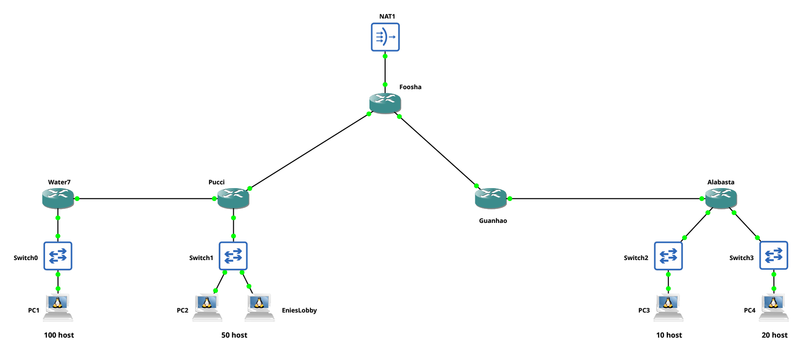

Suppose you have a network topology like the image above, with the number of hosts needed by each LAN shown below it. The 50 hosts in the PC2 LAN already include EniesLobby, the DHCP Server that will be configured in the [chapter 2 Implementation](#enieslobby). Next, determine the number of subnets in the topology.

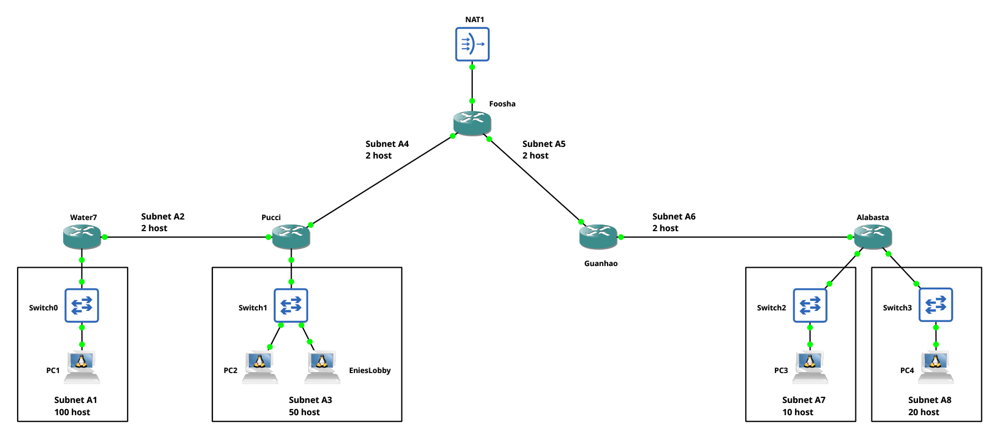

There are 8 subnets in the topology: 4 subnets connected to a switch (marked with boxes) and 4 router-to-router subnets (marked with labels near their link lines).

With the Classful technique, every subnet gets a /24 netmask because no subnet has more than 254 hosts (the Available Hosts of a /24). A possible IP allocation for the topology above is as follows.

| Subnet | Network ID    | Netmask         | Broadcast Address |
| ------ | ------------- | --------------- | ----------------- |
| A1     | `192.168.1.0` | `255.255.255.0` | `192.168.1.255`   |
| A2     | `192.168.2.0` | `255.255.255.0` | `192.168.2.255`   |
| A3     | `192.168.3.0` | `255.255.255.0` | `192.168.3.255`   |
| A4     | `192.168.4.0` | `255.255.255.0` | `192.168.4.255`   |
| A5     | `192.168.5.0` | `255.255.255.0` | `192.168.5.255`   |
| A6     | `192.168.6.0` | `255.255.255.0` | `192.168.6.255`   |
| A7     | `192.168.7.0` | `255.255.255.0` | `192.168.7.255`   |
| A8     | `192.168.8.0` | `255.255.255.0` | `192.168.8.255`   |

However, what if you only need 300 addresses? Class C is not enough, but Class B would waste a huge number of addresses: more than 60,000 addresses would go unused.

You could use two Class C blocks (enough for 512 IP Addresses). This works, and it is commonly done.

But what if you need 25,000 IP Addresses? With this approach, you would need 99 Class C blocks (25,000 ÷ 254 hosts per block). If you use a Class B block, more than 40,000 IP Addresses would still be wasted.

Because this is very inefficient, a much better IP allocation technique was developed: Classless Inter-Domain Routing, commonly known as **CIDR**.

#### 1.3.2 Classless / CIDR

In the Classless method, IP allocation is no longer tied to the 3 Classes above. With this method, IPs can be allocated according to the needs of each subnet. The Classless method is formally implemented as CIDR and is defined in RFC 4632 (previously RFC 1518/1519). With this method:

- If you need 250 IPs, you can use a subnet of size /24
- If you need 300 IPs, you can use a subnet of size /23
- If you need 500 IPs, you can also use a subnet of size /23
- If you need 25,000 IPs, you can use a subnet of size /17
- If you need 250,000 IPs, you can use a subnet of size /14

This makes IP allocation much more flexible, and far fewer IP Addresses are wasted.

Within Classless, there are 2 ways to do subnetting (create subnets): FLSM and VLSM.

##### FLSM (Fixed Length Subnet Masking)

**Fixed Length Subnet Masking (FLSM)** is a network division technique in which every subnet has the same size or number of hosts.

For example, if you have a network address with a /24 prefix and want to divide it into 4 subnets, each subnet gets an equal share, with a /26 prefix.

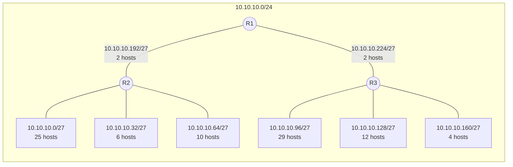

For example, you are given the address `10.10.10.0/24` and have a topology like the one above, with the number of hosts in each subnet shown below its address. The FLSM prefix is determined with the following steps:

1. Count the subnets. The topology above has 8 subnets: 6 LANs and 2 router-to-router links.
2. Find the number of additional bits `n` such that 2<sup>n</sup> ≥ the number of subnets. Since 2<sup>3</sup> = 8, 3 additional bits are needed, so the prefix becomes /24 + 3 = /27.
3. Make sure that prefix is large enough for the subnet with the most hosts. The largest subnet needs 29 hosts + 1 router = 30 IPs, and a /27 has 30 Available Hosts, so it is enough. If it is not enough, a larger root block is needed.
4. Divide the addresses evenly with a block size of 32 addresses: `10.10.10.0`, `.32`, `.64`, `.96`, `.128`, `.160`, `.192`, and `.224`.

A subnet with a /27 prefix contains 32 IPs, but only 30 can be used, because the first IP is used as the Network ID and the last IP is used as the Broadcast Address.

But what if you have 2 subnets, where the first subnet needs 25,000 IPs but the second only needs 500 IPs? Under FLSM rules, both subnets must be /17. This size is enough for the first subnet, but too large and wasteful for the second.

The same problem appears whenever there is a 3rd, 4th, or further subnet with different requirements. That is why another technique is used: VLSM.

##### VLSM (Variable Length Subnet Masking)

Unlike FLSM, **Variable Length Subnet Masking (VLSM)** is a subnetting technique in which each subnet can have a different size.

The main purpose of VLSM is to make IP allocation within a network more efficient, because the netmask size is matched to the number of hosts that need an IP Address in each subnet.

So, in VLSM, each subnet is given a netmask according to the number of IP Addresses it needs.

As an example, we will use the same topology as in the Classful method example.

1. Determine the number of IP Addresses needed by each subnet and label each subnet's netmask based on the number of IPs needed.

   - Subnets connected to a switch (LAN): number of IPs = number of hosts + 1 for the router interface (gateway).
   - Router-to-router subnets: 2 IPs are enough, one for each router interface.

   | Subnet    | Number of IPs (hosts + router) | Netmask |
   | --------- | ------------------------------ | ------- |
   | A1        | 101                            | /25     |
   | A2        | 2                              | /30     |
   | A3        | 51                             | /26     |
   | A4        | 2                              | /30     |
   | A5        | 2                              | /30     |
   | A6        | 2                              | /30     |
   | A7        | 11                             | /28     |
   | A8        | 21                             | /27     |
   | **Total** | **192**                        | **/24** |

   The root netmask is determined from the sum of the block sizes of all subnets: 128 (/25) + 64 (/26) + 32 (/27) + 16 (/28) + 4 × 4 (/30) = 256 addresses. This fits exactly into one /24 block, so IP allocation starts from a /24 netmask.

   > The number of IPs needed (192) is not enough to determine the root, because each subnet uses a whole block according to its netmask. For example, A1, which needs 101 IPs, still uses a /25 block containing 128 addresses.

2. The large subnet formed has the NID `192.168.1.0` with a /24 netmask. Calculate the IP allocation based on that NID and netmask using a tree like the one below.

   ```mermaid
   flowchart TD
       n0["192.168.1.0 / 24"]
       n1["192.168.1.0 / 25"]
       n0 --> n1
       n2["192.168.1.128 / 25"]
       n0 --> n2
       n3["192.168.1.0 / 26"]
       n1 --> n3
       n4["192.168.1.64 / 26"]
       n1 --> n4
       n5["192.168.1.0 / 27"]
       n3 --> n5
       n6["192.168.1.32 / 27"]
       n3 --> n6
       n7["192.168.1.0 / 28"]
       n5 --> n7
       n8["192.168.1.16 / 28"]
       n5 --> n8
       n9["192.168.1.0 / 29"]
       n7 --> n9
       n10["192.168.1.8 / 29"]
       n7 --> n10
       n11["192.168.1.0 / 30"]
       n9 --> n11
       n12["192.168.1.4 / 30"]
       n9 --> n12
       n13["192.168.1.8 / 30"]
       n10 --> n13
       n14["192.168.1.12 / 30"]
       n10 --> n14
   ```

3. Use that tree to do the subnetting, allocating IPs according to the needs of each subnet.

   ```mermaid
   flowchart TD
       n0["192.168.1.0 / 24"]
       n1["192.168.1.0 / 25"]
       n0 --> n1
       n2["192.168.1.128 / 25<br/>A1 = 100 hosts"]
       n0 --> n2
       n3["192.168.1.0 / 26"]
       n1 --> n3
       n4["192.168.1.64 / 26<br/>A3 = 50 hosts"]
       n1 --> n4
       n5["192.168.1.0 / 27"]
       n3 --> n5
       n6["192.168.1.32 / 27<br/>A8 = 20 hosts"]
       n3 --> n6
       n7["192.168.1.0 / 28"]
       n5 --> n7
       n8["192.168.1.16 / 28<br/>A7 = 10 hosts"]
       n5 --> n8
       n9["192.168.1.0 / 29"]
       n7 --> n9
       n10["192.168.1.8 / 29"]
       n7 --> n10
       n11["192.168.1.0 / 30<br/>A2 = 2 hosts"]
       n9 --> n11
       n12["192.168.1.4 / 30<br/>A4 = 2 hosts"]
       n9 --> n12
       n13["192.168.1.8 / 30<br/>A5 = 2 hosts"]
       n10 --> n13
       n14["192.168.1.12 / 30<br/>A6 = 2 hosts"]
       n10 --> n14
       classDef dipakai fill:#d4edda,stroke:#28a745,color:#155724
       class n2,n4,n6,n8,n11,n12,n13,n14 dipakai
   ```

   This tree gives the following IP allocation.

   | Subnet | Network ID      | Netmask           | Broadcast Address |
   | ------ | --------------- | ----------------- | ----------------- |
   | A1     | `192.168.1.128` | `255.255.255.128` | `192.168.1.255`   |
   | A2     | `192.168.1.0`   | `255.255.255.252` | `192.168.1.3`     |
   | A3     | `192.168.1.64`  | `255.255.255.192` | `192.168.1.127`   |
   | A4     | `192.168.1.4`   | `255.255.255.252` | `192.168.1.7`     |
   | A5     | `192.168.1.8`   | `255.255.255.252` | `192.168.1.11`    |
   | A6     | `192.168.1.12`  | `255.255.255.252` | `192.168.1.15`    |
   | A7     | `192.168.1.16`  | `255.255.255.240` | `192.168.1.31`    |
   | A8     | `192.168.1.32`  | `255.255.255.224` | `192.168.1.63`    |

#### 1.3.3 Subnet Calculator

Subnets can be calculated manually using a tree, as in the VLSM example above. You can check the results of the manual calculation with an online **subnet calculator**.

The following example checks the subnet `192.168.1.64/27` using two subnet calculators.

##### calculator.net

Site: https://www.calculator.net/ip-subnet-calculator.html

1. Select the netmask in the **Subnet** field, enter the IP Address in the **IP Address** field, then click **Calculate**.

   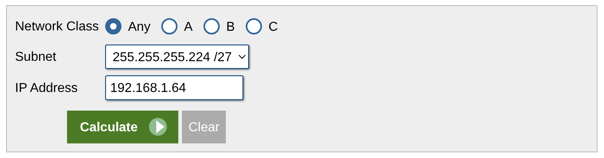

2. Compare the result with your manual calculation.

   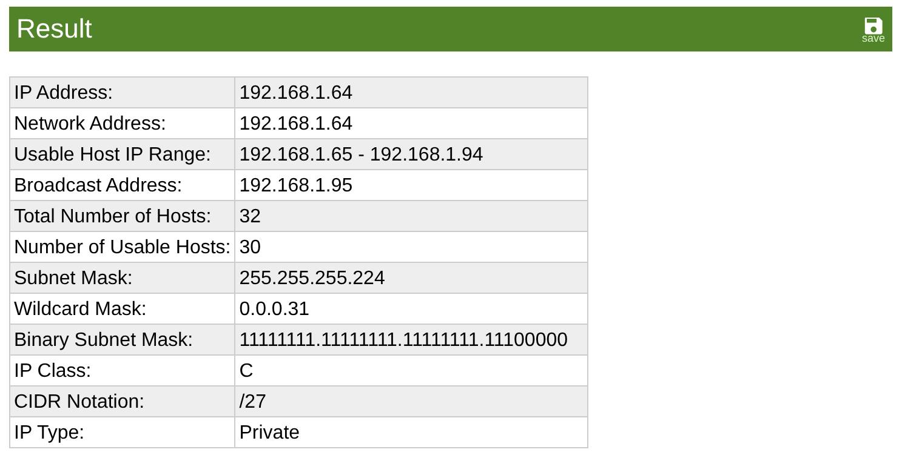

##### jodies.de

Site: https://jodies.de/ipcalc

1. Enter the IP Address in the **Address** field and the prefix in the **Netmask** field, then click **Calculate**.

   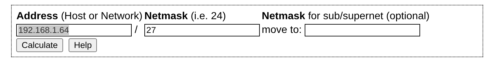

2. Compare the result with your manual calculation.

   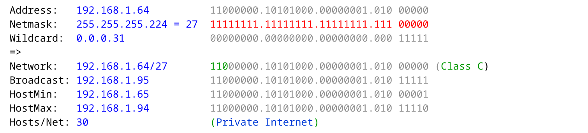

   Besides decimal, the result is also shown in binary. The space in the binary numbers separates the network part (left) from the host part (right).

The terms used by the two subnet calculators differ slightly from the terms used in this module:

| This module       | calculator.net       | jodies.de         |
| ----------------- | -------------------- | ----------------- |
| Network ID        | Network Address      | Network           |
| Broadcast Address | Broadcast Address    | Broadcast         |
| Available Hosts   | Usable Host IP Range | HostMin - HostMax |
| Netmask           | Subnet Mask          | Netmask           |

### 1.4 Supernetting

Supernetting is the opposite of subnetting: it is a technique for combining several small networks (subnets) into one larger network by reducing the prefix length (increasing the number of host bits) of the network address.

In other words, while subnetting splits one large network into several small networks, supernetting combines several contiguous small networks into one larger network block.

Supernetting has several goals and benefits, including:

- Reducing the size of routing tables (more efficient for routers).
- Simplifying the management of large networks.
- Being used in route aggregation on the internet (combining many prefixes into one routing entry).

To do it, you can use CIDR route aggregation by following these steps:

1. Identify the subnets in the topology and label the netmask of each subnet. An example is shown in the following image.

   

2. Merge the lowest subnets in the topology. Lowest means the subnets farthest from the internet (the NAT1 node).

   In this topology, the subnets that can be merged are A1 with A2, and A7 with A8. Each merge forms a larger subnet that contains the smaller subnets inside it.

   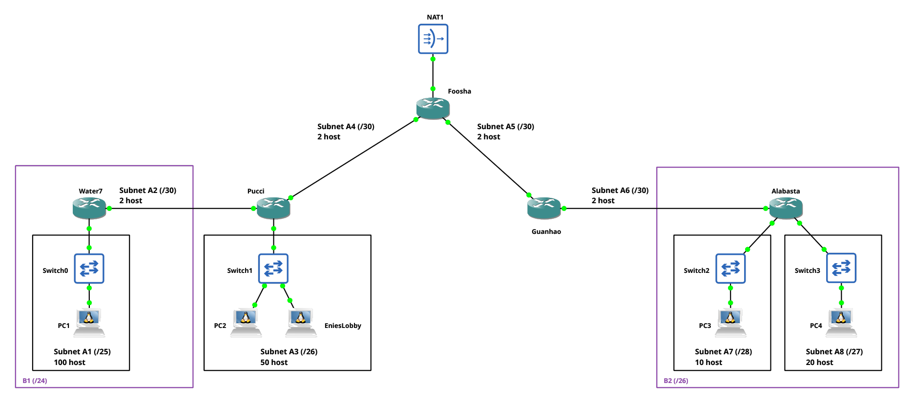

   Subnet B1 is the result of merging subnets A1 and A2, and Subnet B2 is the result of merging subnets A7 and A8. Merged subnets are marked with colored boxes.

   Why does B1 have a /24 netmask and B2 a /26 netmask? In supernetting, the merged subnet uses the largest prefix that can still hold all the merged subnets:

   - B1 = A1 (/25, 128 addresses) + A2 (/30, 4 addresses) = 132 addresses. This does not fit in a /25 (128 addresses), but it fits in a /24 (256 addresses).
   - B2 = A8 (/27, 32 addresses) + A7 (/28, 16 addresses) = 48 addresses, so a /26 (64 addresses) is enough.

   In this example, the total of the other merged subnets is never larger than the largest subnet, so the result only needs to be 1 level above the largest subnet. If the total is larger, for example /25 + /25 + /30 (260 addresses), the result is 2 levels above, which is /23.

   Then repeat this step until you have one large subnet that covers the whole topology.

   Next merge: C1 = B1 + A3 (/23) and C2 = B2 + A6 (/25).

   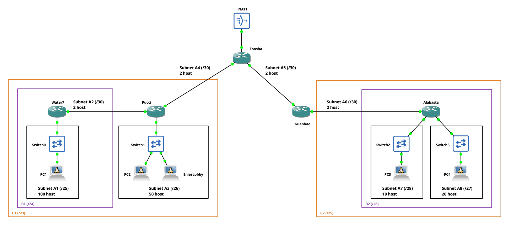

   Next merge: D1 = C1 + A4 (/22) and D2 = C2 + A5 (/24).

   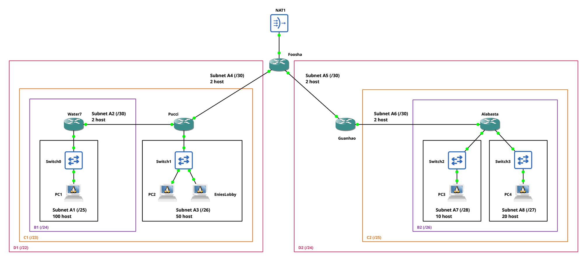

   Final merge: E1 = D1 + D2 (/21), which covers all subnets in the topology.

   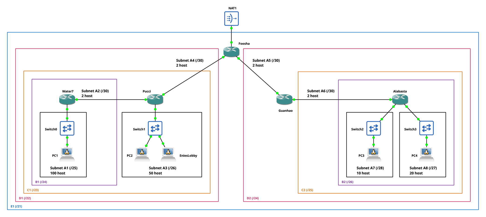

3. The merging process gives one large subnet with a /21 netmask. This time you can use the NID `192.168.0.0`, netmask `255.255.248.0`.

4. Calculate the IP allocation with a tree based on the subnet merges you have done.

   ```mermaid
   flowchart TD
       n0["192.168.0.0 / 21"]
       n1["192.168.0.0 / 22"]
       n0 --> n1
       n2["192.168.4.0 / 24"]
       n0 --> n2
       n3["192.168.0.0 / 23"]
       n1 --> n3
       n4["192.168.2.0 / 30<br/>A4 = 2 hosts"]
       n1 --> n4
       n5["192.168.0.0 / 24"]
       n3 --> n5
       n6["192.168.1.0 / 26<br/>A3 = 50 hosts"]
       n3 --> n6
       n7["192.168.0.0 / 25<br/>A1 = 100 hosts"]
       n5 --> n7
       n8["192.168.0.128 / 30<br/>A2 = 2 hosts"]
       n5 --> n8
       n9["192.168.4.0 / 25"]
       n2 --> n9
       n10["192.168.4.128 / 30<br/>A5 = 2 hosts"]
       n2 --> n10
       n11["192.168.4.0 / 26"]
       n9 --> n11
       n12["192.168.4.64 / 30<br/>A6 = 2 hosts"]
       n9 --> n12
       n13["192.168.4.0 / 27<br/>A8 = 20 hosts"]
       n11 --> n13
       n14["192.168.4.32 / 28<br/>A7 = 10 hosts"]
       n11 --> n14
       classDef dipakai fill:#d4edda,stroke:#28a745,color:#155724
       class n7,n8,n6,n4,n10,n12,n14,n13 dipakai
   ```

   > The difference between the VLSM tree and the supernetting tree is that when a subnet is split, the resulting netmasks follow the subnet merges done earlier.
   >
   > For example, in VLSM a large /21 netmask is split in two into a /22 each. However, in the earlier merging, the /21 was produced by merging a /22 and a /24, so the resulting subnets have /22 and /24 netmasks.

5. Based on the calculation, the IP allocation is as follows.

   | Subnet | Network ID      | Netmask           | Broadcast Address |
   | ------ | --------------- | ----------------- | ----------------- |
   | A1     | `192.168.0.0`   | `255.255.255.128` | `192.168.0.127`   |
   | A2     | `192.168.0.128` | `255.255.255.252` | `192.168.0.131`   |
   | A3     | `192.168.1.0`   | `255.255.255.192` | `192.168.1.63`    |
   | A4     | `192.168.2.0`   | `255.255.255.252` | `192.168.2.3`     |
   | A5     | `192.168.4.128` | `255.255.255.252` | `192.168.4.131`   |
   | A6     | `192.168.4.64`  | `255.255.255.252` | `192.168.4.67`    |
   | A7     | `192.168.4.32`  | `255.255.255.240` | `192.168.4.47`    |
   | A8     | `192.168.4.0`   | `255.255.255.224` | `192.168.4.31`    |

If you use supernetting, the IP block you need will be larger than with VLSM (in this example /21, while VLSM only needs /24). Even so, supernetting has two advantages:

- When a new subnet is added to the topology, you do not need to recalculate, because there is most likely still an unused IP interval (_range_).
- Routing is more efficient, because the routing table is usually simpler than with plain VLSM.

### 1.5 Implementation

In this section, the subnet calculation results are applied in GNS3. MikroTik is used as the router, while netics-pc is used as the client.

#### Topology and Calculation

Create the following topology in GNS3:

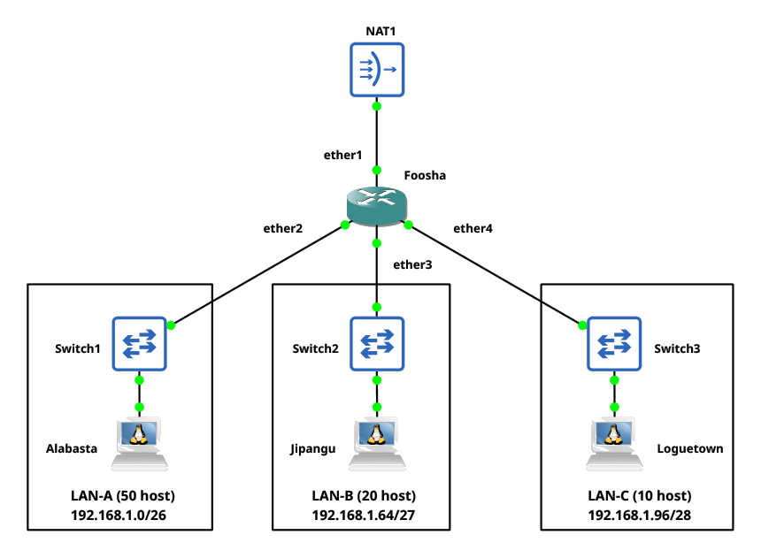

Router Foosha is connected to NAT1 through `ether1` to get internet access. Interfaces `ether2`, `ether3`, and `ether4` are each connected to one LAN through a switch.

You are given the address `192.168.1.0/24`, which must be divided among 3 LANs with the following host requirements:

| Subnet | Number of Hosts |
| ------ | --------------- |
| LAN-A  | 50              |
| LAN-B  | 20              |
| LAN-C  | 10              |

The subnets are allocated using VLSM:

1. Sort the subnets from the largest to the smallest host requirement.
2. For each subnet, choose the smallest subnet (largest prefix) whose number of Available Hosts is enough for all hosts plus 1 address for the router (gateway).
3. Allocate the addresses in order, starting from `192.168.1.0`, using the following VLSM tree. The green boxes are the subnets used by the LANs.

   ```mermaid
   flowchart TD
       n0["192.168.1.0 / 24"]
       n1["192.168.1.0 / 25"]
       n0 --> n1
       n2["192.168.1.128 / 25"]
       n0 --> n2
       n3["192.168.1.0 / 26<br/>LAN-A = 51 hosts"]
       n1 --> n3
       n4["192.168.1.64 / 26"]
       n1 --> n4
       n5["192.168.1.64 / 27<br/>LAN-B = 21 hosts"]
       n4 --> n5
       n6["192.168.1.96 / 27"]
       n4 --> n6
       n7["192.168.1.96 / 28<br/>LAN-C = 11 hosts"]
       n6 --> n7
       n8["192.168.1.112 / 28"]
       n6 --> n8
       classDef dipakai fill:#d4edda,stroke:#28a745,color:#155724
       class n3,n5,n7 dipakai
   ```

The allocation result is as follows:

| Subnet | Requirement (hosts + router) | Prefix | Netmask           | Network ID     | Available Hosts                  | Broadcast Address |
| ------ | ---------------------------- | ------ | ----------------- | -------------- | -------------------------------- | ----------------- |
| LAN-A  | 50 + 1 = 51                  | /26    | `255.255.255.192` | `192.168.1.0`  | `192.168.1.1` - `192.168.1.62`   | `192.168.1.63`    |
| LAN-B  | 20 + 1 = 21                  | /27    | `255.255.255.224` | `192.168.1.64` | `192.168.1.65` - `192.168.1.94`  | `192.168.1.95`    |
| LAN-C  | 10 + 1 = 11                  | /28    | `255.255.255.240` | `192.168.1.96` | `192.168.1.97` - `192.168.1.110` | `192.168.1.111`   |

From the table above, the first Available Hosts address of each subnet is used for the router, and the next address is used for the client:

| Node      | Interface | IP Address      | Netmask           | Gateway        |
| --------- | --------- | --------------- | ----------------- | -------------- |
| Foosha    | `ether2`  | `192.168.1.1`   | `255.255.255.192` | -              |
| Foosha    | `ether3`  | `192.168.1.65`  | `255.255.255.224` | -              |
| Foosha    | `ether4`  | `192.168.1.97`  | `255.255.255.240` | -              |
| Alabasta  | `eth0`    | `192.168.1.2`   | `255.255.255.192` | `192.168.1.1`  |
| Jipangu   | `eth0`    | `192.168.1.66`  | `255.255.255.224` | `192.168.1.65` |
| Loguetown | `eth0`    | `192.168.1.98`  | `255.255.255.240` | `192.168.1.97` |

#### Foosha

MikroTik commands can be auto-completed by pressing the `TAB` key.

1. Change the router name (_identity_) to Foosha so it does not get mixed up with other routers:

   ```
   /system identity set name=Foosha
   ```

   The terminal prompt will change from `[admin@CHR] >` to `[admin@Foosha] >`.

2. View the list of available interfaces:

   ```
   /interface print
   ```

   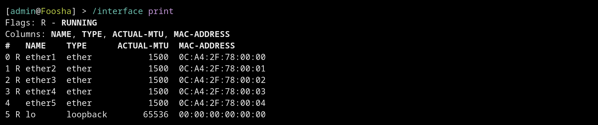

   The `R` (_running_) flag indicates that the interface is connected. `ether1` to `ether4` are connected according to the topology, while `ether5` is not used.

3. Interface `ether1` is connected to NAT1. For Foosha to get an IP Address and internet access from NAT1, `ether1` must run a DHCP client. On MikroTik CHR, the DHCP client on `ether1` is enabled by default. Check its status with:

   ```
   /ip dhcp-client print
   ```

   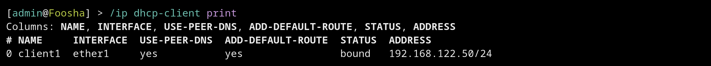

   The `STATUS` column shows `bound`, which means Foosha has received an IP Address from NAT1 (in this example `192.168.122.50/24`; your result may differ).

   If the list is empty, add a DHCP client on `ether1`:

   ```
   /ip dhcp-client add interface=ether1 disabled=no
   ```

4. Check the DNS server used by Foosha:

   ```
   /ip dns print
   ```

   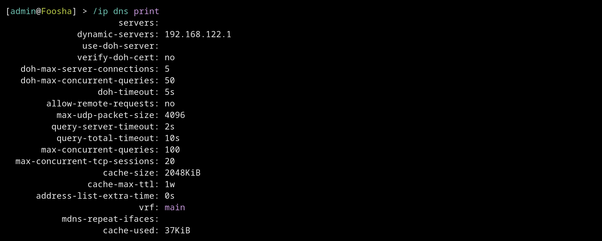

   The DNS server from NAT1 is obtained automatically through the DHCP client and appears on the `dynamic-servers` line. If you want to add a DNS server manually, use:

   ```
   /ip dns set servers=8.8.8.8
   ```

5. Test the internet connection from Foosha:

   ```
   /ping google.com count=4
   ```

   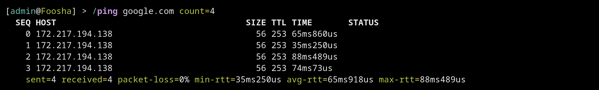

   The values `received=4` and `packet-loss=0%` mean Foosha is connected to the internet.

6. Add an IP Address for each LAN interface according to the table in [Topology and Calculation](#topology-and-calculation). The IP Address is written together with its prefix.

   ```
   /ip address add address=192.168.1.1/26 interface=ether2 comment=LAN-A
   /ip address add address=192.168.1.65/27 interface=ether3 comment=LAN-B
   /ip address add address=192.168.1.97/28 interface=ether4 comment=LAN-C
   ```

7. Check the result with:

   ```
   /ip address print
   ```

   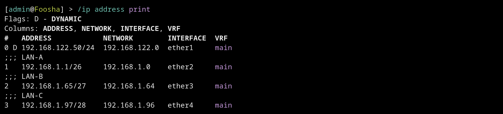

   Look at the `NETWORK` column. MikroTik calculates the Network ID automatically from the IP Address and prefix you entered, so its value must match the Network ID column in the calculation table. The `192.168.122.50/24` row with the `D` (_dynamic_) flag is the IP Address from the DHCP client on `ether1`.

   If you entered an IP Address incorrectly, remove it with the following command, then add the correct IP Address again:

   ```
   /ip address remove [find address="192.168.1.1/26"]
   ```

8. Once the IP Addresses are added, MikroTik automatically knows how to reach these three subnets because they are directly connected to it. You can see this in the routing table:

   ```
   /ip route print
   ```

   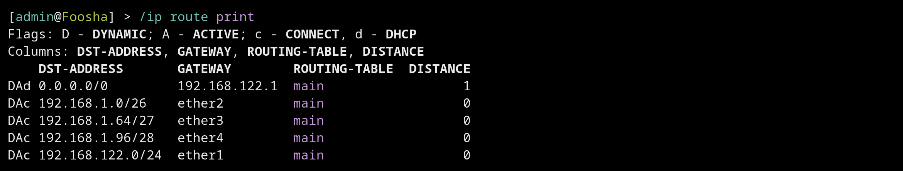

   Routes with the `DAc` flag indicate subnets that are directly connected (_connected_) to Foosha.

   The `0.0.0.0/0` route with the `DAd` flag is the **default route**, the route used for every destination IP that does not match any other route, just like the default gateway in Module 3. This route comes from the DHCP client, so packets going to the internet are forwarded to NAT1 (`192.168.122.1`).

> Unlike the Linux routers in Module 1 and Module 3, MikroTik does not need IP forwarding enabled with `sysctl -w net.ipv4.ip_forward=1`, because it is enabled by default (`ip-forward: yes` in `/ip settings print`). MikroTik configuration is also saved as soon as a command is run, so it persists after the router is restarted without needing a script like `/root/init.sh`.

#### Alabasta

Set the IP Address through **Edit config**, then restart the node to apply the configuration:

```
auto eth0
iface eth0 inet static
	address 192.168.1.2
	netmask 255.255.255.192
	gateway 192.168.1.1
```


Check the assigned IP Address on the `inet` line:

```
ip a show eth0
```


#### Jipangu

Set the IP Address through **Edit config**, then restart the node to apply the configuration:

```
auto eth0
iface eth0 inet static
	address 192.168.1.66
	netmask 255.255.255.224
	gateway 192.168.1.65
```


Check the assigned IP Address on the `inet` line:

```
ip a show eth0
```


#### Loguetown

Set the IP Address through **Edit config**, then restart the node to apply the configuration:

```
auto eth0
iface eth0 inet static
	address 192.168.1.98
	netmask 255.255.255.240
	gateway 192.168.1.97
```


Check the assigned IP Address on the `inet` line:

```
ip a show eth0
```


#### Testing

1. From **Alabasta**, ping its gateway:

   ```
   ping -c 4 192.168.1.1
   ```

   

2. From **Alabasta**, ping the clients in other subnets, namely Jipangu and Loguetown:

   ```
   ping -c 4 192.168.1.66
   ping -c 4 192.168.1.98
   ```

   

   The ping succeeds because the packets are sent to the gateway (Foosha), and Foosha knows how to reach all subnets directly connected to it.

3. From **Foosha**, ping all clients:

   ```
   /ping 192.168.1.2 count=4
   /ping 192.168.1.66 count=4
   /ping 192.168.1.98 count=4
   ```

   

4. From **Alabasta**, try pinging the internet:

   ```
   ping -c 4 8.8.8.8
   ```

   

   The ping fails (`100% packet loss`). The client cannot access the internet yet even though Foosha is already connected to NAT1. For clients to access the internet, additional NAT configuration is needed on Foosha.

## 2. Static Routing (Advanced)

In Module 3, static routing was configured on Linux using `ip route add` on a topology with only a few routers. In this chapter, static routing is applied on MikroTik in a larger topology, so packets must pass through several routers before reaching their destination.

### 2.1 Multi-hop Routing

**Multi-hop routing** is the delivery of packets that pass through more than one router before reaching their destination.

No router knows the entire path to the destination. A router only matches the packet's destination IP against its routing table, then forwards the packet to the next router (_next hop_). Every router along the way repeats this step (_hop-by-hop_).

For example, a packet from PC1 (Water7 LAN) to PC4 (Alabasta LAN) passes through five routers:


The numbers 1 to 5 show the order of the routers the packet passes through. Switches are not counted as hops because a switch only forwards packets within a LAN and does not perform routing.

There are two things to keep in mind for communication to succeed:

- **Outbound route and return route**: routers on the outbound path must know how to reach the destination subnet, and routers on the return path must know how to reach the source subnet. If either one is missing, the ping still fails even though the packet has reached its destination.
- **Default route**: routers at the edge of the topology, such as Water7 and Alabasta, have only one way out. Such a router only needs a single default route (`0.0.0.0/0`) to the upstream router.

With these rules, the routes each router needs are as follows:

| Router   | Destination subnet   | Next hop |
| -------- | -------------------- | -------- |
| Foosha   | A1, A2, A3           | Pucci    |
| Foosha   | A6, A7, A8           | Guanhao  |
| Foosha   | Default (internet)   | NAT1     |
| Pucci    | A1                   | Water7   |
| Pucci    | Default              | Foosha   |
| Water7   | Default              | Pucci    |
| Guanhao  | A7, A8               | Alabasta |
| Guanhao  | Default              | Foosha   |
| Alabasta | Default              | Guanhao  |

Subnets that are directly connected to a router do not need to be added, because the router already knows them automatically.

### 2.2 Route Summarization and Longest Prefix Match

#### 2.2.1 Route Summarization

**Route summarization** is a technique for merging several routes into a single route that covers all of those subnets. It works the same way as supernetting: consecutive subnets are merged into one block with a shorter prefix.

In the table above, Foosha needs 6 routes. However, the subnets behind Pucci (A1, A2, A3) are already merged into D1, and the subnets behind Guanhao (A6, A7, A8) are already merged into D2.


Foosha's routing table before summarization:

| Destination subnet        | Next hop |
| ------------------------- | -------- |
| `192.168.0.0/25` (A1)     | Pucci    |
| `192.168.0.128/30` (A2)   | Pucci    |
| `192.168.1.0/26` (A3)     | Pucci    |
| `192.168.4.64/30` (A6)    | Guanhao  |
| `192.168.4.32/28` (A7)    | Guanhao  |
| `192.168.4.0/27` (A8)     | Guanhao  |

Foosha's routing table after summarization:

| Destination subnet      | Next hop |
| ----------------------- | -------- |
| `192.168.0.0/22` (D1)   | Pucci    |
| `192.168.4.0/24` (D2)   | Guanhao  |

Benefits of route summarization:

- The routing table is smaller, so it is easier to read and check.
- New subnets within the same block do not need to be added one by one to other routers.

Requirements for route summarization:

- The merged subnets must be consecutive and lie within one block, like the result of supernetting.
- All of those subnets must be reachable through the same next hop.

> The summarized block can cover addresses that are not in use yet. For example, D1 (`192.168.0.0/22`) also covers `192.168.3.0` to `192.168.3.255`, even though no subnet uses those addresses. Packets to these addresses are still forwarded by Foosha to Pucci.

#### 2.2.2 Longest Prefix Match

A destination IP can match more than one route. For example, after summarization Foosha has the following routes:

| Route              | Description                         |
| ------------------ | ----------------------------------- |
| `0.0.0.0/0`        | Default route to NAT1               |
| `192.168.4.0/24`   | D2, via Guanhao                     |
| `192.168.4.128/30` | A5, directly connected to Foosha    |

To choose a route, the router uses the **longest prefix match** rule: of all matching routes, the router picks the route with the longest (most specific) prefix.

| Destination IP           | Matching routes  | Selected route                              |
| ------------------------ | ---------------- | ------------------------------------------- |
| `192.168.4.130` (Guanhao) | /0, /24, /30     | `192.168.4.128/30`, directly connected      |
| `192.168.4.34` (PC3)     | /0, /24          | `192.168.4.0/24`, via Guanhao               |
| `8.8.8.8`                | /0               | `0.0.0.0/0`, via NAT1                       |

The default route (/0) matches every destination IP, but it always loses to any other route that is more specific. That is why the default route is only used when no other route matches.

If two routes have the same prefix, MikroTik picks the route with the smallest `distance` value.

### 2.3 Routing Loop and TTL

#### 2.3.1 Routing Loop

**Routing loops** happen when a packet circulates between two or more routers without ever reaching its destination. Each router thinks the other router is the way to the destination.


In the figure above, a packet from PC1 to PC4 is forwarded by Foosha to Guanhao. The route on Guanhao wrongly points back to Foosha, so the packet circulates between the two.

Common causes:

- **Wrong gateway**: Foosha forwards the packet to Guanhao, but the route on Guanhao points back to Foosha instead.
- **Summarization and default route**: Foosha forwards a packet for `192.168.3.10` to Pucci because that address belongs to D1. Pucci does not have that subnet, so the packet is sent back to Foosha via the default route.

Circulating packets flood the link between those routers. To keep packets from circulating forever, IPv4 has a limit in the form of TTL.

#### 2.3.2 TTL and Traceroute

The TTL field in the [IPv4 Header](#ipv4-header) limits the number of routers a packet may pass through:

1. The sender sets TTL to an initial value, for example `64` on Linux and MikroTik.
2. Every router that forwards the packet decreases TTL by 1.
3. If TTL reaches `0`, the router drops the packet and sends an ICMP Time Exceeded message to the sender.

For example, when PC1 pings Water7 (its gateway), the reply from Water7 has `ttl=64` because it does not pass through any other router. When PC1 pings PC4, the reply from PC4 has `ttl=59` because it passes through five routers: Alabasta, Guanhao, Foosha, Pucci, and Water7.

In a routing loop, TTL keeps decreasing until it reaches `0`, so ping shows the message `Time to live exceeded`.

Traceroute uses TTL to find out which routers a packet passes through:

1. Traceroute sends a packet with TTL `1`. The first router drops the packet and replies with Time Exceeded, which reveals the address of the first router.
2. Traceroute sends packets with TTL `2`, `3`, and so on. Each Time Exceeded reply reveals the next router.
3. The process stops when the packet reaches the destination.

If there is a routing loop, the traceroute output shows the addresses of the same routers alternating over and over.

### 2.4 Implementation

In this section, the topology from [Supernetting](#14-supernetting) is configured in GNS3. MikroTik is used as the router, while netics-pc is used as the client.

#### Topology and IP Allocation

Create the following topology in GNS3:


The IP allocation follows the table from [Supernetting](#14-supernetting). The `ether1` interface of every router always points toward NAT1.

| Node     | Interface | Connected to  | Subnet | IP Address         |
| -------- | --------- | ------------- | ------ | ------------------ |
| Foosha   | `ether1`  | NAT1          | -      | DHCP               |
| Foosha   | `ether2`  | Pucci         | A4     | `192.168.2.1/30`   |
| Foosha   | `ether3`  | Guanhao       | A5     | `192.168.4.129/30` |
| Pucci    | `ether1`  | Foosha        | A4     | `192.168.2.2/30`   |
| Pucci    | `ether2`  | Water7        | A2     | `192.168.0.129/30` |
| Pucci    | `ether3`  | Switch1 (PC2, EniesLobby) | A3     | `192.168.1.1/26`   |
| Water7   | `ether1`  | Pucci         | A2     | `192.168.0.130/30` |
| Water7   | `ether2`  | Switch0 (PC1) | A1     | `192.168.0.1/25`   |
| Guanhao  | `ether1`  | Foosha        | A5     | `192.168.4.130/30` |
| Guanhao  | `ether2`  | Alabasta      | A6     | `192.168.4.65/30`  |
| Alabasta | `ether1`  | Guanhao       | A6     | `192.168.4.66/30`  |
| Alabasta | `ether2`  | Switch2 (PC3) | A7     | `192.168.4.33/28`  |
| Alabasta | `ether3`  | Switch3 (PC4) | A8     | `192.168.4.1/27`   |

EniesLobby is the DHCP Server and has a static IP. PC1 to PC4 get their IP Address from EniesLobby via DHCP, with the following ranges (_pool_):

| Node       | Subnet | IP Address                               | Gateway        | DHCP Relay |
| ---------- | ------ | ---------------------------------------- | -------------- | ---------- |
| EniesLobby | A3     | `192.168.1.2/26` (static)                | `192.168.1.1`  | -          |
| PC1        | A1     | DHCP, `192.168.0.2` - `192.168.0.126`   | `192.168.0.1`  | Water7     |
| PC2        | A3     | DHCP, `192.168.1.3` - `192.168.1.62`    | `192.168.1.1`  | -          |
| PC3        | A7     | DHCP, `192.168.4.34` - `192.168.4.46`   | `192.168.4.33` | Alabasta   |
| PC4        | A8     | DHCP, `192.168.4.2` - `192.168.4.30`    | `192.168.4.1`  | Alabasta   |

Each router is configured through the console, after logging in as shown in [Installing MikroTik-CHR in GNS3](#0-installing-mikrotik-chr-in-gns3).

> On Pucci, Water7, Guanhao, and Alabasta, the default DHCP client on `ether1` is not used because `ether1` is connected to another router, not to NAT1. Remove it with `/ip dhcp-client remove [find interface=ether1]`.

#### Foosha

Foosha already gets its IP and default route from NAT1 through the DHCP client on `ether1`, as in [Foosha](#foosha) in chapter 1.

1. Change the identity and add the IP Addresses:

   ```
   /system identity set name=Foosha
   /ip address add address=192.168.2.1/30 interface=ether2 comment=A4
   /ip address add address=192.168.4.129/30 interface=ether3 comment=A5
   ```

2. Add routes to the subnets behind Pucci and Guanhao:

   ```
   /ip route add dst-address=192.168.0.0/25 gateway=192.168.2.2 comment=A1
   /ip route add dst-address=192.168.0.128/30 gateway=192.168.2.2 comment=A2
   /ip route add dst-address=192.168.1.0/26 gateway=192.168.2.2 comment=A3
   /ip route add dst-address=192.168.4.64/30 gateway=192.168.4.130 comment=A6
   /ip route add dst-address=192.168.4.32/28 gateway=192.168.4.130 comment=A7
   /ip route add dst-address=192.168.4.0/27 gateway=192.168.4.130 comment=A8
   ```

   `dst-address` is the destination subnet, while `gateway` is the next hop IP, which is the IP of the neighbouring router on the subnet directly connected to Foosha.

3. Add NAT so the subnets behind Foosha can access the internet:

   ```
   /ip firewall nat add chain=srcnat out-interface=ether1 action=masquerade
   ```

   This rule replaces the sender's IP with the IP of Foosha's `ether1` every time a packet leaves toward NAT1, so replies from the internet can come back. This is the additional NAT configuration mentioned in [Testing](#testing) in chapter 1.

4. Check the routing table:

   ```
   /ip route print
   ```

   

   Routes added manually have the `s` (_static_) flag. The `A` (_active_) flag means the route is currently in use.

#### Pucci

1. Change the identity and add the IP Addresses:

   ```
   /system identity set name=Pucci
   /ip address add address=192.168.2.2/30 interface=ether1 comment=A4
   /ip address add address=192.168.0.129/30 interface=ether2 comment=A2
   /ip address add address=192.168.1.1/26 interface=ether3 comment=A3
   ```

2. Add a default route to Foosha and a route to A1 via Water7:

   ```
   /ip route add dst-address=0.0.0.0/0 gateway=192.168.2.1
   /ip route add dst-address=192.168.0.0/25 gateway=192.168.0.130 comment=A1
   ```

3. Pucci does not get a DNS server from DHCP. Set the DNS server manually, then check the result:

   ```
   /ip dns set servers=8.8.8.8
   /ip dns print
   ```

   

   The `servers` line shows the newly set DNS server.

#### Water7

1. Change the identity and add the IP Addresses:

   ```
   /system identity set name=Water7
   /ip address add address=192.168.0.130/30 interface=ether1 comment=A2
   /ip address add address=192.168.0.1/25 interface=ether2 comment=A1
   ```

2. Water7 has only one way out, which is Pucci, so a single default route is enough:

   ```
   /ip route add dst-address=0.0.0.0/0 gateway=192.168.0.129
   ```

3. Set the DNS server:

   ```
   /ip dns set servers=8.8.8.8
   ```

#### Guanhao

1. Change the identity and add the IP Addresses:

   ```
   /system identity set name=Guanhao
   /ip address add address=192.168.4.130/30 interface=ether1 comment=A5
   /ip address add address=192.168.4.65/30 interface=ether2 comment=A6
   ```

2. Add a default route to Foosha and routes to A7 and A8 via Alabasta:

   ```
   /ip route add dst-address=0.0.0.0/0 gateway=192.168.4.129
   /ip route add dst-address=192.168.4.32/28 gateway=192.168.4.66 comment=A7
   /ip route add dst-address=192.168.4.0/27 gateway=192.168.4.66 comment=A8
   ```

3. Set the DNS server:

   ```
   /ip dns set servers=8.8.8.8
   ```

#### Alabasta

1. Change the identity and add the IP Addresses:

   ```
   /system identity set name=Alabasta
   /ip address add address=192.168.4.66/30 interface=ether1 comment=A6
   /ip address add address=192.168.4.33/28 interface=ether2 comment=A7
   /ip address add address=192.168.4.1/27 interface=ether3 comment=A8
   ```

2. Alabasta has only one way out, which is Guanhao, so a single default route is enough:

   ```
   /ip route add dst-address=0.0.0.0/0 gateway=192.168.4.65
   ```

3. Set the DNS server:

   ```
   /ip dns set servers=8.8.8.8
   ```

#### EniesLobby

EniesLobby is a netics-pc that acts as the DHCP Server for PC1 to PC4. The DHCP Server used is Kea, the same as in [Module 1](../Modul-1/README%20-%20English.md#27-dhcp-server-configuration-using-kea-dhcp4).

1. Set the IP Address through **Edit config**, then restart the node to apply the configuration:

   ```
   auto eth0
   iface eth0 inet static
   	address 192.168.1.2
   	netmask 255.255.255.192
   	gateway 192.168.1.1
   	up echo nameserver 8.8.8.8 > /etc/resolv.conf
   ```

   

   EniesLobby uses a static IP because the DHCP Server's address must stay fixed. This is also the address that the DHCP relays will send requests to later.

2. On **EniesLobby**, install Kea, then check its version:

   ```
   apk update
   apk add kea-dhcp4
   kea-dhcp4 -V
   ```

   

   The installation needs internet access, which is already available through the default route on Pucci and the NAT on Foosha.

3. On **EniesLobby**, replace the entire contents of `/etc/kea/kea-dhcp4.conf` with the following configuration:

   ```json
   {
     "Dhcp4": {
       "interfaces-config": {
         "interfaces": ["eth0"]
       },
       "lease-database": {
         "type": "memfile",
         "persist": true,
         "name": "/var/lib/kea/kea-leases4.csv"
       },
       "valid-lifetime": 600,
       "max-valid-lifetime": 7200,
       "option-data": [
         { "name": "domain-name-servers", "data": "8.8.8.8" }
       ],
       "subnet4": [
         {
           "id": 1,
           "subnet": "192.168.0.0/25",
           "pools": [ { "pool": "192.168.0.2 - 192.168.0.126" } ],
           "option-data": [ { "name": "routers", "data": "192.168.0.1" } ]
         },
         {
           "id": 2,
           "subnet": "192.168.1.0/26",
           "pools": [ { "pool": "192.168.1.3 - 192.168.1.62" } ],
           "option-data": [ { "name": "routers", "data": "192.168.1.1" } ]
         },
         {
           "id": 3,
           "subnet": "192.168.4.32/28",
           "pools": [ { "pool": "192.168.4.34 - 192.168.4.46" } ],
           "option-data": [ { "name": "routers", "data": "192.168.4.33" } ]
         },
         {
           "id": 4,
           "subnet": "192.168.4.0/27",
           "pools": [ { "pool": "192.168.4.2 - 192.168.4.30" } ],
           "option-data": [ { "name": "routers", "data": "192.168.4.1" } ]
         }
       ]
     }
   }
   ```

   - `subnet4` contains four client subnets: A1, A3, A7, and A8. Kea selects the subnet based on the address of the relay that forwards the request, or based on the interface if the client is on the same subnet (A3).
   - Each pool starts from the second host, because the first host is used by the gateway. The A3 pool starts from `192.168.1.3` because `192.168.1.2` is used by EniesLobby.
   - `routers` is the gateway for each subnet. `domain-name-servers` is written outside `subnet4`, so it applies to all subnets.

4. On **EniesLobby**, check whether the configuration is correct:

   ```
   kea-dhcp4 -t /etc/kea/kea-dhcp4.conf
   ```

   

   All four subnets appear on `DHCPSRV_CFGMGR_NEW_SUBNET4` lines and there are no `ERROR` lines. The `WARN` line about multi-threading is normal.

5. On **EniesLobby**, run Kea in the background:

   ```
   mkdir -p /var/lib/kea /run/kea
   kea-dhcp4 -c /etc/kea/kea-dhcp4.conf > /root/kea.log 2>&1 &
   ```

#### DHCP Relay

PC1, PC3, and PC4 are on different subnets from EniesLobby. Clients send DHCP requests as broadcasts, while routers do not forward broadcasts to other subnets. Therefore, the router connected to a client subnet must act as a **DHCP relay**, an intermediary that forwards client requests to the DHCP Server.

The DHCP relay concept is the same as [DHCP Relay](../Modul-1/README%20-%20English.md#dhcp-relay) in Module 1. The difference is that MikroTik already has a built-in DHCP relay, so you do not need to install `dhcp-helper` or enable IP forwarding.

Parameters used:

| Parameter      | Function                                                                                                     |
| -------------- | ------------------------------------------------------------------------------------------------------------ |
| `name`         | Relay name                                                                                                   |
| `interface`    | The interface connected to the client subnet. The relay receives DHCP broadcasts from this interface         |
| `dhcp-server`  | IP Address of the DHCP Server, which is EniesLobby (`192.168.1.2`)                                           |
| `local-address`| IP Address of the router on the client subnet. Kea uses this address to select the subnet, then sends the reply to this address |
| `disabled=no`  | Enables the relay, because a newly created relay is disabled                                                 |

1. On **Water7**, add a relay for A1, then check the result:

   ```
   /ip dhcp-relay add name=relay-A1 interface=ether2 dhcp-server=192.168.1.2 local-address=192.168.0.1 disabled=no
   /ip dhcp-relay print
   ```

   

   Without `disabled=no`, the relay appears with the `X` (_disabled_) flag and does not forward any requests.

2. On **Alabasta**, add relays for A7 and A8, then check the result:

   ```
   /ip dhcp-relay add name=relay-A7 interface=ether2 dhcp-server=192.168.1.2 local-address=192.168.4.33 disabled=no
   /ip dhcp-relay add name=relay-A8 interface=ether3 dhcp-server=192.168.1.2 local-address=192.168.4.1 disabled=no
   /ip dhcp-relay print
   ```

   

   Alabasta needs two relays because it is connected to two client subnets.

Pucci does not need a relay, because PC2 is on the same subnet as EniesLobby.

> EniesLobby's replies are sent to the relay's `local-address`, so EniesLobby must have a path to A1, A7, and A8. This path is already available from the static routes created earlier. If those routes did not exist, the replies from EniesLobby would not reach the clients.

#### PC1 to PC4

1. Configure **PC1**, **PC2**, **PC3**, and **PC4** through **Edit config** with the same configuration, then restart the nodes to apply the configuration:

   ```
   auto eth0
   iface eth0 inet dhcp
   ```

   

   `inet dhcp` makes the PC request an IP Address, gateway, and DNS server from the DHCP Server when the node starts.

2. On each PC, check the IP Address and gateway it received:

   ```
   ip -4 addr show eth0
   ip route
   ```

   - **PC1**:

     

   - **PC2**:

     

   - **PC3**:

     

   - **PC4**:

     

   | Node | IP Address        | Gateway        | Obtained via              |
   | ---- | ----------------- | -------------- | ------------------------- |
   | PC1  | `192.168.0.2/25`  | `192.168.0.1`  | Relay `relay-A1` (Water7) |
   | PC2  | `192.168.1.3/26`  | `192.168.1.1`  | Directly, without relay   |
   | PC3  | `192.168.4.34/28` | `192.168.4.33` | Relay `relay-A7` (Alabasta) |
   | PC4  | `192.168.4.2/27`  | `192.168.4.1`  | Relay `relay-A8` (Alabasta) |

   In this run, each PC gets the first address of its subnet's pool. Each PC's gateway also matches the `routers` value of that subnet.

3. On **EniesLobby**, view the list of IP Addresses that have been leased (_lease_):

   ```
   cut -d, -f1,2,6 /var/lib/kea/kea-leases4.csv
   ```

   

   `cut` is used to show only the address, MAC address, and subnet columns. The `subnet_id` column matches `id` in `subnet4`, which shows that each PC gets an IP from its own subnet.

#### Multi-hop Testing

1. From **PC1**, ping its gateway (Water7):

   ```
   ping -c 4 192.168.0.1
   ```

   

   The reply from Water7 has `ttl=64` because it does not pass through any other router.

2. From **PC1**, ping PC4:

   ```
   ping -c 4 192.168.4.2
   ```

   

   The reply from PC4 passes through five routers, so its TTL decreases from `64` to `ttl=59`.

3. From **PC1**, view the path the packets take:

   ```
   traceroute 192.168.4.2
   ```

   

   The output shows five routers before reaching PC4: Water7 (`192.168.0.1`), Pucci (`192.168.0.129`), Foosha (`192.168.2.1`), Guanhao (`192.168.4.130`), and Alabasta (`192.168.4.66`).

4. From **Water7**, do the same using MikroTik commands:

   ```
   /ping 192.168.4.2 count=4
   ```

   

   ```
   /tool traceroute 192.168.4.2
   ```

   

   Traceroute on MikroTik keeps running and updating its output. Press `Q` to stop it.

5. Test the internet connection from the router and the client farthest from NAT1:

   - From **Alabasta**:

     ```
     /ping google.com count=4
     ```

     

   - From **PC4**:

     ```
     ping -c 4 google.com
     ```

     

#### Route Summarization

1. On **Foosha**, remove all routes that go through Pucci and Guanhao:

   ```
   /ip route remove [find gateway=192.168.2.2]
   /ip route remove [find gateway=192.168.4.130]
   ```

   `[find ...]` searches for routes that match the criteria, and the result is passed to the `remove` command.

2. On **Foosha**, add the two summarized routes:

   ```
   /ip route add dst-address=192.168.0.0/22 gateway=192.168.2.2 comment=D1
   /ip route add dst-address=192.168.4.0/24 gateway=192.168.4.130 comment=D2
   ```

3. On **Guanhao**, merge the A7 and A8 routes into B2 (`192.168.4.0/26`):

   ```
   /ip route remove [find gateway=192.168.4.66]
   /ip route add dst-address=192.168.4.0/26 gateway=192.168.4.66 comment=B2
   ```

4. On **Foosha**, check the routing table again:

   ```
   /ip route print
   ```

   

   Foosha now has only two static routes: D1 and D2. Repeat the ping from PC1 to PC4 to make sure all subnets are still reachable.

5. On **Foosha**, show all routes that match Guanhao's IP:

   ```
   /ip route print where 192.168.4.130 in dst-address
   ```

   

   The output shows three routes: `0.0.0.0/0`, `192.168.4.0/24`, and `192.168.4.128/30`. Based on longest prefix match, Foosha uses `192.168.4.128/30` because it has the longest prefix.

#### Routing Loop and TTL

First scenario: wrong gateway.

1. On **Guanhao**, change the gateway of route B2 to Foosha to simulate a configuration mistake:

   ```
   /ip route set [find comment=B2] gateway=192.168.4.129
   ```

2. From **PC1**, ping PC4:

   ```
   ping -c 4 192.168.4.2
   ```

   

   The ping fails with the message `Time to live exceeded`. Packets from PC1 circulate between Foosha and Guanhao until their TTL runs out at Guanhao (`192.168.4.130`), so Guanhao is the one that sends this message.

3. From **PC1**, view the packet path:

   ```
   traceroute 192.168.4.2
   ```

   

   Starting from hop 4, the addresses of Guanhao (`192.168.4.130`) and Foosha (`192.168.2.1`) alternate until the traceroute's maximum hop limit. Foosha appears as `192.168.2.1` because a router replies using the IP of the interface that points back toward the sender, which is `ether2`.

4. On **Guanhao**, view the logs related to routes:

   ```
   /log print where message~"^route "
   ```

   

   The log records every configuration change along with its command. The `where message~"^route "` part filters the log entries that start with the word `route`. The last line shows the `set` command that changed the gateway of route B2 and caused the loop.

5. On **Guanhao**, change the gateway of route B2 back to Alabasta, then repeat the ping from PC1:

   ```
   /ip route set [find comment=B2] gateway=192.168.4.66
   ```

Second scenario: summarization and default route.

1. From **PC1**, ping an address that belongs to D1 but is not used by any subnet:

   ```
   ping -c 4 192.168.3.10
   ```

   

   The ping fails with the message `Time to live exceeded`. Foosha forwards the packet to Pucci because `192.168.3.10` belongs to D1, then Pucci sends it back to Foosha via the default route.

2. On **Pucci**, add a blackhole route for the entire D1 block:

   ```
   /ip route add dst-address=192.168.0.0/22 blackhole comment=D1-blackhole
   ```

   A **blackhole** route is a route that drops all packets that match it. Subnets A1, A2, A3, and A4 are still reachable because their routes are more specific than /22. Only the unused addresses are dropped.

3. On **Pucci**, check the routing table:

   ```
   /ip route print
   ```

   

   The `D1-blackhole` route is shown without a gateway, because packets that match it are not forwarded anywhere.

4. From **PC1**, repeat the ping to `192.168.3.10`:

   ```
   ping -c 4 192.168.3.10
   ```

   

   The ping still fails, but the `Time to live exceeded` message no longer appears. Packets are dropped right away at Pucci without circulating.

The same problem can happen with D2. The solution is the same: add a blackhole route `192.168.4.0/24` on Guanhao.

## 3. Dynamic Routing

In chapter 2, every route was added manually. Foosha alone needed six routes before summarization, and every topology change required routes on several routers to be changed one by one. In this chapter, the routing table is filled automatically by the routers using dynamic routing.

### 3.1 Introduction to Dynamic Routing

#### 3.1.1 Definition

**Dynamic routing** is a way of filling the routing table automatically. A router exchanges route information with the other routers directly connected to it, called **neighbors**. The rules for this exchange of information are called a **routing protocol**.

Imagine a group of people asking each other for directions. Each person only knows the roads around their own house, and tells their neighbors about them. The neighbors pass the story on to their own neighbors, so that eventually everyone knows how to get to anyone's house.

Dynamic routing works in the following order:

1. Each router announces the subnets directly connected to it to its neighbors.
2. The neighbors pass this information on to other neighbors, until every router knows every subnet.
3. If there is more than one path to the same subnet, the router chooses the best path based on the **metric**, a value that represents the distance or cost of a path. The smaller the metric, the better the path.
4. If the topology changes, for example a link goes down, the router updates its own routing table without having to be reconfigured.

#### 3.1.2 Purpose

Comparison of static routing and dynamic routing:

| Aspect                     | Static Routing                                            | Dynamic Routing                                                   |
| -------------------------- | --------------------------------------------------------- | ----------------------------------------------------------------- |
| Filling the routing table  | Manually by the admin                                     | Automatically by the routing protocol                             |
| What is configured         | A route to every subnet that is not directly connected    | The interfaces that run the routing protocol                      |
| When a new subnet is added | Routes are added on every router that needs them          | Only needs to be configured on the router connected to the subnet |
| When a link goes down      | Routes still point to the broken link                     | The router looks for another path, if one exists                  |
| Resource usage             | Light                                                     | Heavier, because routers keep exchanging information              |
| Suitable for               | Small networks that rarely change                         | Large networks or networks that change often                      |

Dynamic routing does not have to replace static routing completely. Both can be used together, for example a default route to the internet is set manually on one router, then propagated to the other routers using a routing protocol.

### 3.2 Types of Routing Protocols

Routing protocols are grouped by the algorithm they use and by the scope in which the protocol operates.

#### 3.2.1 By Algorithm

**Distance vector** is a group of routing protocols in which a router only knows the _distance_ and the direction, or _vector_ (the neighbor it must go through), to each subnet. The router does not know the shape of the whole topology and simply trusts the information from its neighbors. The algorithm used is Bellman-Ford.

Distance vector is like a road sign that says "Alabasta 4 km →". The sign tells you the distance and direction, but does not show you the road map.

**Link state** is a group of routing protocols in which every router knows the shape of the whole topology, that is, which routers exist and which links connect them. From this information, each router calculates the shortest path to every subnet by itself using Dijkstra's algorithm. Link state is like holding a complete map and planning the route yourself.

| Aspect                               | Distance Vector                                    | Link State                                             |
| ------------------------------------ | -------------------------------------------------- | ------------------------------------------------------ |
| Information held by the router       | Distance and direction to every subnet             | A map of the whole topology                            |
| Information sent                     | The whole routing table, periodically to neighbors | Link information, to all routers when a change occurs  |
| CPU and memory usage                 | Low                                                | Higher                                                 |
| Speed of adapting to changes         | Slow                                               | Fast                                                   |
| Example protocols                    | RIP                                                | OSPF, IS-IS                                            |

#### 3.2.2 By Scope

An **Autonomous System (AS)** is a collection of networks managed by a single party under the same routing policy, for example the network of an ISP, a campus, or a company. The whole topology in this module can be considered a single AS.

By scope, routing protocols are divided into two groups:

- **IGP** (_Interior Gateway Protocol_): a routing protocol for exchanging routes within a single AS. Examples are RIP, OSPF, and IS-IS.
- **EGP** (_Exterior Gateway Protocol_): a routing protocol for exchanging routes between ASes, for example between ISPs on the internet. The EGP in use today is BGP (_Border Gateway Protocol_).

RIP and OSPF, covered in this chapter, are both IGPs.

### 3.3 Dynamic Routing Protocols

#### 3.3.1 RIP

**RIP** (_Routing Information Protocol_) is a distance vector routing protocol that uses **hop count** as its metric. Hop count is the number of routers a packet must pass through to reach a subnet. RIP always chooses the path with the lowest hop count, regardless of link speed.

RIPv1 does not send the netmask, so it only supports [Classful](#131-classful) addressing. RIPv2 sends the netmask with every route, so it supports VLSM and CIDR as in [Classless / CIDR](#132-classless--cidr). MikroTik uses RIPv2.

##### How RIP Works

1. Each router sends its routing table to all its neighbors every 30 seconds. This transmission is called an **update**.
2. Directly connected subnets are announced with metric 1.
3. A router that receives an update adds 1 to the metric of each route, then stores the route if it does not exist yet or if its metric is smaller than that of the existing route.
4. On the next update, the route is passed on to the other neighbors with the new metric.

Besides the periodic updates, a router also sends an update immediately when its routing table changes (_triggered update_), so changes do not have to wait 30 seconds.

For example, subnet A8 (`192.168.4.0/27`) is directly connected to Alabasta. Information about A8 spreads to Water7 along the path Alabasta, Guanhao, Foosha, and Pucci:

| Order  | Router   | Update received            | A8 metric on that router     |
| ------ | -------- | -------------------------- | ---------------------------- |
| 1      | Alabasta | - (directly connected)     | 1                            |
| 2      | Guanhao  | From Alabasta, metric 1    | 2                            |
| 3      | Foosha   | From Guanhao, metric 2     | 3                            |
| 4      | Pucci    | From Foosha, metric 3      | 4                            |
| 5      | Water7   | From Pucci, metric 4       | 5                            |

The maximum RIP metric is 15. A route with metric 16 is considered _unreachable_. This limit prevents routes from looping endlessly, but it also makes RIP unsuitable for large networks.

RIP uses three timers to control updates and to remove routes that are no longer valid:

| Timer              | Default value | Function                                                                   |
| ------------------ | ------------- | -------------------------------------------------------------------------- |
| Update             | 30 seconds    | Interval for sending the routing table to neighbors                        |
| Timeout            | 180 seconds   | If a route is not refreshed within this time, it is considered invalid     |
| Garbage collection | 120 seconds   | Waiting time before an invalid route is removed from the routing table     |

##### Count to Infinity

Because a router only trusts the information from its neighbors, RIP is vulnerable to the **count to infinity** problem, in which the metric of a route keeps rising until it reaches 16 because two routers keep giving each other information that is no longer correct.

For example, the Water7 interface connected to A1 (`192.168.0.0/25`) goes down:

| Step                             | A1 route on Water7           | A1 route on Pucci       |
| -------------------------------- | ---------------------------- | ----------------------- |
| Start                            | Metric 1, directly connected | Metric 2, via Water7    |
| Water7 interface to A1 goes down | Unreachable                  | Metric 2, via Water7    |
| Pucci sends an update            | Metric 3, via Pucci          | Metric 2, via Water7    |
| Water7 sends an update           | Metric 3, via Pucci          | Metric 4, via Water7    |
| And so on                        | ...                          | ...                     |
| End                              | Metric 16, unreachable       | Metric 16, unreachable  |

Before Water7 has a chance to announce that A1 is down, Pucci sends an update saying that A1 is reachable with metric 2. Water7 believes it, even though Pucci's path to A1 actually goes through Water7. Until the metric reaches 16, packets to A1 loop between Water7 and Pucci, like the [Routing Loop](#231-routing-loop) in chapter 2.

RIP has three mechanisms to prevent this problem:

- **Split horizon**: a router does not announce a route back to the neighbor it learned the route from. Pucci learned A1 from Water7, so Pucci does not announce A1 to Water7.
- **Route poisoning**: when a subnet becomes unreachable, the router immediately announces that subnet with metric 16, without waiting for the timeout. Water7 immediately tells Pucci that A1 has metric 16.
- **Poison reverse**: a router still announces a route back to the neighbor it learned it from, but with metric 16. Pucci announces A1 to Water7 with metric 16, so Water7 knows that A1 cannot be reached through Pucci. This is more explicit than split horizon, which simply stays silent.

#### 3.3.2 OSPF

**OSPF** (_Open Shortest Path First_) is a link state routing protocol. Every OSPF router collects information about all the links in the network, then calculates the shortest path to every subnet by itself using Dijkstra's algorithm.

Every OSPF router has a **router ID**, a unique identity written in IPv4 format, for example `1.1.1.1`. The router ID does not have to match an IP Address assigned to an interface.

##### How OSPF Works

1. **Finding neighbors**: a router sends a **Hello** packet every 10 seconds through the interfaces running OSPF. Two routers that receive each other's Hello packets become neighbors. If no Hello is received from a neighbor for 40 seconds (**dead interval**), that neighbor is considered dead.
2. **Exchanging link information**: every router creates an **LSA** (_Link State Advertisement_), which describes its own links, such as subnets, neighbors, and cost. LSAs are spread to all routers, not only to neighbors.
3. **Building the LSDB**: all received LSAs are stored in the **LSDB** (_Link State Database_). Once the exchange is complete, all routers have the same LSDB, like holding the same map.
4. **Calculating paths**: every router runs Dijkstra's algorithm on the LSDB to find the path with the lowest total cost to every subnet. The result is put into the routing table.
5. **Updating on changes**: if a link changes, the router that detects it immediately spreads a new LSA. The other routers update their LSDB and recalculate their paths.

**Cost** is the OSPF metric. Every interface has a cost value, and the cost of a path is the sum of the costs of all the interfaces along it. Unlike hop count, cost can be set according to link speed, so OSPF can choose a path that goes through more routers if that path is faster.

OSPF stores information in three tables:

| Table          | Contents                                   |
| -------------- | ------------------------------------------ |
| Neighbor table | List of OSPF neighbors and their status    |
| LSDB           | Collection of LSAs, that is, the topology map |
| Routing table  | Best paths from the Dijkstra calculation   |

##### Area

The more routers there are, the larger the LSDB and the more often every router recalculates its paths. For this reason, OSPF divides the network into several **areas**. The LSDB only needs to be identical within one area, while subnets from other areas are received only as a summary, not as a full map.

There are two kinds of areas:

- **Backbone area**: the central area with ID `0.0.0.0` (area 0). All other areas must connect to the backbone area, and inter-area traffic always passes through the backbone area.
- **Standard area**: any area other than the backbone area, with an ID other than 0, for example `0.0.0.1` (area 1).

The topology in this module can be divided into three areas:


Based on their position relative to the areas, OSPF routers have the following roles:

| Role | Definition | Example |
| ---- | ---------- | ------- |
| **Internal router** | All OSPF interfaces are in one area | Water7 (area 1), Alabasta (area 2), Foosha (area 0) |
| **Backbone router** | Has at least one interface in area 0 | Foosha, Pucci, Guanhao |
| **ABR** (_Area Border Router_) | Connected to more than one area, one of which is area 0 | Pucci, Guanhao |
| **ASBR** (_Autonomous System Boundary Router_) | Injects routes from outside OSPF, for example a default route to the internet | Foosha |

A router can have more than one role. Foosha is an internal router in area 0, as well as a backbone router and an ASBR.

### 3.4 Redundancy and Failover

**Redundancy** means providing more than one path to the same destination. If one path goes down, there is still another path that can be used.

The chapter 2 topology has no redundancy, because each router has only one path to each of the other routers. In this chapter, link A9 is added between Pucci and Guanhao:


A9 only connects two routers, so a /30 is enough. Its address is taken from the unused part of E1 (`192.168.0.0/21`) from [Supernetting](#14-supernetting), namely `192.168.5.0/30`. This way, the chapter 2 IP allocation does not need to be recalculated.

The green boxes in the following tree are the subnets from chapter 2, while the yellow box is A9:


With A9 in place, there are two paths from PC1 to PC4:

| Path     | Routers passed                            | Hop count |
| -------- | ----------------------------------------- | --------- |
| Primary  | Water7, Pucci, Guanhao, Alabasta          | 4         |
| Backup   | Water7, Pucci, Foosha, Guanhao, Alabasta  | 5         |

The primary path is the path with the best metric. The backup path is only used when the primary path fails.

**Failover** is the process of traffic moving from the primary path to the backup path when the primary path fails. With static routing, failover does not happen on its own, because the routes keep pointing to the broken path until the admin changes them. With dynamic routing, failover happens automatically.

A router learns that a path has failed in two ways:

- **Interface down**: the router knows immediately when one of its own interfaces goes down, for example when a cable is unplugged.
- **Neighbor not heard**: the router does not receive updates or Hello packets from a neighbor within a certain time limit, namely the 180-second timeout in RIP and the 40-second dead interval in OSPF. This method is needed when the failure happens on the neighbor's side while the router's own interface stays up.

### 3.5 Routing Convergence

**Convergence** is the state in which all routers have correct and consistent routing tables after a topology change. The time from the change until convergence is reached is called the **convergence time**.

Until the network has converged, some routers still use old information. As a result, packets can be lost or loop between routers.

Convergence time is affected by three stages:

| Stage                    | RIP                                                      | OSPF                                                     |
| ------------------------ | -------------------------------------------------------- | -------------------------------------------------------- |
| Detecting the failure    | 180-second timeout if a neighbor is not heard            | 40-second dead interval if a neighbor is not heard       |
| Spreading the change     | Passed on router by router through updates               | New LSA immediately spread to all routers                |
| Calculating the new path | Picks the smallest metric from the received updates      | Runs Dijkstra on the LSDB                                |

Because of this, OSPF generally converges much faster than RIP.

### 3.6 Implementation

In this section, the static routes from chapter 2 are replaced with RIP, and then with OSPF. Both protocols are tested on the same topology, including when link A9 goes down.

#### Topology and IP Allocation

The topology continues the chapter 2 [Implementation](#24-implementation), with link A9 added between Pucci and Guanhao as in [Redundancy and Failover](#34-redundancy-and-failover):


The IP allocation is the same as in chapter 2 [Topology and IP Allocation](#topology-and-ip-allocation), including EniesLobby, the DHCP relay, and PC1 to PC4, plus the following IP Addresses for A9:

| Node    | Interface | Connected to | Subnet | IP Address       |
| ------- | --------- | ------------ | ------ | ---------------- |
| Pucci   | `ether4`  | Guanhao      | A9     | `192.168.5.1/30` |
| Guanhao | `ether3`  | Pucci        | A9     | `192.168.5.2/30` |

#### Preparation

1. In GNS3, add a link between `ether4` on Pucci and `ether3` on Guanhao. The link can be added while the nodes are running.

2. On **Foosha**, **Pucci**, **Water7**, **Guanhao**, and **Alabasta**, remove all the static routes from chapter 2:

   ```
   /ip route remove [find static]
   ```

   `[find static]` selects all routes with the `s` flag, including the default route and the blackhole routes. The default route Foosha gets from DHCP is not removed because it is not a static route.

3. On **Pucci**, add the IP Address for A9:

   ```
   /ip address add address=192.168.5.1/30 interface=ether4 comment=A9
   ```

4. On **Guanhao**, add the IP Address for A9:

   ```
   /ip address add address=192.168.5.2/30 interface=ether3 comment=A9
   ```

5. On **Pucci**, check the routing table:

   ```
   /ip route print
   ```

   

   The routing table only contains routes with the `c` (_connected_) flag, that is, directly connected subnets. At this stage, the routers do not yet know the subnets behind other routers, so PC1 cannot reach PC4. The DHCP relays on Water7 and Alabasta also cannot reach EniesLobby yet.

#### RIP Configuration

RIP configuration on MikroTik consists of two parts. They must be created in order, because the interface-template refers to the instance name:


1. **Instance**: the RIP process on the router, along with the types of routes it announces.
2. **Interface-template**: the list of interfaces on which RIP sends and receives updates.

Parameters used:

| Parameter                    | Function                                                                                                   |
| ---------------------------- | ---------------------------------------------------------------------------------------------------------- |
| `name=rip1`                  | Instance name referenced by the interface-template                                                         |
| `redistribute=connected,rip` | Routes to announce: `connected` for directly connected subnets, `rip` for routes learned from RIP neighbors |
| `instance=rip1`              | The instance that uses the interface-template                                                              |
| `interfaces`                 | Interfaces connected to other routers                                                                      |

> If `rip` is not included in `redistribute`, the router only announces its own subnets. Routes learned from neighbors are not passed on, so distant routers never learn about them.

Interfaces connected to clients are not added to the interface-template, because there are no other routers on them. Client subnets are still announced through `redistribute=connected`.

Link A9 is not added yet either, so that the result can be compared with the static routing from chapter 2.

##### Foosha

1. Create the RIP instance:

   ```
   /routing rip instance add name=rip1 redistribute=connected,rip
   ```

2. Add an interface-template for `ether2` (A4, to Pucci) and `ether3` (A5, to Guanhao):

   ```
   /routing rip interface-template add instance=rip1 interfaces=ether2,ether3
   ```

   `ether1` is not included because it is connected to NAT1, not to a RIP router.

3. Check the configuration:

   ```
   /routing rip instance print
   /routing rip interface-template print
   ```

   

##### Pucci

1. Create the RIP instance:

   ```
   /routing rip instance add name=rip1 redistribute=connected,rip
   ```

2. Add an interface-template for `ether1` (A4, to Foosha) and `ether2` (A2, to Water7):

   ```
   /routing rip interface-template add instance=rip1 interfaces=ether1,ether2
   ```

3. Check the configuration:

   ```
   /routing rip instance print
   /routing rip interface-template print
   ```

   

##### Water7

1. Create the RIP instance:

   ```
   /routing rip instance add name=rip1 redistribute=connected,rip
   ```

2. Add an interface-template for `ether1` (A2, to Pucci):

   ```
   /routing rip interface-template add instance=rip1 interfaces=ether1
   ```

3. Check the configuration:

   ```
   /routing rip instance print
   /routing rip interface-template print
   ```

   

##### Guanhao

1. Create the RIP instance:

   ```
   /routing rip instance add name=rip1 redistribute=connected,rip
   ```

2. Add an interface-template for `ether1` (A5, to Foosha) and `ether2` (A6, to Alabasta):

   ```
   /routing rip interface-template add instance=rip1 interfaces=ether1,ether2
   ```

3. Check the configuration:

   ```
   /routing rip instance print
   /routing rip interface-template print
   ```

   

##### Alabasta

1. Create the RIP instance:

   ```
   /routing rip instance add name=rip1 redistribute=connected,rip
   ```

2. Add an interface-template for `ether1` (A6, to Guanhao):

   ```
   /routing rip interface-template add instance=rip1 interfaces=ether1
   ```

3. Check the configuration:

   ```
   /routing rip instance print
   /routing rip interface-template print
   ```

   

#### RIP Testing

1. On **Foosha**, check the interfaces running RIP:

   ```
   /routing rip interface print
   ```

   

   Each interface in the interface-template appears along with the IP Address used to send updates.

2. On **Foosha**, check the RIP neighbors:

   ```
   /routing rip neighbor print
   ```

   

   Foosha receives updates from Pucci (`192.168.2.2`) and Guanhao (`192.168.4.130`). The `routes` column is the number of routes received from that neighbor, while `last-update` is the time since the last update.

3. On **Water7**, check the routing table:

   ```
   /ip route print
   ```

   

   Routes learned through RIP have the `r` flag. Water7 learns all subnets through Pucci (`192.168.0.129`), including NAT1's `192.168.122.0/24`, which Foosha announces because it is directly connected to it.

   The `DISTANCE` column shows the priority of the route source in MikroTik. The smaller the value, the more trusted the route. Connected routes have a value of 0, static routes 1, and RIP routes 120.

4. On **Water7**, view the metric of the route to A8:

   ```
   /routing route print detail where dst-address=192.168.4.0/27
   ```

   

   The value `.metric=5` matches the example in [How RIP Works](#how-rip-works). A8 is announced by Alabasta with metric 1, then increases by 1 at Guanhao, Foosha, Pucci, and Water7.

5. From **PC1**, ping PC4:

   ```
   ping -c 4 192.168.4.2
   ```

   

6. From **PC1**, view the path taken by the packets:

   ```
   traceroute 192.168.4.2
   ```

   

   The path is the same as with the static routing in chapter 2, namely Water7, Pucci, Foosha, Guanhao, and Alabasta. The difference is that not a single route was added manually.

7. From **PC4**, request an IP Address from the DHCP Server again:

   ```
   udhcpc -i eth0 -n -q
   ```

   

   PC4 still gets `192.168.4.2` from EniesLobby (`192.168.1.2`) through the relay on Alabasta. Packets between the relay and EniesLobby now follow the routes learned through RIP, so the DHCP relay configuration from chapter 2 does not need to be changed. The `-n` option makes `udhcpc` stop if it does not get an IP, while `-q` makes it exit once it has obtained an IP.

#### Default Route in RIP

1. From **Alabasta**, ping the internet:

   ```
   /ping google.com count=4
   ```

   

   The ping fails with the message `resolve failed`. Alabasta has no default route, so the DNS server `8.8.8.8` cannot be reached.

2. On **Foosha**, change the RIP instance so that the default route is also announced:

   ```
   /routing rip instance set [find name=rip1] redistribute=connected,rip,dhcp originate-default=if-installed
   ```

   - `dhcp` is added to `redistribute` because Foosha's default route comes from the DHCP client on `ether1`, as in chapter 1 [Foosha](#foosha).
   - `originate-default=if-installed` allows the default route to be announced as long as Foosha has a default route. Its default value is `never`, which means the default route is never announced.

   > In RouterOS 7.24.6, which is used in this module, both parameters must be set together. Setting only `originate-default` without `dhcp` in `redistribute` does not make the default route get announced.

3. On **Foosha**, check the RIP instance:

   ```
   /routing rip instance print
   ```

   

4. On **Alabasta**, check the routing table:

   ```
   /ip route print
   ```

   

   The default route `0.0.0.0/0` now appears with the `r` flag, through Guanhao (`192.168.4.65`).

5. From **Alabasta**, ping the internet again:

   ```
   /ping google.com count=4
   ```

   

6. From **PC4**, ping the internet:

   ```
   ping -c 4 google.com
   ```

   

#### Redundancy and Failover in RIP

So far, link A9 has not been running RIP, so there is only one path from PC1 to PC4. The following steps enable RIP on A9, then test failover when A9 goes down.

1. On **Pucci**, add `ether4` to the interface-template, then check the result:

   ```
   /routing rip interface-template set [find instance=rip1] interfaces=ether1,ether2,ether4
   /routing rip interface-template print
   ```

   

   `set` replaces the entire value of the `interfaces` parameter, so the existing interfaces must still be listed.

2. On **Guanhao**, add `ether3` to the interface-template, then check the result:

   ```
   /routing rip interface-template set [find instance=rip1] interfaces=ether1,ether2,ether3
   /routing rip interface-template print
   ```

   

3. On **Pucci**, check the RIP neighbors:

   ```
   /routing rip neighbor print
   ```

   

   Pucci now has three neighbors. The new neighbor `192.168.5.2` is Guanhao, through A9.

4. On **Water7**, check the metric of the route to A8 again:

   ```
   /routing route print detail where dst-address=192.168.4.0/27
   ```

   

   The metric drops from 5 to 4, because the path through A9 passes through one router fewer.

5. From **PC1**, view the path to PC4:

   ```
   traceroute 192.168.4.2
   ```

   

   The packets now pass through Water7, Pucci, Guanhao (`192.168.5.2`), and Alabasta without going through Foosha. This path becomes the primary path, while the path through Foosha becomes the backup path.

6. From **PC1**, run a ping with no limit on the number of packets:

   ```
   ping 192.168.4.2
   ```

7. While the ping is still running, disable `ether4` on **Pucci** to simulate link A9 going down:

   ```
   /interface disable ether4
   ```

8. A few seconds later, on **Guanhao**, check the route to A1:

   ```
   /ip route print where dst-address=192.168.0.0/25
   ```

   

   Guanhao still sends traffic for A1 to Pucci through A9 (`192.168.5.1`). In GNS3, disabling an interface on one side does not bring down the interface on the other side, so Guanhao does not know that A9 is down. Guanhao only removes this route after it has received no updates from Pucci for the 180-second timeout.

9. Wait until the ping on **PC1** gets replies again, then stop it with `Ctrl+C`:

   

   The replies stop after `icmp_seq=7` and appear again at `icmp_seq=167`. Ping sends one packet per second, so failover takes about 160 seconds.

   During that time, packets from PC1 actually already reach PC4 through Foosha, because Pucci knows immediately that its `ether4` is down. However, the replies from PC4 are still sent by Guanhao to A9, so they are lost. The time is slightly under 180 seconds because the last update from Pucci was received a few seconds before `ether4` was disabled.

   The `ttl` value changes from `60` to `59` because the new path passes through one more router.

10. On **Guanhao**, check the route to A1 again:

    ```
    /ip route print where dst-address=192.168.0.0/25
    ```

    

    The A1 route now goes through Foosha (`192.168.4.129`).

11. From **PC1**, view the path to PC4:

    ```
    traceroute 192.168.4.2
    ```

    

    The packets go through Foosha (`192.168.2.1`) again, which is the backup path.

12. On **Pucci**, enable `ether4` again:

    ```
    /interface enable ether4
    ```

#### OSPF Configuration

Before configuring OSPF, remove the RIP configuration on **Foosha**, **Pucci**, **Water7**, **Guanhao**, and **Alabasta**. Remove it in the reverse order of creation:

```
/routing rip interface-template remove [find]
/routing rip instance remove [find]
```

OSPF configuration on MikroTik has three parts. They must be created in order, because each part refers to the one before it:


1. **Instance**: the OSPF process on the router, together with its router ID.
2. **Area**: the area the router belongs to.
3. **Interface-template**: the interfaces that run OSPF, together with their area.

The area assignment follows the figure in [Area](#area):

| Router   | Router ID | Area       | Interface                                           |
| -------- | --------- | ---------- | --------------------------------------------------- |
| Foosha   | `1.1.1.1` | `backbone` | `ether2`, `ether3`                                  |
| Pucci    | `2.2.2.2` | `backbone` | `ether1`, `ether4`                                  |
| Pucci    | `2.2.2.2` | `area1`    | `ether2`, `ether3` (passive)                        |
| Water7   | `3.3.3.3` | `area1`    | `ether1`, `ether2` (passive)                        |
| Guanhao  | `4.4.4.4` | `backbone` | `ether1`, `ether3`                                  |
| Guanhao  | `4.4.4.4` | `area2`    | `ether2`                                            |
| Alabasta | `5.5.5.5` | `area2`    | `ether1`, `ether2` (passive), `ether3` (passive)    |

Parameters used:

| Parameter       | Function                                                                                |
| --------------- | --------------------------------------------------------------------------------------- |
| `router-id`     | Router ID, written in IPv4 format                                                       |
| `name`          | Name of the instance or area, referred to by the next part                              |
| `area-id`       | Area ID in IPv4 format. The backbone area is written as `0.0.0.0`                       |
| `area`          | The area that the interfaces in the interface-template belong to                        |
| `passive`       | The interface's subnet is still advertised, but no Hello is sent through that interface |

Unlike RIP, OSPF automatically advertises the subnet of every interface in the interface-template, so `redistribute=connected` is not needed. For this reason, interfaces connected to clients are still included, but as `passive`, because there is no OSPF router on them.

##### Foosha

1. Create the OSPF instance:

   ```
   /routing ospf instance add name=ospf1 router-id=1.1.1.1 originate-default=if-installed
   ```

   `originate-default=if-installed` makes Foosha advertise the default route from NAT1 to the other OSPF routers, so Foosha acts as an ASBR. Unlike RIP, OSPF does not need `dhcp` in `redistribute`.

2. Create the backbone area:

   ```
   /routing ospf area add name=backbone area-id=0.0.0.0 instance=ospf1
   ```

3. Add an interface-template for `ether2` (A4) and `ether3` (A5):

   ```
   /routing ospf interface-template add area=backbone interfaces=ether2,ether3
   ```

4. Check the configuration:

   ```
   /routing ospf instance print
   /routing ospf area print
   /routing ospf interface-template print
   ```

   

   The values `hello-interval=10s`, `dead-interval=40s`, and `cost=1` are the defaults discussed in [OSPF](#332-ospf).

##### Pucci

Pucci is connected to the backbone area and area1, so Pucci acts as an ABR.

1. Create the OSPF instance:

   ```
   /routing ospf instance add name=ospf1 router-id=2.2.2.2
   ```

2. Create the backbone area and area1:

   ```
   /routing ospf area add name=backbone area-id=0.0.0.0 instance=ospf1
   /routing ospf area add name=area1 area-id=0.0.0.1 instance=ospf1
   ```

3. Add an interface-template for each area:

   ```
   /routing ospf interface-template add area=backbone interfaces=ether1,ether4
   /routing ospf interface-template add area=area1 interfaces=ether2
   /routing ospf interface-template add area=area1 interfaces=ether3 passive
   ```

   `ether1` (A4) and `ether4` (A9) go into the backbone area. `ether2` (A2) goes into area1, while `ether3` (A3, to PC2) goes into area1 as `passive`.

4. Check the configuration:

   ```
   /routing ospf instance print
   /routing ospf area print
   /routing ospf interface-template print
   ```

   

##### Water7

1. Create the OSPF instance:

   ```
   /routing ospf instance add name=ospf1 router-id=3.3.3.3
   ```

2. Create area1:

   ```
   /routing ospf area add name=area1 area-id=0.0.0.1 instance=ospf1
   ```

3. Add an interface-template for `ether1` (A2) and `ether2` (A1, to PC1):

   ```
   /routing ospf interface-template add area=area1 interfaces=ether1
   /routing ospf interface-template add area=area1 interfaces=ether2 passive
   ```

4. Check the configuration:

   ```
   /routing ospf instance print
   /routing ospf area print
   /routing ospf interface-template print
   ```

   

##### Guanhao

Guanhao is connected to the backbone area and area2, so Guanhao also acts as an ABR.

1. Create the OSPF instance:

   ```
   /routing ospf instance add name=ospf1 router-id=4.4.4.4
   ```

2. Create the backbone area and area2:

   ```
   /routing ospf area add name=backbone area-id=0.0.0.0 instance=ospf1
   /routing ospf area add name=area2 area-id=0.0.0.2 instance=ospf1
   ```

3. Add an interface-template for each area:

   ```
   /routing ospf interface-template add area=backbone interfaces=ether1,ether3
   /routing ospf interface-template add area=area2 interfaces=ether2
   ```

   `ether1` (A5) and `ether3` (A9) go into the backbone area, while `ether2` (A6) goes into area2.

4. Check the configuration:

   ```
   /routing ospf instance print
   /routing ospf area print
   /routing ospf interface-template print
   ```

   

##### Alabasta

1. Create the OSPF instance:

   ```
   /routing ospf instance add name=ospf1 router-id=5.5.5.5
   ```

2. Create area2:

   ```
   /routing ospf area add name=area2 area-id=0.0.0.2 instance=ospf1
   ```

3. Add an interface-template for `ether1` (A6), and for `ether2` (A7) and `ether3` (A8) as `passive`:

   ```
   /routing ospf interface-template add area=area2 interfaces=ether1
   /routing ospf interface-template add area=area2 interfaces=ether2,ether3 passive
   ```

4. Check the configuration:

   ```
   /routing ospf instance print
   /routing ospf area print
   /routing ospf interface-template print
   ```

   

#### OSPF Testing

After all routers are configured, wait about 40 seconds until all routers have finished exchanging LSAs.

1. On **Pucci**, check the interfaces that run OSPF:

   ```
   /routing ospf interface print
   ```

   

   Each interface shows its area and cost, and `ether3` has the status `passive`. The `dr` and `bdr` states appear because on an Ethernet link, OSPF elects one **DR** (_Designated Router_) and one **BDR** (_Backup Designated Router_) as the central point for exchanging LSAs on that link.

2. On **Pucci**, check the OSPF neighbors:

   ```
   /routing ospf neighbor print
   ```

   

   Pucci has three neighbors with `state="Full"`, which means their LSDBs are already identical. Guanhao (`4.4.4.4`) and Foosha (`1.1.1.1`) are in the backbone area, while Water7 (`3.3.3.3`) is in area1.

3. On **Water7**, check the LSDB:

   ```
   /routing ospf lsa print terse proplist=area,type,originator,id
   ```

   `terse` shows each LSA on a single line, while `proplist` limits the columns shown.

   

   - `router` LSAs come only from Pucci (`2.2.2.2`) and Water7 (`3.3.3.3`), because only those two are in area1. Water7 does not store the map of other areas.
   - Subnets from other areas are received as `inter-area-prefix` LSAs created by Pucci as the ABR.
   - The `external` LSA with `id=0.0.0.0` is the default route from Foosha as the ASBR.

4. On **Water7**, check the routing table:

   ```
   /ip route print
   ```

   

   Routes learned through OSPF have the `o` flag and a distance of 110, including the default route from Foosha.

5. From **PC1**, look at the path to PC4:

   ```
   traceroute 192.168.4.2
   ```

   

   OSPF chooses the path through A9, because its total cost is the lowest. Every interface has a cost of 1, so the path with the fewest routers has the lowest cost.

6. From **PC4**, ping the internet:

   ```
   ping -c 4 google.com
   ```

   

7. From **PC4**, request an IP Address again from the DHCP Server:

   ```
   udhcpc -i eth0 -n -q
   ```

   

   The result is the same as with RIP, but this time the route to EniesLobby comes from OSPF. DHCP relay does not depend on which routing protocol is used, as long as there is a route between the relay and the DHCP Server.

#### Failover in OSPF

1. From **PC1**, ping PC4 12 times:

   ```
   ping -c 12 192.168.4.2
   ```

2. While the ping is still running, disable `ether4` on **Pucci**:

   ```
   /interface disable ether4
   ```

3. Look at the ping result on **PC1**:

   

   Only `icmp_seq=7` is lost, so OSPF failover takes about 1 second.

   Guanhao does not need to wait for the 40-second dead interval. Pucci immediately floods a new LSA without the A9 link through Foosha. When calculating paths, OSPF only uses links advertised by the routers at both ends, so Guanhao immediately stops using A9.

4. On **Guanhao**, check the route to A1:

   ```
   /ip route print where dst-address=192.168.0.0/25
   ```

   

   The route to A1 now goes through Foosha (`192.168.4.129`).

5. From **PC1**, look at the path to PC4:

   ```
   traceroute 192.168.4.2
   ```

   

6. On **Pucci**, enable `ether4` again:

   ```
   /interface enable ether4
   ```

Comparison of RIP and OSPF failover in this topology:

| Aspect                        | RIP                                           | OSPF                                     |
| ----------------------------- | --------------------------------------------- | ---------------------------------------- |
| Packets lost when A9 goes down | About 160 packets                            | 1 packet                                 |
| Failover time                 | About 160 seconds                             | About 1 second                           |
| Cause                         | Guanhao waits for Pucci's update to time out  | Pucci immediately floods a new LSA       |

This result matches [Routing Convergence](#35-routing-convergence): OSPF converges much faster because link changes are flooded to all routers immediately, while RIP depends on timers.
