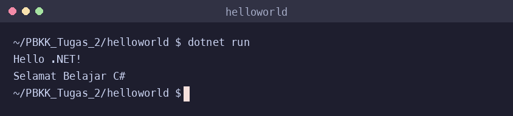
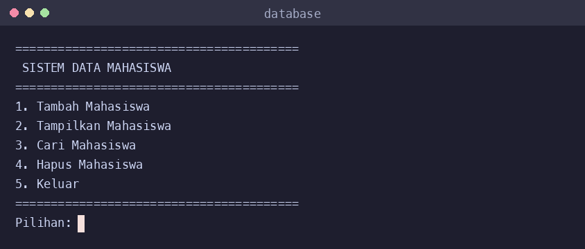
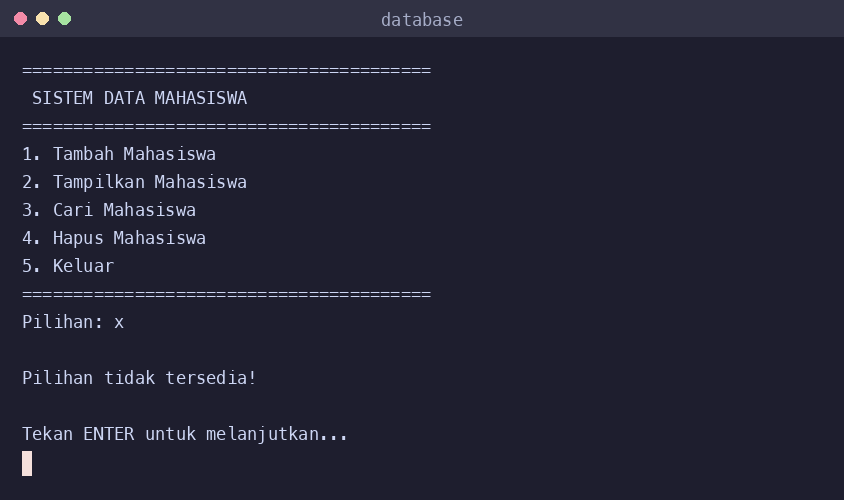
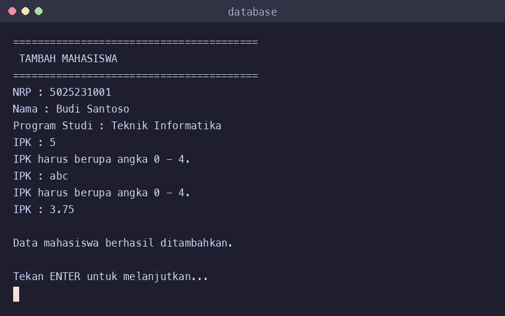
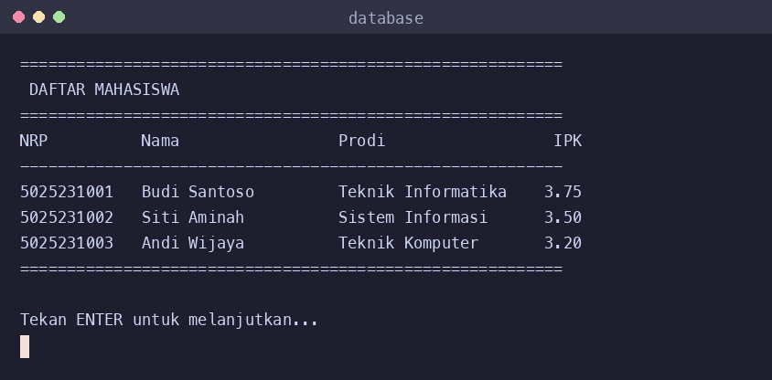
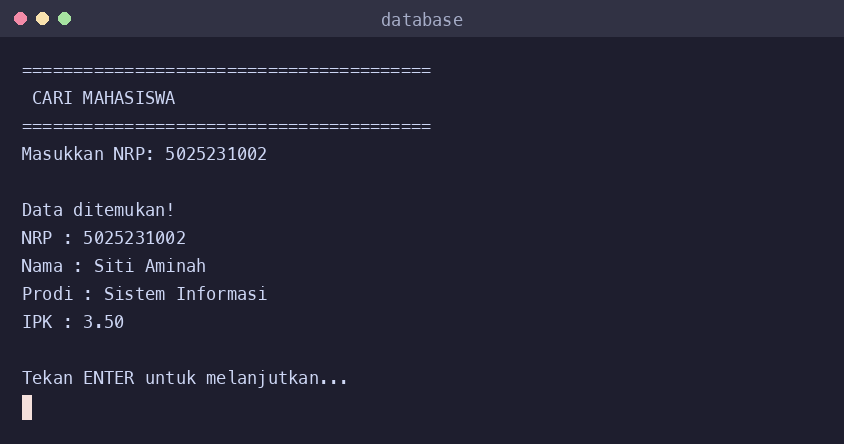
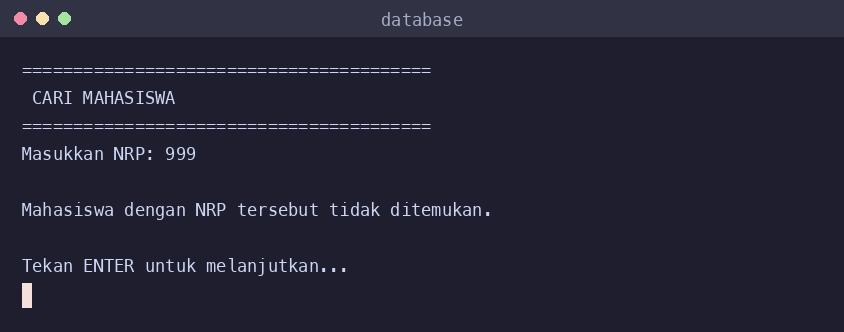
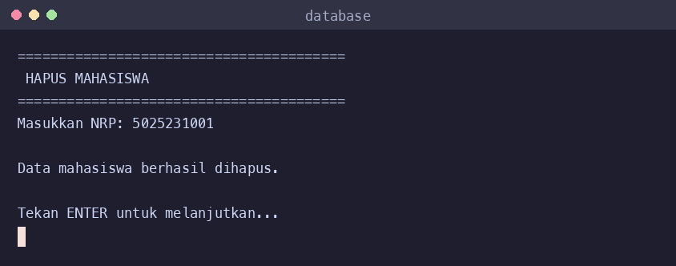
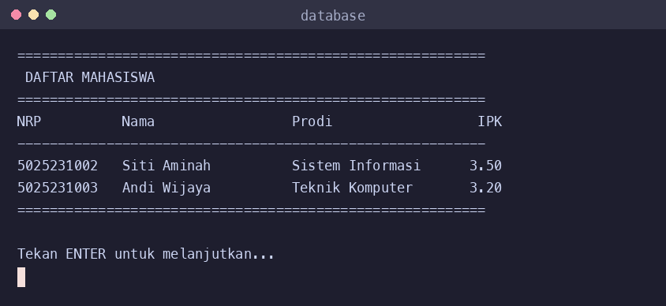
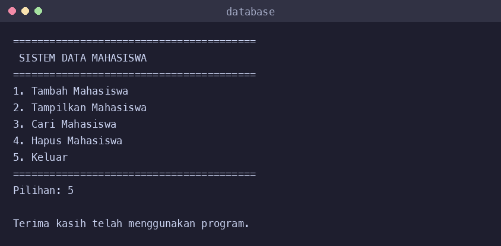

# Laporan Tugas 2 Pemrograman Berbasis Kerangka Kerja

Nama: …
NRP: …

## 1. Program Hello World

```csharp
using System;

class Program{
    static void Main(string[] args)
    {
        Console.WriteLine("Hello .NET!");
        Console.WriteLine("Selamat Belajar C#");
    }
}
```

Program ini mencetak dua baris teks ke terminal. `using System;` mengimpor namespace `System`, tempat class `Console` berada. Method `static void Main(string[] args)` di dalam class `Program` adalah entry point, yaitu method yang pertama dijalankan saat program dieksekusi. `Console.WriteLine()` mencetak teks lalu pindah ke baris berikutnya.



## 2. Program Sistem Data Mahasiswa

Program konsol berbasis menu untuk menambah, menampilkan, mencari, dan menghapus data mahasiswa. Data disimpan di memori, jadi hilang ketika program ditutup.

### Class Mahasiswa

```csharp
class Mahasiswa
{
    public string NRP { get; set; }
    public string Nama { get; set; }
    public string Prodi { get; set; }
    public double IPK { get; set; }

    public Mahasiswa(string nrp, string nama, string prodi, double ipk)
    {
        NRP = nrp;
        Nama = nama;
        Prodi = prodi;
        IPK = ipk;
    }
}
```

Satu objek `Mahasiswa` menyimpan satu data mahasiswa. Atributnya ditulis sebagai auto-property (`{ get; set; }`) dan diisi lewat constructor ketika objek dibuat dengan `new Mahasiswa(...)`.

### Penyimpanan data

```csharp
static List<Mahasiswa> daftarMahasiswa = new List<Mahasiswa>();
```

Semua objek `Mahasiswa` dimasukkan ke `List<Mahasiswa>`, koleksi yang ukurannya bisa bertambah dan berkurang. Field ini dibuat `static` karena semua method di class `Program` juga `static`, jadi semuanya memakai list yang sama.

### Menu utama

```csharp
do
{
    TampilkanMenu();

    Console.Write("Pilihan: ");
    string input = Console.ReadLine();

    if (!int.TryParse(input, out pilihan))
    {
        pilihan = 0;
    }

    switch (pilihan)
    {
        case 1: TambahMahasiswa(); break;
        case 2: TampilkanMahasiswa(); break;
        case 3: CariMahasiswa(); break;
        case 4: HapusMahasiswa(); break;
        case 5: Console.WriteLine("Terima kasih telah menggunakan program."); break;
        default: Console.WriteLine("Pilihan tidak tersedia!"); break;
    }

    if (pilihan != 5)
    {
        Console.WriteLine("Tekan ENTER untuk melanjutkan...");
        Console.ReadLine();
    }
} while (pilihan != 5);
```

`TampilkanMenu()` membersihkan layar dengan `Console.Clear()` lalu mencetak daftar menu. Menu dibungkus `do-while`, sehingga tampil minimal sekali dan diulang terus sampai pengguna memilih 5.

Input pengguna diubah ke angka dengan `int.TryParse`. Kalau input bukan angka, `pilihan` diisi 0 dan masuk ke cabang `default`, jadi program tidak crash. Cabang lain di `switch` memanggil method sesuai nomor menu. Setelah setiap aksi selain keluar, program menunggu pengguna menekan ENTER sebelum kembali ke menu.





### Tambah mahasiswa

```csharp
double ipk;

while (true)
{
    Console.Write("IPK : ");

    if (double.TryParse(Console.ReadLine(), out ipk))
    {
        if (ipk >= 0 && ipk <= 4)
        {
            break;
        }
    }

    Console.WriteLine("IPK harus berupa angka 0 - 4.");
}

Mahasiswa mahasiswa = new Mahasiswa(nrp, nama, prodi, ipk);
daftarMahasiswa.Add(mahasiswa);
```

`TambahMahasiswa()` meminta NRP, nama, dan program studi, lalu IPK. IPK dibaca di dalam `while (true)`, dan perulangan baru berhenti kalau input bisa diubah ke `double` dan nilainya antara 0 sampai 4. Kalau tidak, program mencetak pesan error dan meminta IPK lagi. Setelah IPK valid, objek `Mahasiswa` baru dibuat dan dimasukkan ke list dengan `Add()`.



### Tampilkan mahasiswa

```csharp
if (daftarMahasiswa.Count == 0)
{
    Console.WriteLine("Belum ada data mahasiswa.");
    return;
}

foreach (Mahasiswa m in daftarMahasiswa)
{
    Console.WriteLine(
        "{0,-12} {1,-20} {2,-20} {3,5:F2}",
        m.NRP, m.Nama, m.Prodi, m.IPK
    );
}
```

Kalau list masih kosong, method langsung berhenti setelah mencetak pesan. Kalau ada isinya, setiap mahasiswa dicetak dalam satu baris dengan composite formatting. Angka setelah koma di dalam `{}` menentukan lebar kolom: `-12` dan `-20` berarti rata kiri selebar 12 dan 20 karakter, sedangkan `5` berarti rata kanan selebar 5 karakter. `F2` membuat IPK selalu tampil dengan dua angka di belakang koma.



### Cari mahasiswa

```csharp
Mahasiswa mahasiswaDitemukan = null;

foreach (Mahasiswa m in daftarMahasiswa)
{
    if (m.NRP.Equals(nrpCari, StringComparison.OrdinalIgnoreCase))
    {
        mahasiswaDitemukan = m;
        break;
    }
}

if (mahasiswaDitemukan != null)
{
    Console.WriteLine("Data ditemukan!");
    // cetak NRP, Nama, Prodi, IPK
}
else
{
    Console.WriteLine("Mahasiswa dengan NRP tersebut tidak ditemukan.");
}
```

`foreach` memeriksa list dari awal sampai menemukan NRP yang cocok, lalu keluar dengan `break`. Perbandingannya memakai `StringComparison.OrdinalIgnoreCase`, jadi huruf besar dan kecil dianggap sama. Kalau tidak ada yang cocok, `mahasiswaDitemukan` tetap `null` dan program mencetak pesan bahwa data tidak ditemukan.





### Hapus mahasiswa

```csharp
if (mahasiswaDitemukan != null)
{
    daftarMahasiswa.Remove(mahasiswaDitemukan);
    Console.WriteLine("Data mahasiswa berhasil dihapus.");
}
else
{
    Console.WriteLine("Data mahasiswa tidak ditemukan.");
}
```

`HapusMahasiswa()` mencari NRP dengan `foreach` yang sama seperti di `CariMahasiswa()`. Bedanya, objek yang ditemukan langsung dihapus dari list dengan `Remove()`.






