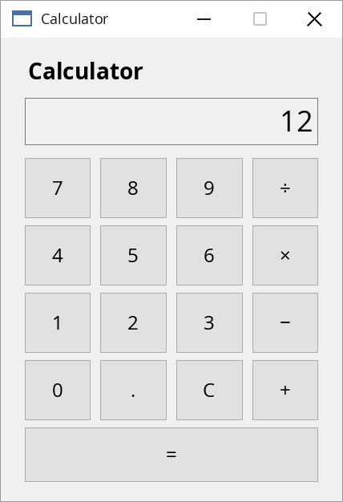
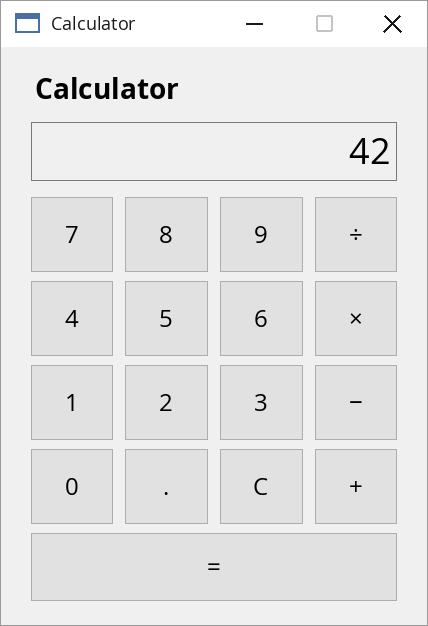
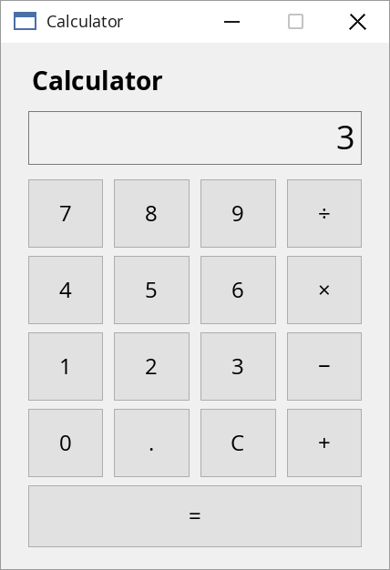
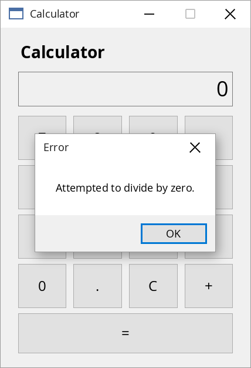

# Laporan Tugas 3 Pemrograman Berbasis Kerangka Kerja

Nama: …
NRP: …

## Program Kalkulator (Windows Forms)

Aplikasi kalkulator sederhana berbasis Windows Forms yang bisa melakukan penjumlahan, pengurangan, perkalian, dan pembagian. Project ini memakai `net10.0-windows` dengan `UseWindowsForms` aktif, jadi hanya bisa dijalankan di Windows.


### Entry point

```csharp
namespace Pertemuan3
{
    internal static class Program
    {
        [STAThread]
        static void Main()
        {
            ApplicationConfiguration.Initialize();
            Application.Run(new Form1());
        }
    }
}
```

`[STAThread]` wajib ada di aplikasi Windows Forms karena komponen UI Windows berjalan di model thread STA. `ApplicationConfiguration.Initialize()` mengatur pengaturan bawaan seperti DPI dan font default. `Application.Run(new Form1())` membuka jendela `Form1` dan menjalankan event loop sampai jendela itu ditutup.

### Tata letak form

```csharp
txtDisplay.Font = new Font("Segoe UI", 18F);
txtDisplay.ReadOnly = true;
txtDisplay.Text = "0";
txtDisplay.TextAlign = HorizontalAlignment.Right;

btn7.Text = "7";
btn7.Click += NumberButton_Click;

btnDivide.Text = "÷";
btnDivide.Click += OperatorButton_Click;

btnEquals.Click += btnEquals_Click;
```

`Form1.Designer.cs` dibuat oleh designer Visual Studio. Isinya satu label judul, satu `TextBox` sebagai layar, dan 17 tombol. Layar dibuat `ReadOnly` supaya angka hanya bisa dimasukkan lewat tombol, dan teksnya rata kanan seperti kalkulator biasa.

Bagian `Click +=` menghubungkan tombol dengan method yang dijalankan saat tombol diklik. Sepuluh tombol angka memakai method yang sama, `NumberButton_Click`. Empat tombol operator juga berbagi satu method, `OperatorButton_Click`. Tombol `.`, `C`, dan `=` masing-masing punya method sendiri.

### Variabel penyimpan

```csharp
double firstNumber = 0;
double secondNumber = 0;
double result = 0;
string operation = "";
```

Keempat field ini menyimpan keadaan kalkulator di antara klik tombol: angka pertama, angka kedua, hasil, dan operator yang dipilih.

### Tombol angka

```csharp
private void NumberButton_Click(object sender, EventArgs e)
{
    Button button = (Button)sender;
    if (txtDisplay.Text == "0")
        txtDisplay.Text = button.Text;
    else
        txtDisplay.Text += button.Text;
}
```

Parameter `sender` berisi tombol yang diklik. Setelah di-cast ke `Button`, teks tombolnya (misalnya `"7"`) dipakai sebagai angka yang dimasukkan. Kalau layar masih `0`, angka nol itu diganti. Kalau tidak, angka baru ditambahkan di belakang angka yang sudah ada.

### Tombol operator

```csharp
private void OperatorButton_Click(object sender, EventArgs e)
{
    Button button = (Button)sender;
    firstNumber = double.Parse(txtDisplay.Text);
    operation = button.Text;
    txtDisplay.Clear();
}
```

Saat operator diklik, angka di layar diubah menjadi `double` dan disimpan sebagai `firstNumber`. Simbol operatornya disimpan di `operation`, lalu layar dikosongkan untuk angka kedua.

### Tombol sama dengan

```csharp
private void btnEquals_Click(object sender, EventArgs e)
{
    try
    {
        secondNumber = double.Parse(txtDisplay.Text);

        switch (operation)
        {
            case "+": result = firstNumber + secondNumber; break;
            case "−": result = firstNumber - secondNumber; break;
            case "×": result = firstNumber * secondNumber; break;
            case "÷":
                if (secondNumber == 0)
                    throw new DivideByZeroException();
                result = firstNumber / secondNumber;
                break;
        }

        txtDisplay.Text = result.ToString();
    }
    catch (Exception ex)
    {
        MessageBox.Show(ex.Message, "Error");
    }
}
```

Angka di layar disimpan sebagai `secondNumber`, lalu `switch` memilih perhitungan berdasarkan simbol di `operation`. Simbol di `case` harus sama persis dengan teks tombol. Karena itu pengurangan memakai karakter `−` (minus Unicode), bukan tanda hubung `-`.

Pembagian dengan nol perlu dicek manual. Pada `double`, `5 / 0` tidak menimbulkan error dan malah menghasilkan `∞`. Program melempar `DivideByZeroException` sendiri, dan blok `catch` menampilkan pesannya di `MessageBox`. Blok `catch` yang sama juga menangkap `FormatException` kalau layar kosong saat `=` ditekan.










### Tombol desimal

```csharp
private void btnDecimal_Click(object sender, EventArgs e)
{
    if (!txtDisplay.Text.Contains("."))
        txtDisplay.Text += ".";
}
```

Titik hanya ditambahkan kalau layar belum mengandung titik, jadi satu angka tidak bisa punya dua titik desimal.


### Tombol clear

```csharp
private void btnClear_Click(object sender, EventArgs e)
{
    firstNumber = 0;
    secondNumber = 0;
    result = 0;
    operation = "";
    txtDisplay.Text = "0";
}
```

Tombol `C` mengembalikan semua variabel ke nilai awal dan layar ke `0`, sehingga perhitungan baru bisa dimulai dari awal.


