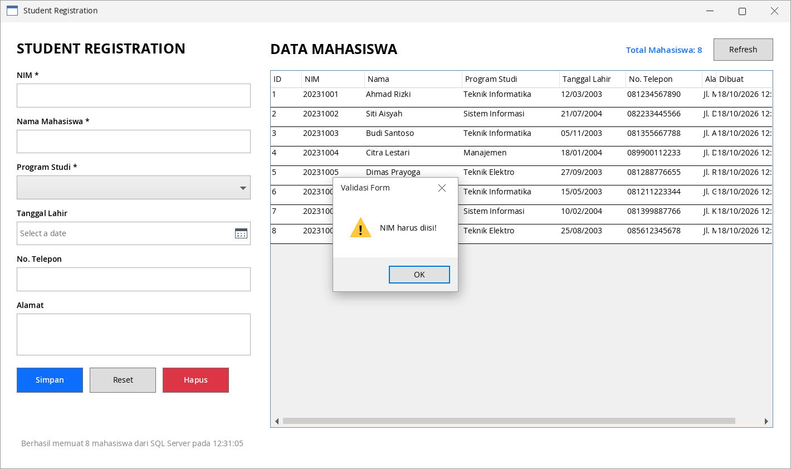
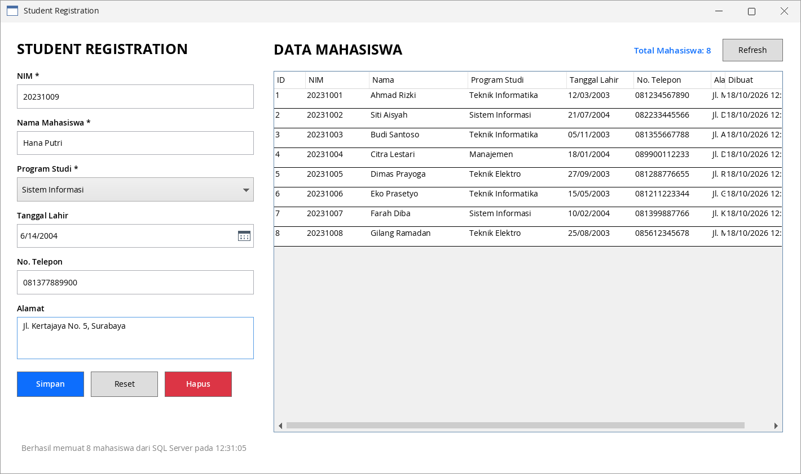
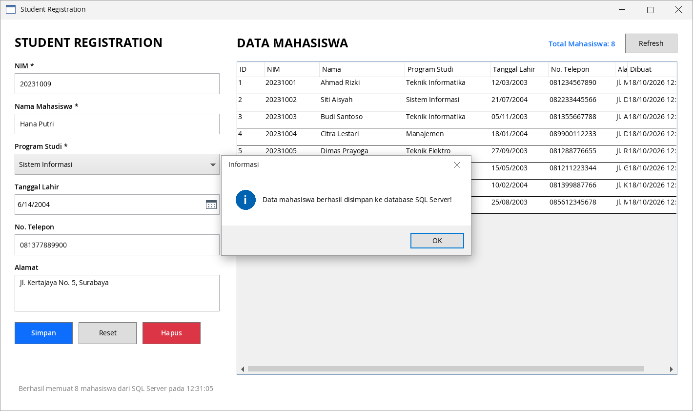
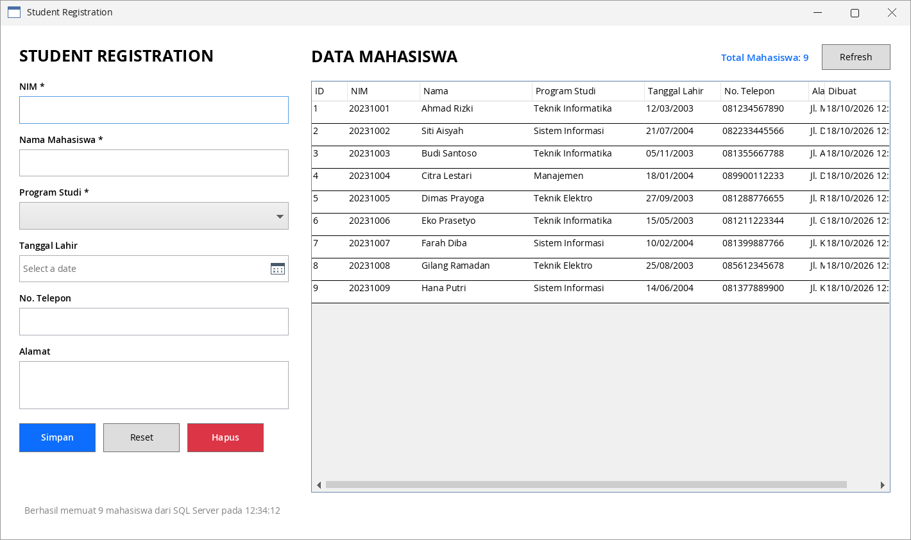
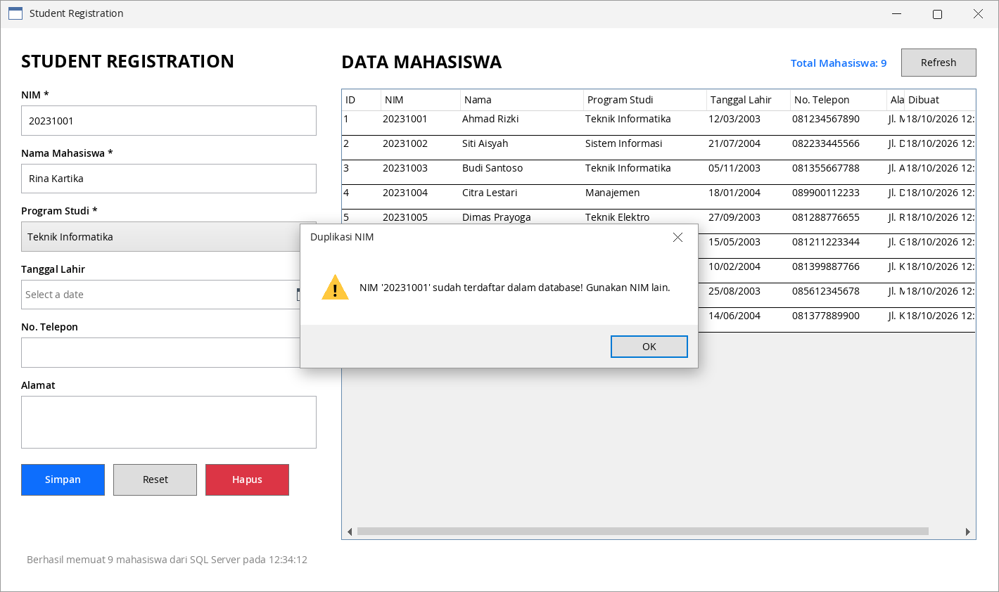
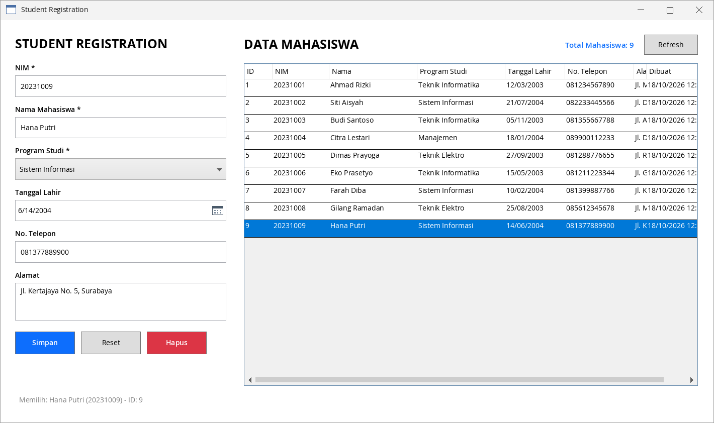
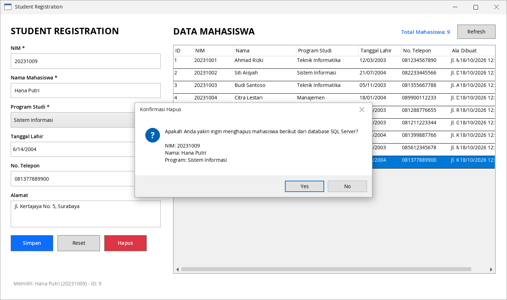
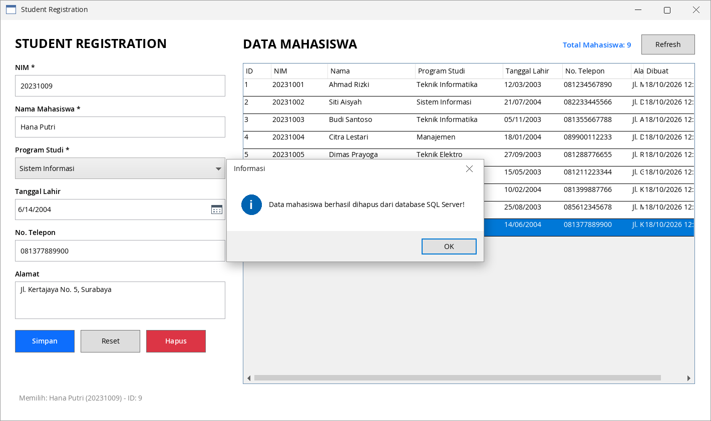
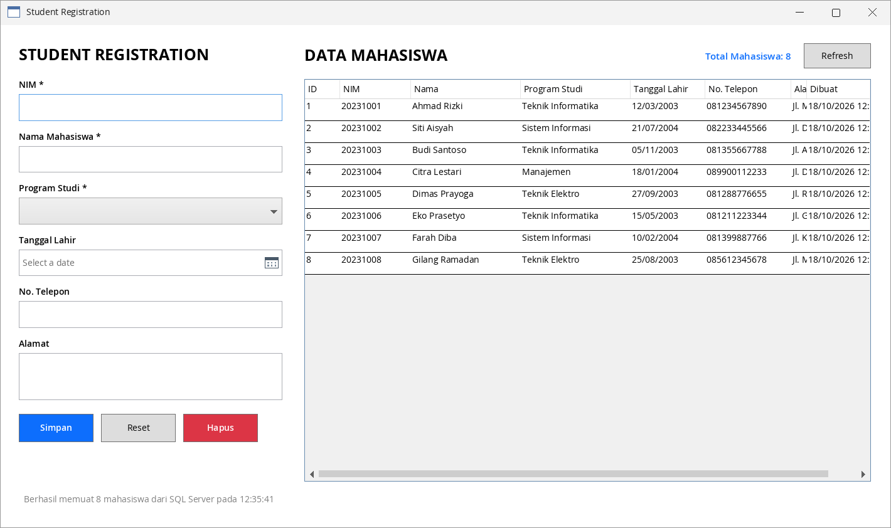

# Laporan Tugas 5 Pemrograman Berbasis Kerangka Kerja

Nama: …
NRP: …

## Aplikasi Student Registration (WPF + SQL Server)

Aplikasi desktop WPF untuk mendaftarkan, menampilkan, dan menghapus data mahasiswa. Data disimpan di database SQL Server `StudentRegistrationDB` dan diakses dengan ADO.NET (`Microsoft.Data.SqlClient`). Project memakai `net10.0-windows` dengan `UseWPF` aktif.

## 1. Database

### Tabel Programs

```sql
CREATE TABLE Programs
(
    ProgramId INT IDENTITY(1,1)
        CONSTRAINT PK_Programs PRIMARY KEY,

    ProgramCode VARCHAR(20) NOT NULL
        CONSTRAINT UQ_Programs_ProgramCode UNIQUE,

    ProgramName VARCHAR(100) NOT NULL,

    IsActive BIT NOT NULL
        CONSTRAINT DF_Programs_IsActive DEFAULT 1,

    CreatedAt DATETIME2 NOT NULL
        CONSTRAINT DF_Programs_CreatedAt
        DEFAULT SYSDATETIME()
);
```

Tabel ini menyimpan daftar program studi. `ProgramId` dibuat otomatis oleh `IDENTITY(1,1)`, yaitu mulai dari 1 dan naik 1 setiap baris baru. `ProgramCode` diberi constraint `UNIQUE` supaya kode prodi seperti `TI` tidak bisa dimasukkan dua kali. `IsActive` dan `CreatedAt` punya nilai default, jadi tidak perlu diisi saat `INSERT`. Lima program studi dimasukkan sebagai data awal: TI, SI, MNJ, TE, dan DKV.

### Tabel Students dan relasinya

```sql
CREATE TABLE Students
(
    StudentId INT IDENTITY(1,1)
        CONSTRAINT PK_Students PRIMARY KEY,

    NIM VARCHAR(20) NOT NULL
        CONSTRAINT UQ_Students_NIM UNIQUE,

    Name VARCHAR(100) NOT NULL,

    ProgramId INT NOT NULL,

    BirthDate DATE NULL,

    Address VARCHAR(250) NULL,

    PhoneNumber VARCHAR(20) NULL,

    CreatedAt DATETIME2 NOT NULL
        CONSTRAINT DF_Students_CreatedAt
        DEFAULT SYSDATETIME(),

    UpdatedAt DATETIME2 NULL,

    CONSTRAINT FK_Students_Programs
        FOREIGN KEY (ProgramId)
        REFERENCES Programs(ProgramId)
);
```

Setiap mahasiswa terhubung ke satu program studi lewat foreign key `ProgramId`. Satu program studi bisa punya banyak mahasiswa, jadi relasinya 1:N. Constraint `UQ_Students_NIM` membuat NIM tidak bisa dobel. Aplikasi memanfaatkan constraint ini untuk mendeteksi NIM yang sudah terdaftar. Script mengisi 5 mahasiswa awal, lalu 3 mahasiswa tambahan untuk mini assignment (1 TI, 1 SI, 1 TE), jadi totalnya 8 mahasiswa.

### Query JOIN

```sql
SELECT
    s.StudentId, s.NIM, s.Name, s.ProgramId, p.ProgramName,
    s.BirthDate, s.Address, s.PhoneNumber, s.CreatedAt, s.UpdatedAt
FROM Students s
INNER JOIN Programs p
    ON s.ProgramId = p.ProgramId
ORDER BY s.StudentId;
```

Tabel `Students` hanya menyimpan `ProgramId`. Supaya nama prodi bisa ditampilkan, kedua tabel digabung dengan `INNER JOIN` berdasarkan `ProgramId`. Query yang sama dipakai aplikasi di `StudentRepository.GetAll()`.

## 2. Model

```csharp
public class Student
{
    public int StudentId { get; set; }
    public string NIM { get; set; } = string.Empty;
    public string Name { get; set; } = string.Empty;
    public int ProgramId { get; set; }
    public string ProgramName { get; set; } = string.Empty;
    public DateTime? BirthDate { get; set; }
    public string Address { get; set; } = string.Empty;
    public string PhoneNumber { get; set; } = string.Empty;
    public DateTime CreatedAt { get; set; }
    public DateTime? UpdatedAt { get; set; }
}
```

`Student` dan `Program` di folder `Models` adalah class biasa yang isinya sama dengan kolom tabel. `BirthDate` dan `UpdatedAt` bertipe `DateTime?` karena kolomnya boleh `NULL`. `ProgramName` sebenarnya bukan kolom tabel `Students`, tapi ikut disimpan supaya hasil JOIN bisa langsung ditampilkan di tabel.

## 3. Repository

Semua query ke database dikumpulkan di `StudentRepository`, jadi kode tampilan tidak perlu menulis SQL sendiri.

### Connection string

```csharp
private string _connectionString =
    @"Server=.\SQLEXPRESS;Database=StudentRegistrationDB;Trusted_Connection=True;TrustServerCertificate=True;";

private void TryLoadConnectionStringFromFile()
{
    string configPath = Path.Combine(AppDomain.CurrentDomain.BaseDirectory, "appsettings.json");
    if (File.Exists(configPath))
    {
        using var doc = JsonDocument.Parse(File.ReadAllText(configPath));
        if (doc.RootElement.TryGetProperty("ConnectionStrings", out var csSection) &&
            csSection.TryGetProperty("DefaultConnection", out var csElement))
        {
            // ...
            _connectionString = connStr;
        }
    }
}
```

Connection string bawaan mengarah ke instance `SQLEXPRESS` di komputer sendiri dengan Windows Authentication (`Trusted_Connection=True`). Saat repository dibuat, program mencoba membaca `ConnectionStrings:DefaultConnection` dari `appsettings.json`. File ini ikut disalin ke folder output karena `CopyToOutputDirectory` di `project.csproj`. Kalau file tidak ada atau gagal dibaca, connection string bawaan yang dipakai.

### Membaca data

```csharp
using var connection = new SqlConnection(_connectionString);
using var command = new SqlCommand(sql, connection);

connection.Open();
using var reader = command.ExecuteReader();

while (reader.Read())
{
    students.Add(new Student
    {
        StudentId = reader.GetInt32(reader.GetOrdinal("StudentId")),
        NIM = reader.GetString(reader.GetOrdinal("NIM")),
        // ...
        BirthDate = reader.IsDBNull(reader.GetOrdinal("BirthDate"))
            ? null
            : reader.GetDateTime(reader.GetOrdinal("BirthDate")),
        // ...
    });
}
```

`GetAll()` menjalankan query JOIN di atas, lalu `SqlDataReader` membaca hasilnya baris per baris. Setiap baris diubah menjadi objek `Student`. Untuk kolom yang boleh `NULL`, `IsDBNull` dicek dulu sebelum nilainya dibaca, karena `GetDateTime` atau `GetString` akan error kalau nilainya `NULL`. Deklarasi `using var` menutup koneksi otomatis saat method selesai.

`GetTotalStudents()` menjalankan `SELECT COUNT(*)` dengan `ExecuteScalar()`, yang mengembalikan satu nilai saja. `GetAllPrograms()` mengambil prodi yang `IsActive = 1` untuk isi ComboBox.

### Menambah dan menghapus data

```csharp
command.Parameters.AddWithValue("@NIM", student.NIM);
command.Parameters.AddWithValue("@Name", student.Name);
command.Parameters.AddWithValue("@ProgramId", student.ProgramId);
command.Parameters.AddWithValue("@BirthDate", (object?)student.BirthDate ?? DBNull.Value);
command.Parameters.AddWithValue("@Address",
    string.IsNullOrWhiteSpace(student.Address) ? (object)DBNull.Value : student.Address);

connection.Open();
int rowsAffected = command.ExecuteNonQuery();
return rowsAffected > 0;
```

`Add()` menjalankan `INSERT` dengan parameter (`@NIM`, `@Name`, dan seterusnya), bukan dengan menempelkan input ke string SQL. Dengan cara ini input pengguna selalu dianggap data, sehingga aman dari SQL injection. Nilai `null` atau teks kosong dikirim sebagai `DBNull.Value` supaya tersimpan sebagai `NULL` di database. `ExecuteNonQuery()` mengembalikan jumlah baris yang berubah, dan method mengembalikan `true` kalau ada baris yang masuk.

`Delete()` bekerja dengan cara yang sama, memakai `DELETE FROM Students WHERE StudentId = @StudentId`.

## 4. Tampilan

`MainWindow.xaml` dibagi menjadi dua kolom. Kolom kiri selebar 340 berisi form input: NIM, nama, program studi (`ComboBox`), tanggal lahir (`DatePicker`), nomor telepon, alamat, serta tombol Simpan, Reset, dan Hapus. Kolom kanan berisi judul, jumlah mahasiswa, tombol Refresh, dan `DataGrid` untuk tabel mahasiswa. Di bagian bawah ada `StatusBar` untuk pesan status.

```xml
<ComboBox x:Name="cmbProdi"
          DisplayMemberPath="ProgramName"
          SelectedValuePath="ProgramId" />
```

ComboBox diisi dengan list objek `Program`. `DisplayMemberPath` menentukan teks yang tampil (nama prodi), sedangkan `SelectedValuePath` menentukan nilai yang diambil saat dipilih (`ProgramId`). Nilai itulah yang disimpan ke database.

```xml
<DataGridTextColumn Header="Tanggal Lahir"
                    Binding="{Binding BirthDate, StringFormat=dd/MM/yyyy}"
                    Width="95"/>
```

Kolom `DataGrid` ditulis manual (`AutoGenerateColumns="False"`). Setiap kolom di-binding ke property `Student`, dan tanggal diformat dengan `StringFormat`. `IsReadOnly="True"` membuat tabel hanya untuk dilihat dan dipilih, tidak bisa diedit langsung.

## 5. Memuat data

```csharp
public MainWindow()
{
    InitializeComponent();
    _studentRepository = new StudentRepository();
    LoadPrograms();
    LoadStudents();
}

private void LoadStudents()
{
    try
    {
        var students = _studentRepository.GetAll();
        StudentDataGrid.ItemsSource = students;

        int total = _studentRepository.GetTotalStudents();
        txtTotalMahasiswa.Text = $"Total Mahasiswa: {total}";

        txtStatus.Text = $"Berhasil memuat {students.Count} mahasiswa dari SQL Server pada {DateTime.Now:HH:mm:ss}";
    }
    catch (Exception ex)
    {
        txtStatus.Text = "Koneksi ke database gagal. Pastikan service SQL Server aktif.";
        MessageBox.Show(ex.Message + "...", "Database Error", MessageBoxButton.OK, MessageBoxImage.Error);
    }
}
```

Saat jendela dibuka, constructor langsung memuat daftar prodi dan data mahasiswa. Hasil `GetAll()` dipasang ke `ItemsSource` milik `DataGrid`, lalu jumlah mahasiswa dan waktu pemuatan ditampilkan. Kalau koneksi ke SQL Server gagal, pesan error muncul di `MessageBox` dan status bar.

`LoadPrograms()` punya cadangan. Kalau database tidak bisa diakses atau tabel `Programs` kosong, ComboBox diisi dari `GetFallbackPrograms()` yang berisi lima prodi yang sama dengan data awal di SQL.


## 6. Menyimpan data

```csharp
if (string.IsNullOrWhiteSpace(nim))
{
    MessageBox.Show("NIM harus diisi!", "Validasi Form", MessageBoxButton.OK, MessageBoxImage.Warning);
    txtNim.Focus();
    return;
}
// validasi yang sama untuk Nama dan Program Studi

var student = new Student
{
    NIM = nim,
    Name = nama,
    ProgramId = Convert.ToInt32(cmbProdi.SelectedValue),
    BirthDate = dpBirthDate.SelectedDate,
    PhoneNumber = txtTelepon.Text.Trim(),
    Address = txtAlamat.Text.Trim()
};
```

`BtnSimpan_Click` mengecek tiga field wajib (NIM, nama, dan program studi) sebelum menyimpan. Kalau ada yang kosong, muncul peringatan, kursor dipindah ke field tersebut, dan method berhenti dengan `return`.



Kalau semua field wajib sudah terisi, isi form dimasukkan ke objek `Student` lalu dikirim ke `_studentRepository.Add()`. Setelah berhasil, muncul pesan sukses, form dikosongkan dengan `ResetForm()`, dan tabel dimuat ulang dengan `LoadStudents()`.







```csharp
catch (SqlException sqlEx) when (sqlEx.Number == 2627 || sqlEx.Number == 2601)
{
    MessageBox.Show(
        $"NIM '{nim}' sudah terdaftar dalam database! Gunakan NIM lain.",
        "Duplikasi NIM",
        MessageBoxButton.OK,
        MessageBoxImage.Warning);
    txtNim.Focus();
}
```

Kalau NIM yang dimasukkan sudah ada, SQL Server menolak `INSERT` karena constraint `UQ_Students_NIM` dan melempar `SqlException`. Nomor error 2627 dan 2601 adalah kode SQL Server untuk pelanggaran unique constraint dan unique index. Dengan filter `when`, hanya kedua error ini yang ditangkap di blok tersebut dan diubah menjadi pesan yang mudah dipahami. Error database lain masuk ke `catch (Exception ex)` di bawahnya.



## 7. Memilih data di tabel

```csharp
private void StudentDataGrid_SelectionChanged(object sender, SelectionChangedEventArgs e)
{
    if (StudentDataGrid.SelectedItem is Student student)
    {
        txtNim.Text = student.NIM;
        txtNama.Text = student.Name;
        cmbProdi.SelectedValue = student.ProgramId;
        dpBirthDate.SelectedDate = student.BirthDate;
        txtTelepon.Text = student.PhoneNumber;
        txtAlamat.Text = student.Address;

        txtStatus.Text = $"Memilih: {student.Name} ({student.NIM}) - ID: {student.StudentId}";
    }
}
```

Saat sebuah baris diklik, `SelectedItem` berisi objek `Student` dari baris itu. Pattern matching `is Student student` mengecek tipenya sekaligus menyimpannya ke variabel. Data mahasiswa lalu disalin ke form, dan ComboBox otomatis memilih prodi yang benar karena `SelectedValue` diisi dengan `ProgramId`.



## 8. Menghapus data

```csharp
if (StudentDataGrid.SelectedItem is not Student selectedStudent)
{
    MessageBox.Show("Pilih data mahasiswa pada tabel yang ingin dihapus!", "Peringatan",
        MessageBoxButton.OK, MessageBoxImage.Warning);
    return;
}

var confirm = MessageBox.Show(
    $"Apakah Anda yakin ingin menghapus mahasiswa berikut dari database SQL Server?\n\nNIM: {selectedStudent.NIM}\nNama: {selectedStudent.Name}\nProgram: {selectedStudent.ProgramName}",
    "Konfirmasi Hapus",
    MessageBoxButton.YesNo,
    MessageBoxImage.Question);

if (confirm != MessageBoxResult.Yes)
{
    return;
}

bool success = _studentRepository.Delete(selectedStudent.StudentId);
```

`BtnHapus_Click` memastikan ada baris yang dipilih, lalu meminta konfirmasi dengan `MessageBoxButton.YesNo`. Data baru dihapus kalau pengguna menekan Yes. Penghapusan memakai `StudentId`, bukan NIM, karena `StudentId` adalah primary key. Setelah berhasil, form dikosongkan dan tabel dimuat ulang.







## 9. Reset dan Refresh

```csharp
private void ResetForm()
{
    txtNim.Clear();
    txtNama.Clear();
    cmbProdi.SelectedIndex = -1;
    dpBirthDate.SelectedDate = null;
    txtTelepon.Clear();
    txtAlamat.Clear();
    StudentDataGrid.SelectedItem = null;
    txtNim.Focus();
}

private void RefreshButton_Click(object sender, RoutedEventArgs e)
{
    LoadPrograms();
    LoadStudents();
}
```

`ResetForm()` mengosongkan semua input, menghapus pilihan di ComboBox (`SelectedIndex = -1`) dan di tabel, lalu memindahkan kursor ke field NIM. Method ini dipakai tombol Reset dan dipanggil lagi setelah simpan atau hapus berhasil. Tombol Refresh memuat ulang daftar prodi dan data mahasiswa dari database.
