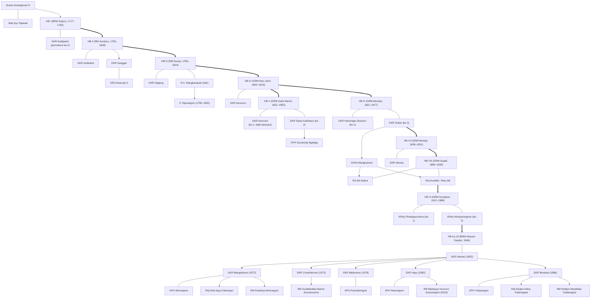

# Laporan Evaluasi 2 RSBP: Ontologi Silsilah Kasultanan Ngayogyakarta Hadiningrat

**Kelompok:** _(isi nama kelompok)_
**File:** `ontologi_kasultanan_yogyakarta.owl`, `queries.txt`
**Namespace:** `http://www.semanticweb.org/mamahda/ontologies/2026/10/kasultanan-yogyakarta#`

---

## 1. Diagram Silsilah

Ontologi memuat 47 individu orang dalam 12 generasi (Sunan Amangkurat IV sampai cucu Sri Sultan Hamengku Bawono Ka 10) dan 21 individu pernikahan. Garis tebal (`==>`) menandai garis takhta.



> Diagram di atas bisa dirender di https://mermaid.live lalu disisipkan sebagai gambar di PDF.

### Keterangan sumber per bagian silsilah

| Bagian silsilah | Keterangan | Sumber |
|---|---|---|
| HB I | Nama lahir BRM Sujono, lahir 5 Agustus 1717, putra Sunan Amangkurat IV dan garwa selir Mas Ayu Tejawati, naik takhta 13 Maret 1755, wafat 24 Maret 1792 | [1] |
| HB II | RM Sundoro, lahir 7 Maret 1750, putra HB I dari permaisuri kedua GKR Kadipaten. Bertakhta 1792–1810, 1811–1812, dan 1826–1828. Wafat 3 Januari 1828 | [2] |
| HB III | RM Surojo, lahir 20 Februari 1769, putra HB II dan GKR Kedhaton, wafat 3 November 1814 | [3] |
| GKR Hangger | Putri HB II dari garwa padmi GKR Kedhaton, menikah dengan Danurejo II | [14] |
| P. Diponegoro | Putra sulung HB III dari garwa selir. Tahun lahir/wafat dan nama ibu (R.A. Mangkarawati) dari [19] | [3], [19] |
| HB IV | GRM Ibnu Jarot, lahir 3 April 1804, putra HB III dan GKR Hageng, wafat 6 Desember 1823. Permaisuri: GKR Kencono | [4] |
| HB V | GRM Gatot Menol, lahir 20 Januari 1821, putra HB IV dan GKR Kencono. Permaisuri I GKR Kencono (tidak berputra), permaisuri II GKR Sekar Kedhaton. Wafat 5 Juni 1855 | [5] |
| KPH Suryaning Ngalaga | GRM Timur Muhammad, lahir dari permaisuri HB V setelah HB V wafat | [5], [6] |
| HB VI | GRM Mustojo, lahir 10 Agustus 1821, adik HB V. Menikah pada usia 27 tahun (≈1848) dengan GKR Kencono putri Paku Buwono VIII (bergelar GKR Hamengku Buwono). Wafat 20 Juli 1877 | [6] |
| HB VII | GRM Murtejo, lahir 4 Februari 1839, putra HB VI dari GKR Sultan, permaisuri kedua. Wafat 30 Desember 1921 | [7] |
| GPAA Mangkubumi | Putra HB VI dari Ratu Sultan, sehingga saudara seayah-seibu HB VII | [21], [16] |
| HB VIII | GRM Sujadi, lahir 3 Maret 1880, putra HB VII dan GKR Hemas, wafat 22 Oktober 1939 | [8] |
| Istri HB VIII | Istri ke-1 RA Siti Katina (menikah 1907) dan istri ke-5 RAj Kustilah/Kanjeng Ratu Alit, keduanya putri GPAA Mangkubumi | [9], [16], [23] |
| HB IX | GRM Dorojatun, lahir 12 April 1912, anak ke-9 HB VIII dari istri ke-5, Kanjeng Ratu Alit. Wafat 2 Oktober 1988 | [9] |
| Istri HB IX | KRAy Pintakapurnama (menikah 1940), KRAy Windyaningrum (menikah 1943) | [17] |
| HB Ka 10 | BRM Herjuno Darpito, lahir 2 April 1946, putra HB IX dan KRAy Windyaningrum. Bertakhta sejak 7 Maret 1989. Permaisuri GKR Hemas, lima putri | [10] |
| GKR Hemas | Nama lahir Tatiek Dradjad Suprihastuti, lahir 31 Oktober 1952 | [13], [20] |
| Lima putri HB Ka 10 | Nama lahir dari [10]. Tahun lahir, suami, dan cucu dari [18]. GKR Hayu menikah dengan KPH Notonegoro pada 2013, berputra RM Manteyyo (lahir Agustus 2019) | [10], [11], [12], [18] |
| RAj Nisaka Irdina | Putri GKR Bendara dan KPH Yudanegara | [15] |

### Perbedaan data antar sumber (versi yang dipilih dicetak tebal)

| No | Data | Versi A | Versi B | Keputusan |
|---|---|---|---|---|
| 1 | Ibu HB IV | **"GKR Hageng"** (halaman HB IV [4]); disebut juga "Ratu Ageng" di [5] | "GKR Kencono" (halaman HB III [3]) | Dipakai GKR Hageng. Nama GKR Kencono dicatat di `gelar` |
| 2 | Urutan GKR Sultan sebagai istri HB VI | **Permaisuri kedua** [7] | Istri pertama [21] | Dipakai versi [7] (urutanPernikahan = 2). Catatan: HB VII lahir 1839, sebelum HB VI menikahi GKR Hamengku Buwono (~1848), jadi versi [21] lebih cocok secara kronologis. Bisa jadi "kedua" di [7] berarti urutan pengangkatan sebagai permaisuri |
| 3 | Ibu HB VIII | **GKR Hemas** [8], [16] | "Ratu Mas", istri ke-9 HB VII [22] | Dipakai GKR Hemas |
| 4 | Nama kecil Diponegoro | **RM Antawirya** [3] | BRM Mustahar [19] | Dipakai RM Antawirya. Nama BRM Mustahar dicatat di `gelar` |
| 5 | Urutan Ratu Alit sebagai istri HB VIII | **Istri ke-5** [9], [16], [23] | — | Konsisten di semua sumber |

Data yang tidak ditemukan di sumber mana pun tidak diisi, misalnya tahun lahir para permaisuri sebelum GKR Hemas, tahun lahir menantu HB Ka 10, dan ayah RM Gusthilantika Marrel.

---

## 2. Pembagian Tugas

| Nama | NRP | Tugas |
|---|---|---|
| _(nama)_ | _(NRP)_ | Pengumpulan data silsilah & referensi |
| _(nama)_ | _(NRP)_ | Pembangunan ontologi di Protege |
| _(nama)_ | _(NRP)_ | Penyusunan query SPARQL |
| _(nama)_ | _(NRP)_ | Penyusunan laporan & diagram |

---

## 3. Hierarki Kelas

```
owl:Thing
├── Orang
│   ├── LakiLaki
│   │   └── Penguasa
│   └── Perempuan          (disjoint dengan LakiLaki)
│       └── Permaisuri
├── Pernikahan             (disjoint dengan Orang, Kerajaan)
└── Kerajaan
```

| Kelas | Keterangan |
|---|---|
| Orang | Manusia anggota silsilah |
| LakiLaki / Perempuan | Pembagian berdasarkan jenis kelamin, saling disjoint |
| Penguasa | Sultan yang pernah bertakhta di Kasultanan Yogyakarta (HB I – HB Ka 10) |
| Permaisuri | Garwa padmi Sultan |
| Pernikahan | Reifikasi pernikahan untuk menyimpan urutan dan tahun menikah |
| Kerajaan | Individu `KasultananYogyakarta` |

> _(Sisipkan screenshot tab Classes Protege di sini)_

---

## 4. Tabel Property

### Object Property

| Property | Domain | Range | Karakteristik | Inverse / Super-property |
|---|---|---|---|---|
| punyaAyah | Orang | LakiLaki | **Functional** | inverse: ayahDari; sub dari punyaOrangTua |
| punyaIbu | Orang | Perempuan | **Functional** | inverse: ibuDari; sub dari punyaOrangTua |
| ayahDari | LakiLaki | Orang | **Inverse Functional** | sub dari punyaAnak |
| ibuDari | Perempuan | Orang | **Inverse Functional** | sub dari punyaAnak |
| punyaOrangTua | Orang | Orang | – | inverse: punyaAnak; sub dari punyaLeluhur |
| punyaAnak | Orang | Orang | – | sub dari punyaKeturunan |
| punyaLeluhur | Orang | Orang | **Transitive** | inverse: punyaKeturunan |
| punyaKeturunan | Orang | Orang | **Transitive** | – |
| menikahDengan | Orang | Orang | Symmetric | – |
| suami | Pernikahan | LakiLaki | Functional | – |
| istri | Pernikahan | Perempuan | Functional | – |
| digantikanOleh | Penguasa | Penguasa | **Functional** | inverse: menggantikan |
| menggantikan | Penguasa | Penguasa | **Inverse Functional** | – |
| memerintah | Penguasa | Kerajaan | – | – |

Kondisi yang memenuhi ketentuan (f):
- **Functional:** setiap orang hanya memiliki satu ayah (`punyaAyah`) dan satu ibu (`punyaIbu`). Setiap Sultan hanya memiliki satu penerus langsung (`digantikanOleh`).
- **Inverse functional:** `ayahDari`/`ibuDari`. Jika X ayahDari Z dan Y ayahDari Z, maka X = Y. Begitu pula `menggantikan`: satu Sultan hanya digantikan oleh satu Sultan.
- **Transitive:** `punyaLeluhur`. HB Ka 10 punyaOrangTua HB IX dan HB IX punyaOrangTua HB VIII, sehingga reasoner menyimpulkan HB Ka 10 punyaLeluhur HB VIII, dan seterusnya sampai HB I.

### Data Property

| Property | Domain | Range | Functional | Keterangan |
|---|---|---|---|---|
| nama | Orang | xsd:string | ya | Nama/gelar utama |
| namaKecil | Orang | xsd:string | – | Nama lahir |
| gelar | Orang | xsd:string | – | Gelar/nama lain |
| jenisKelamin | Orang | xsd:string | ya | "Laki-laki" / "Perempuan" |
| tahunLahir | Orang | xsd:integer | ya | Tahun lahir |
| tahunWafat | Orang | xsd:integer | ya | Tahun wafat |
| tahunMulaiBerkuasa | Penguasa | xsd:integer | ya | Tahun pertama naik takhta |
| tahunAkhirBerkuasa | Penguasa | xsd:integer | – | Akhir masa pemerintahan |
| urutanPenguasa | Penguasa | xsd:integer | ya | 1 = HB I (generasi pertama) |
| urutanPernikahan | Pernikahan | xsd:integer | ya | Urutan istri bagi sang suami |
| tahunMenikah | Pernikahan | xsd:integer | ya | Tahun pernikahan |
| namaKerajaan | Kerajaan | xsd:string | ya | Nama kerajaan |
| sumber | – | xsd:string | – | Nomor referensi IEEE |

> _(Sisipkan screenshot tab Object/Data Properties Protege di sini)_

---

## 5. Hasil SPARQL

Query lengkap ada di `queries.txt` dan dijalankan di Protege 5.6.9 lewat plugin **Snap SPARQL Query** 6.0.0. Tab SPARQL Query bawaan tidak dipakai karena tidak berfungsi di Protege 5.6.x (galat `NoClassDefFoundError` pada plugin rdf-library). Snap SPARQL tidak mendukung property path, sehingga relasi cucu (query c) ditulis dengan gabungan pola `UNION`.

### a. Penguasa yang ayahnya pernah menjadi penguasa sebelumnya (9 baris)

| namaPenguasa | jenisKelamin | namaAyah |
|---|---|---|
| Sri Sultan Hamengku Buwono II | Laki-laki | Sri Sultan Hamengku Buwono I |
| Sri Sultan Hamengku Buwono III | Laki-laki | Sri Sultan Hamengku Buwono II |
| Sri Sultan Hamengku Buwono IV | Laki-laki | Sri Sultan Hamengku Buwono III |
| Sri Sultan Hamengku Buwono V | Laki-laki | Sri Sultan Hamengku Buwono IV |
| Sri Sultan Hamengku Buwono VI | Laki-laki | Sri Sultan Hamengku Buwono IV |
| Sri Sultan Hamengku Buwono VII | Laki-laki | Sri Sultan Hamengku Buwono VI |
| Sri Sultan Hamengku Buwono VIII | Laki-laki | Sri Sultan Hamengku Buwono VII |
| Sri Sultan Hamengku Buwono IX | Laki-laki | Sri Sultan Hamengku Buwono VIII |
| Sri Sultan Hamengku Bawono Ka 10 | Laki-laki | Sri Sultan Hamengku Buwono IX |

HB I tidak muncul karena ayahnya, Sunan Amangkurat IV, bukan penguasa Kasultanan Yogyakarta.

### b. Anak dari pernikahan pertama (10 baris)

| namaAnak | namaAyah | tahunLahirAyah | namaIbu | tahunLahirIbu |
|---|---|---|---|---|
| RM Manteyyo Kuncoro Suryonegoro | KPH Notonegoro |  | GKR Hayu | 1982 |
| RAj Artie Ayya Fatimasari | KPH Wironegoro |  | GKR Mangkubumi | 1972 |
| RM Drasthya Wironegoro | KPH Wironegoro |  | GKR Mangkubumi | 1972 |
| RAj Nisaka Irdina Yudanegara | KPH Yudanegara |  | GKR Bendara | 1986 |
| RM Radityo Mandhala Yudanegara | KPH Yudanegara |  | GKR Bendara | 1986 |
| GKR Bendara | Sri Sultan Hamengku Bawono Ka 10 | 1946 | GKR Hemas | 1952 |
| GKR Condrokirono | Sri Sultan Hamengku Bawono Ka 10 | 1946 | GKR Hemas | 1952 |
| GKR Hayu | Sri Sultan Hamengku Bawono Ka 10 | 1946 | GKR Hemas | 1952 |
| GKR Maduretno | Sri Sultan Hamengku Bawono Ka 10 | 1946 | GKR Hemas | 1952 |
| GKR Mangkubumi | Sri Sultan Hamengku Bawono Ka 10 | 1946 | GKR Hemas | 1952 |

Anak HB V, HB VI, HB VIII, dan HB IX tidak muncul. Pernikahan pertama HB V dengan GKR Kencono tidak berputra [5]. Anak dari pernikahan pertama HB VI, HB VIII, dan HB IX tidak tercatat di sumber. Anak-anak yang tercatat (KPH Suryaning Ngalaga, HB VII, HB IX, HB Ka 10) berasal dari pernikahan berikutnya. Kolom tahun lahir ayah yang kosong menunjukkan data tidak tercatat.

### c. Cucu penguasa generasi pertama (HB I), urut tahun lahir (2 baris)

| namaCucu | tahunLahir |
|---|---|
| GKR Hangger |  |
| Sri Sultan Hamengku Buwono III | 1769 |

### d. Pasangan sepupu yang ayahnya bersaudara (2 baris)

| namaLakiLaki | namaPerempuan | ayahLakiLaki | ayahPerempuan | kakekBersama |
|---|---|---|---|---|
| Sri Sultan Hamengku Buwono VIII | Raden Ayu Siti Katina | Sri Sultan Hamengku Buwono VII | GPAA Mangkubumi | Sri Sultan Hamengku Buwono VI |
| Sri Sultan Hamengku Buwono VIII | Kanjeng Ratu Alit | Sri Sultan Hamengku Buwono VII | GPAA Mangkubumi | Sri Sultan Hamengku Buwono VI |

### e. Putra-putri Sultan yang tidak naik takhta (UNION + OPTIONAL + MINUS) (17 baris)

**Pertanyaan:** Tampilkan putra-putri Sultan, yaitu anak dari seorang Sultan atau anak dari seorang Permaisuri, yang tidak pernah naik takhta. Sertakan nama orang tua yang menghubungkannya dan tahun lahir jika tercatat.

- `UNION` menggabungkan dua jalur: anak lewat ayah yang bertipe Penguasa, atau anak lewat ibu yang bertipe Permaisuri.
- `OPTIONAL` dipakai untuk tahun lahir, yang tidak selalu tercatat.
- `MINUS` membuang anak yang bertipe Penguasa.

| nama | jenisKelamin | namaOrangTua | tahunLahir |
|---|---|---|---|
| Bendara Pangeran Ario Diponegoro | Laki-laki | Sri Sultan Hamengku Buwono III | 1785 |
| GKR Bendara | Perempuan | GKR Hemas | 1986 |
| GKR Bendara | Perempuan | Sri Sultan Hamengku Bawono Ka 10 | 1986 |
| GKR Condrokirono | Perempuan | GKR Hemas | 1975 |
| GKR Condrokirono | Perempuan | Sri Sultan Hamengku Bawono Ka 10 | 1975 |
| GKR Hangger | Perempuan | GKR Kedhaton |  |
| GKR Hangger | Perempuan | Sri Sultan Hamengku Buwono II |  |
| GKR Hayu | Perempuan | GKR Hemas | 1982 |
| GKR Hayu | Perempuan | Sri Sultan Hamengku Bawono Ka 10 | 1982 |
| GKR Maduretno | Perempuan | GKR Hemas | 1978 |
| GKR Maduretno | Perempuan | Sri Sultan Hamengku Bawono Ka 10 | 1978 |
| GKR Mangkubumi | Perempuan | GKR Hemas | 1972 |
| GKR Mangkubumi | Perempuan | Sri Sultan Hamengku Bawono Ka 10 | 1972 |
| GPAA Mangkubumi | Laki-laki | GKR Sultan |  |
| GPAA Mangkubumi | Laki-laki | Sri Sultan Hamengku Buwono VI |  |
| KPH Suryaning Ngalaga | Laki-laki | GKR Sekar Kedhaton |  |
| KPH Suryaning Ngalaga | Laki-laki | Sri Sultan Hamengku Buwono V |  |

Diponegoro hanya muncul sekali karena ibunya, R.A. Mangkarawati, adalah garwa selir, bukan Permaisuri.

> _(Sisipkan screenshot hasil tiap query dari view Snap SPARQL Query di Protege)_

---

## 6. Daftar Pustaka

[1] Kraton Jogja, "Sri Sultan Hamengku Buwono I," *kratonjogja.id*. [Online]. Available: https://www.kratonjogja.id/raja-raja/2-sri-sultan-hamengku-buwono-i/. [Accessed: Oct. 19, 2026].

[2] Kraton Jogja, "Sri Sultan Hamengku Buwono II," *kratonjogja.id*. [Online]. Available: https://www.kratonjogja.id/raja-raja/3-sri-sultan-hamengku-buwono-ii/. [Accessed: Oct. 19, 2026].

[3] Kraton Jogja, "Sri Sultan Hamengku Buwono III," *kratonjogja.id*. [Online]. Available: https://www.kratonjogja.id/raja-raja/4-sri-sultan-hamengku-buwono-iii/. [Accessed: Oct. 19, 2026].

[4] Kraton Jogja, "Sri Sultan Hamengku Buwono IV," *kratonjogja.id*. [Online]. Available: https://www.kratonjogja.id/raja-raja/5-sri-sultan-hamengku-buwono-iv/. [Accessed: Oct. 19, 2026].

[5] Kraton Jogja, "Sri Sultan Hamengku Buwono V," *kratonjogja.id*. [Online]. Available: https://www.kratonjogja.id/raja-raja/6-sri-sultan-hamengku-buwono-v/. [Accessed: Oct. 19, 2026].

[6] Kraton Jogja, "Sri Sultan Hamengku Buwono VI," *kratonjogja.id*. [Online]. Available: https://www.kratonjogja.id/raja-raja/7-sri-sultan-hamengku-buwono-vi/. [Accessed: Oct. 19, 2026].

[7] Kraton Jogja, "Sri Sultan Hamengku Buwono VII," *kratonjogja.id*. [Online]. Available: https://www.kratonjogja.id/raja-raja/8-sri-sultan-hamengku-buwono-vii/. [Accessed: Oct. 19, 2026].

[8] Kraton Jogja, "Sri Sultan Hamengku Buwono VIII," *kratonjogja.id*. [Online]. Available: https://www.kratonjogja.id/raja-raja/9-sri-sultan-hamengku-buwono-viii/. [Accessed: Oct. 19, 2026].

[9] Kraton Jogja, "Sri Sultan Hamengku Buwono IX," *kratonjogja.id*. [Online]. Available: https://www.kratonjogja.id/raja-raja/10-sri-sultan-hamengku-buwono-ix/. [Accessed: Oct. 19, 2026].

[10] Kraton Jogja, "Yang Bertakhta," *kratonjogja.id*. [Online]. Available: https://www.kratonjogja.id/yang-bertakhta/. [Accessed: Oct. 19, 2026].

[11] Kraton Jogja, "Gusti Kanjeng Ratu Hayu, Menjaga Tradisi dengan Teknologi," *kratonjogja.id*. [Online]. Available: https://www.kratonjogja.id/figur/27-gusti-kanjeng-ratu-hayu-menjaga-tradisi-dengan-teknologi/. [Accessed: Oct. 19, 2026].

[12] Kraton Jogja, "GKR Maduretno, Putri Tengah yang Dekat dengan Sang Ayah," *kratonjogja.id*. [Online]. Available: https://www.kratonjogja.id/figur/28-gkr-maduretno-putri-tengah-yang-dekat-dengan-sang-ayah/. [Accessed: Oct. 19, 2026].

[13] Kraton Jogja, "GKR Hemas, Kekuatan Perempuan untuk Kebaikan," *kratonjogja.id*. [Online]. Available: https://www.kratonjogja.id/figur/35-gkr-hemas-kekuatan-perempuan-untuk-kebaikan/. [Accessed: Oct. 19, 2026].

[14] Kraton Jogja, "Pepatih Dalem Kesultanan Yogyakarta," *kratonjogja.id*. [Online]. Available: https://www.kratonjogja.id/ragam/8-pepatih-dalem-kesultanan-yogyakarta/. [Accessed: Oct. 19, 2026].

[15] Kraton Jogja, "Memasuki Masa Remaja, RAj Nisaka Irdina Yudanegara Jalani Upacara Tarapan," *kratonjogja.id*, Sep. 30, 2023. [Online]. Available: https://www.kratonjogja.id/peristiwa/1289-memasuki-masa-remaja-raj-nisaka-irdina-yudanegara-jalani-upacara-tarapan/. [Accessed: Oct. 19, 2026].

[16] "Hamengkubuwana VIII," *Wikipedia bahasa Indonesia*. [Online]. Available: https://id.wikipedia.org/wiki/Hamengku_Buwono_VIII. [Accessed: Oct. 19, 2026].

[17] "Hamengkubuwana IX," *Wikipedia bahasa Indonesia*. [Online]. Available: https://id.wikipedia.org/wiki/Sri_Sultan_Hamengkubuwono_IX. [Accessed: Oct. 19, 2026].

[18] "Hamengkubuwana X," *Wikipedia bahasa Indonesia*. [Online]. Available: https://id.wikipedia.org/wiki/Hamengkubuwana_X. [Accessed: Oct. 19, 2026].

[19] "Diponegoro," *Wikipedia bahasa Indonesia*. [Online]. Available: https://id.wikipedia.org/wiki/Diponegoro. [Accessed: Oct. 19, 2026].

[20] "Gusti Kanjeng Ratu Hemas," *Wikipedia bahasa Indonesia*. [Online]. Available: https://id.wikipedia.org/wiki/Gusti_Kanjeng_Ratu_Hemas. [Accessed: Oct. 19, 2026].

[21] C. Buyers, "Yogyakarta: Genealogy (6)," *The Royal Ark*. [Online]. Available: https://www.royalark.net/Indonesia/yogya6.htm. [Accessed: Oct. 19, 2026].

[22] C. Buyers, "Yogyakarta: Genealogy (7)," *The Royal Ark*. [Online]. Available: https://www.royalark.net/Indonesia/yogya7.htm. [Accessed: Oct. 19, 2026].

[23] C. Buyers, "Yogyakarta: Genealogy (8)," *The Royal Ark*. [Online]. Available: https://www.royalark.net/Indonesia/yogya8.htm. [Accessed: Oct. 19, 2026].
